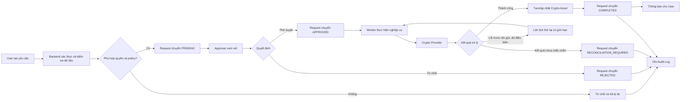
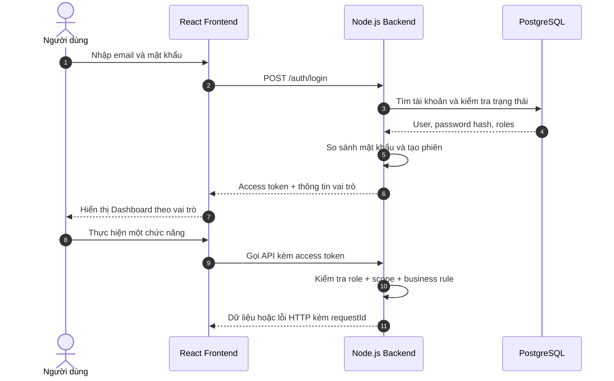
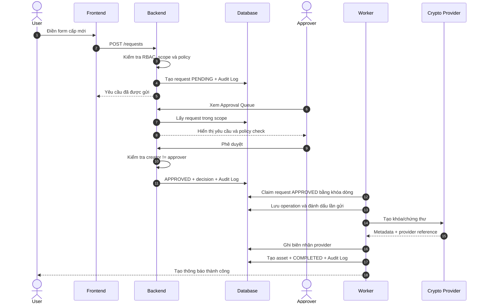
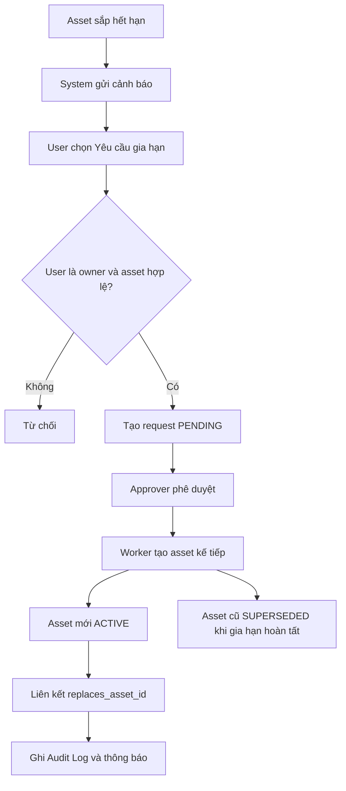
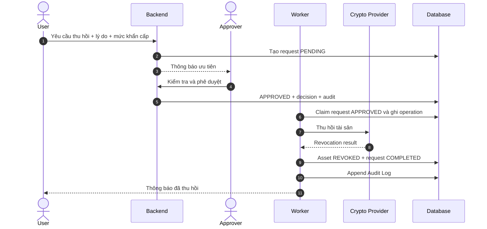
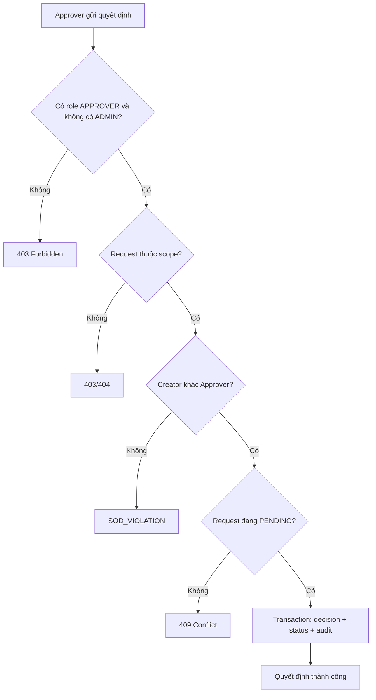
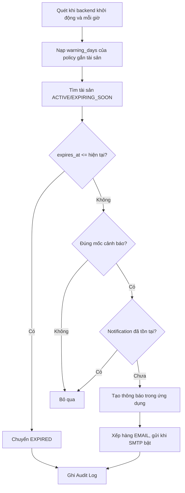
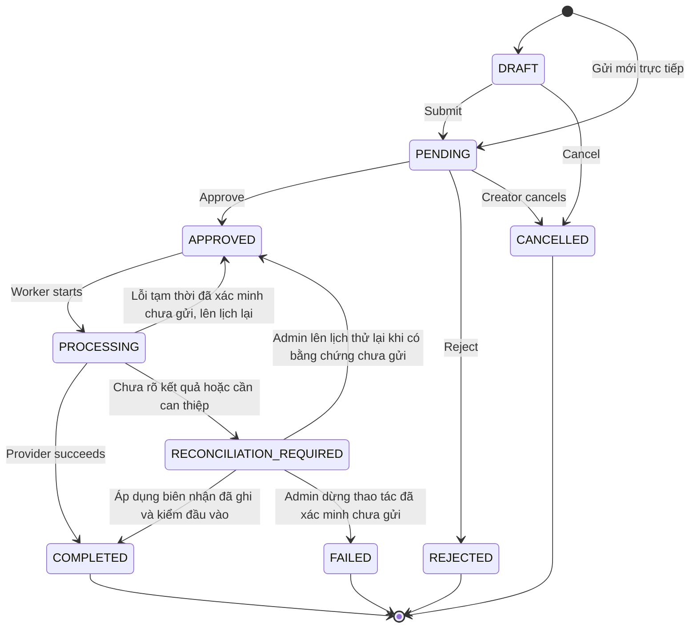
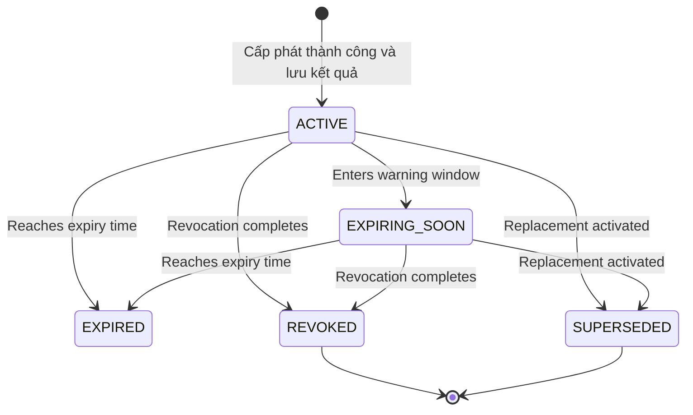

# LUỒNG HOẠT ĐỘNG CỦA HỆ THỐNG

## Hệ thống quản lý khóa mã hóa và chứng thư số

> Tài liệu mô tả cách hệ thống vận hành từ khi người dùng gửi yêu cầu đến khi tài sản được cấp phát, gia hạn, thu hồi hoặc hết hạn. Các sơ đồ sử dụng Mermaid và có thể hiển thị trực tiếp trên GitHub hoặc trình đọc Markdown hỗ trợ Mermaid.

Đối chiếu ngày 06/11/2026 với backend, worker và schema 017. [Kịch bản nghiệm thu](docs/NGHIEM_THU_UAT.md) · [Kiến trúc và ERD](02_so_do_he_thong_tong_quat.md)

---

## 1. Mục đích của hệ thống

Hệ thống quản lý toàn bộ vòng đời của khóa mã hóa và chứng thư số trong tổ chức. Thay vì xử lý qua email, bảng tính hoặc trao đổi thủ công, tất cả yêu cầu được đưa vào một quy trình thống nhất:

1. Nhân viên gửi yêu cầu.
2. Hệ thống kiểm tra quyền và chính sách.
3. Người có thẩm quyền phê duyệt hoặc từ chối.
4. Hệ thống thực hiện nghiệp vụ tương ứng.
5. Người dùng nhận kết quả và thông báo.
6. Mọi bước được lưu vào Audit Log.

Nguyên tắc quan trọng nhất là **người tạo yêu cầu không được tự phê duyệt yêu cầu của mình**.

---

## 2. Các tác nhân tham gia

| Tác nhân | Vai trò trong luồng hoạt động |
|---|---|
| User / Employee | Gửi yêu cầu cấp mới, gia hạn, thu hồi; theo dõi tài sản của mình |
| Approver / Manager | Xem xét và phê duyệt/từ chối yêu cầu trong phạm vi phụ trách |
| Security Admin | Quản lý chính sách, tài khoản, vai trò, tài sản và Audit Log |
| System / Background Job | Cấp phát sau phê duyệt, quét hết hạn và gửi cảnh báo tự động |
| Crypto Provider | Thành phần tạo hoặc quản lý khóa/chứng thư; MVP có thể dùng mock provider |

---

## 3. Luồng hoạt động tổng quát

### Ý nghĩa

- Frontend chỉ thu thập và hiển thị dữ liệu; backend mới là nơi quyết định người dùng có được phép thao tác hay không.
- Approver chỉ xử lý yêu cầu thuộc phòng ban hoặc phạm vi được phân công.
- Sau khi được duyệt, tác vụ cấp phát/gia hạn/thu hồi được thực hiện bởi worker để tránh làm API bị chậm.
- Khi chưa rõ kết quả provider, request chuyển `RECONCILIATION_REQUIRED`. Admin đối chiếu bằng chứng trước khi thao tác. Lỗi tạm thời trước khi gửi có thể được lên lịch thử lại.
- Mọi kết quả thành công, thất bại hoặc bị từ chối đều được ghi Audit Log.

---

## 4. Luồng đăng nhập và kiểm tra quyền

Ba lớp kiểm tra quyền:

1. **Role/permission:** vai trò có được sử dụng chức năng không?
2. **Object scope:** người dùng có được truy cập bản ghi cụ thể không?
3. **Business rule:** trạng thái và quy tắc nghiệp vụ có cho phép thao tác không?

---

## 5. Luồng yêu cầu cấp phát mới

### 5.1. Các bước

1. User mở form “Yêu cầu cấp mới”.
2. User chọn loại tài sản, policy và nhập lý do. Giao diện lấy thông số phù hợp policy. User có thể lưu nháp rồi mở lại trước khi gửi.
3. Hệ thống kiểm tra dữ liệu với policy hiện hành.
4. Request được tạo ở trạng thái `PENDING`.
5. Approver phù hợp nhận thông báo.
6. Approver mở yêu cầu và xem kết quả kiểm tra policy.
7. Backend kiểm tra Approver khác người tạo và đúng phạm vi.
8. Nếu được duyệt, worker yêu cầu Crypto Provider cấp tài sản.
9. Metadata và tham chiếu provider được lưu. Private key thuộc provider.
10. User nhận thông báo cấp phát thành công.

### 5.2. Sơ đồ tuần tự

---

## 6. Luồng gia hạn

Gia hạn không sửa ngày hết hạn của chứng thư đã phát hành. Hệ thống tạo một tài sản kế tiếp và giữ tài sản cũ để bảo toàn lịch sử.

Quy tắc:

- Chỉ owner mới được yêu cầu gia hạn.
- Các bản nháp có thể cùng tồn tại. Khi gửi, backend chặn yêu cầu đang mở khác trên cùng tài sản.
- Gia hạn dùng phiên bản policy đã gắn với tài sản. Tài sản đích phải `ACTIVE` hoặc `EXPIRING_SOON` và thuộc cùng phạm vi provider hiện cấu hình.
- Lịch sử tài sản cũ không bị ghi đè.

---

## 7. Luồng thu hồi

Các lý do thu hồi đề xuất:

- Nghi ngờ lộ khóa.
- Mất thiết bị.
- Ngừng sử dụng.
- Đã được thay thế.
- Lý do khác.

Tài sản đã `REVOKED` không thể chuyển lại `ACTIVE`.

---

## 8. Luồng phê duyệt và nguyên tắc SoD

Hệ thống dùng transaction và version/row lock để bảo đảm khi hai Approver cùng xử lý, chỉ một quyết định có hiệu lực.

---

## 9. Luồng tự động cảnh báo và cập nhật hết hạn

Mỗi thông báo có `deduplication_key` để quét lại giữ một bản ghi cho cùng người nhận, mốc và kênh. Người nhận gồm owner, Approver đúng phạm vi và Admin đủ điều kiện. Nếu kết quả SMTP không chắc chắn, hàng đợi chuyển đối soát. [Vận hành email](EMAIL_OPERATIONS.md)

---

## 10. Trạng thái của yêu cầu

## 11. Trạng thái của tài sản

`REGISTERED` là trạng thái được schema hỗ trợ. Worker hiện tạo tài sản `ACTIVE` sau khi lưu kết quả thành công. Yêu cầu lỗi hoặc đang đối soát giữ thông tin trong `requests` và `provider_operations`. [Schema và trạng thái](backend/src/jobs/asset-processing.service.ts)

---

## 12. Xử lý lỗi và trường hợp ngoại lệ

| Tình huống | Cách hệ thống xử lý |
|---|---|
| Thuật toán không phù hợp policy | Từ chối với lỗi `POLICY_VIOLATION` |
| User xem asset của người khác | Trả 403 hoặc 404, không lộ dữ liệu |
| Người tạo tự phê duyệt | Trả `SOD_VIOLATION` và ghi Audit Log |
| Hai Approver cùng phê duyệt | Một người thành công, người còn lại nhận 409 |
| Lỗi tạm thời trước khi gọi provider | Lên lịch lại có giới hạn khi đã xác minh chưa gửi |
| Kết quả provider chưa rõ | `RECONCILIATION_REQUIRED`, đối chiếu operation và biên nhận |
| Job quét cảnh báo chạy lặp | Deduplication key giữ một bản ghi theo người nhận, mốc và kênh |
| Email lỗi | Phân loại từ chối rõ ràng và kết quả mơ hồ, lưu retry hoặc đối soát theo bằng chứng |
| Tài sản đã thu hồi được yêu cầu thu hồi lại | Từ chối do trạng thái không hợp lệ |

---

## 13. Ví dụ xuyên suốt dùng khi demo

1. Nhân viên Nguyễn An đăng nhập và thấy một chứng thư sắp hết hạn.
2. Nguyễn An tạo yêu cầu gia hạn.
3. Trưởng phòng mở Approval Queue và xem kết quả policy check.
4. Backend xác nhận trưởng phòng đúng scope và không phải người tạo.
5. Trưởng phòng phê duyệt.
6. Worker gọi Mock Crypto Provider và tạo chứng thư kế tiếp.
7. Nguyễn An nhận thông báo; chứng thư mới xuất hiện ở trạng thái `ACTIVE`.
8. Chứng thư cũ vẫn còn trong lịch sử và liên kết với chứng thư mới.
9. Security Admin mở Audit Log và truy vết toàn bộ các bước.

Đây là luồng minh họa đầy đủ cho đặc trưng của hệ thống: **quản lý thông tin, phê duyệt, phân quyền, tự động hóa và kiểm toán**.

