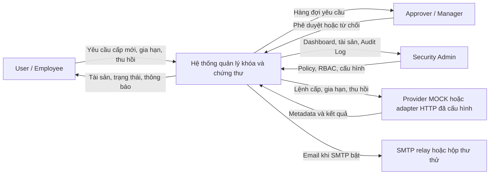
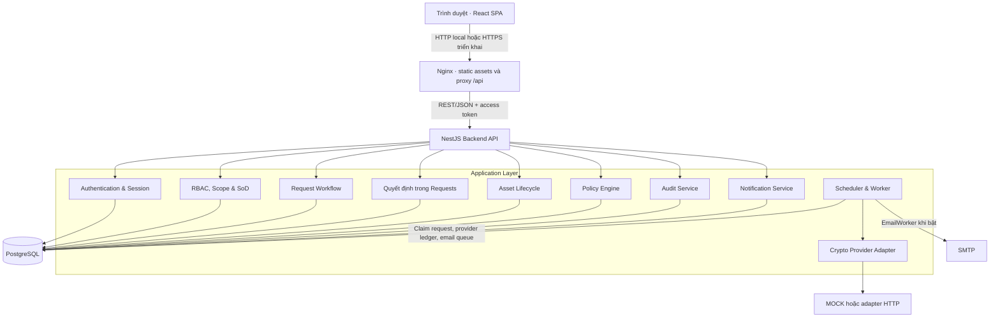
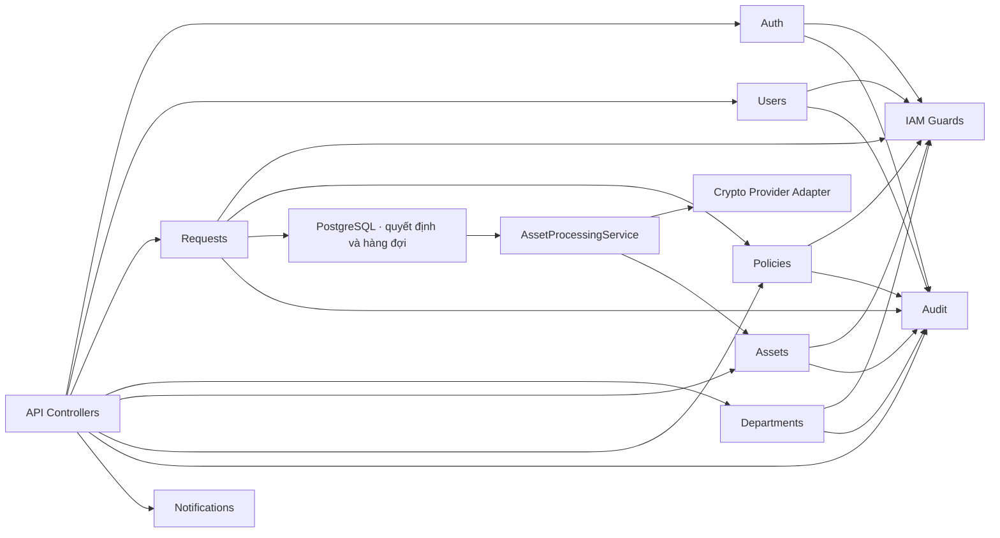
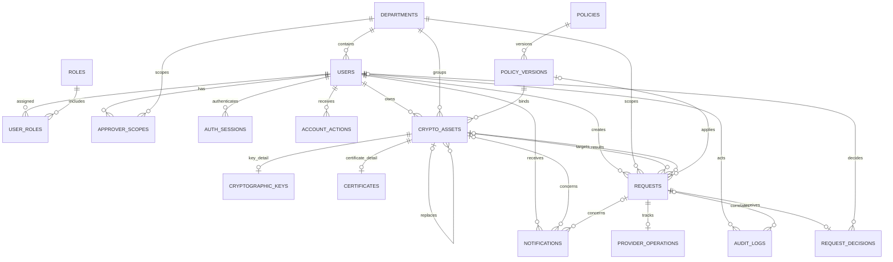
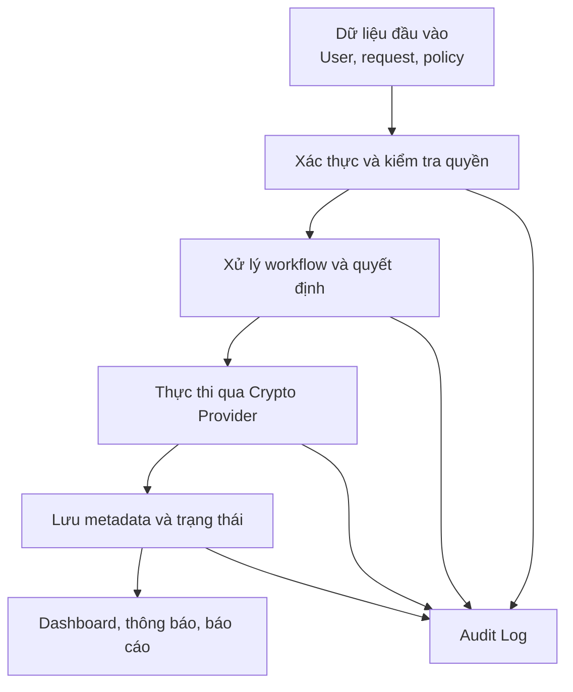
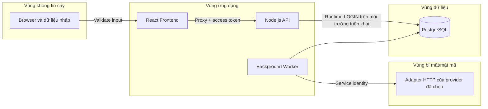
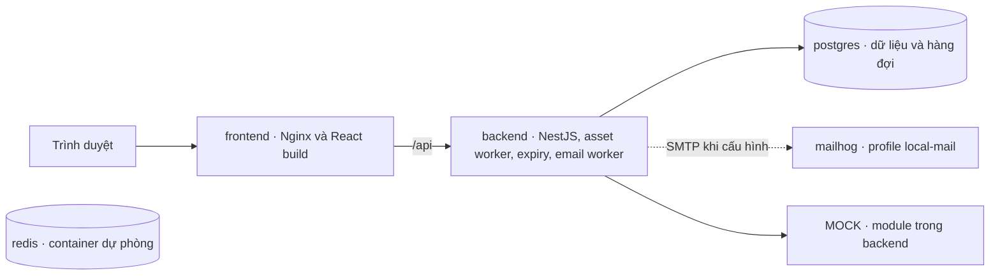

# SƠ ĐỒ HỆ THỐNG TỔNG QUÁT

## Hệ thống quản lý khóa mã hóa và chứng thư số

> Tài liệu mô tả kiến trúc tổng quát, các thành phần, luồng dữ liệu và cách triển khai của hệ thống.

Đối chiếu ngày 06/11/2026 với schema 017 và mã hiện hành. [ERD đủ cột và constraint](docs/ERD_HIEN_HANH.md) · [ERD draw.io](erd_QuanLyKhoa_HTTT.drawio) · [Hướng dẫn sử dụng](docs/HUONG_DAN_CRYPTA.md)

---

## 1. Bối cảnh hệ thống

Hệ thống là nền tảng trung tâm kết nối người dùng nghiệp vụ với dịch vụ quản lý khóa/chứng thư. Frontend không trực tiếp truy cập database hoặc Crypto Provider. Mọi thao tác đều đi qua backend để kiểm tra authentication, authorization, policy và ghi Audit Log.

### Sơ đồ ngữ cảnh



---

## 2. Kiến trúc logic tổng quát



---

## 3. Chức năng của từng lớp

### 3.1. Presentation Layer — React Frontend

- Hiển thị giao diện theo vai trò.
- Thu thập và kiểm tra dữ liệu nhập cơ bản.
- Gọi REST API của backend.
- Hiển thị dashboard, danh sách, form, timeline và thông báo.
- Không chứa quy tắc bảo mật mang tính quyết định.
- Không truy cập trực tiếp database hoặc private key.

### 3.2. Application Layer — Node.js Backend

- Xác thực người dùng và quản lý phiên.
- Kiểm tra role, permission và phạm vi dữ liệu.
- Thực thi quy tắc SoD.
- Điều phối workflow cấp mới, gia hạn và thu hồi.
- Kiểm tra yêu cầu với policy hiện hành.
- Ghi Audit Log và tạo notification.
- Cung cấp API cho frontend.

### 3.3. Data Layer — PostgreSQL

- Lưu tài khoản, vai trò và phòng ban.
- Lưu metadata của khóa/chứng thư.
- Lưu request, quyết định và lịch sử trạng thái.
- Lưu phiên bản policy.
- Lưu notification và Audit Log.
- Lưu tham chiếu provider và fingerprint công khai. Private key thuộc provider.

### 3.4. Processing Layer — Scheduler, Queue và Worker

- Xử lý cấp phát sau khi request được duyệt.
- Claim công việc trong PostgreSQL và lưu trạng thái gửi, biên nhận và đối soát.
- Chỉ thử lại các trường hợp có bằng chứng phù hợp. Kết quả không chắc chắn đi vào đối soát.
- Quét tài sản khi backend khởi động và mỗi giờ.
- Chuyển trạng thái tài sản sang `EXPIRED`.
- Gửi cảnh báo theo policy.
- Tách xử lý dài khỏi request/response của API.

### 3.5. Integration Layer — Crypto Provider Adapter

- Cấp và gia hạn qua `POST /assets`, thu hồi qua `POST /assets/revoke` của adapter HTTP.
- Demo dùng provider MOCK để mô phỏng tác động bên ngoài.
- Adapter HTTP là ranh giới tích hợp. Sandbox KMS/CA/HSM và khả năng đối chiếu theo `operationId` cần xác minh với provider được chọn.
- Backend chỉ lưu `provider_reference` và metadata an toàn.

---

## 4. Sơ đồ module backend



### Trách nhiệm module

| Module | Trách nhiệm chính |
|---|---|
| Auth | Login, refresh token, logout và session |
| IAM | RBAC, object scope và SoD guard |
| Users | Hồ sơ, trạng thái tài khoản, vai trò, phòng ban |
| Requests | Tạo, submit, cancel và truy vấn request |
| Departments | Quản lý đơn vị và kiểm liên kết trước khi ngừng hoạt động |
| Quyết định trong Requests | Approve/reject nguyên tử và chống duyệt đồng thời |
| Assets | Quản lý metadata và vòng đời tài sản |
| Policies | Versioning và kiểm tra thuật toán/thời hạn |
| Audit | Ghi sự kiện append-only và che dữ liệu nhạy cảm |
| Notifications | Thông báo trong ứng dụng và email |
| Jobs | Expiry scan, reminder, provisioning và retry |
| Crypto Provider | Chế độ MOCK và adapter HTTP |

---

## 5. Kiến trúc dữ liệu tổng quát



### Nhóm bảng chính

| Nhóm | Bảng tiêu biểu | Mục đích |
|---|---|---|
| Danh tính | `users`, `roles`, `user_roles`, `departments` | Tài khoản và phân quyền |
| Tài sản | `crypto_assets`, `cryptographic_keys`, `certificates` | Metadata khóa/chứng thư |
| Workflow | `requests`, `request_decisions`, `provider_operations` | Yêu cầu, quyết định duy nhất và biên nhận provider |
| Chính sách | `policies`, `policy_versions` | Quy tắc có phiên bản |
| Hệ thống | `audit_logs`, `notifications`, `auth_sessions`, `account_actions`, `account_action_limits`, `schema_migrations` | Kiểm toán, hàng đợi, phiên, token một lần và ledger |

ERD mô tả quan hệ chính sau migration 017. Yêu cầu nháp có thể thiếu policy, còn tài sản đã cấp luôn có `policy_version_id`. Nhật ký actor hoặc request có thể rỗng. [Bootstrap schema](database_schema.sql) · [Migration](backend/src/database/migration.service.ts)

---

## 6. Luồng dữ liệu chính



Luồng này thể hiện đặc trưng của một Hệ thống thông tin: dữ liệu đầu vào được kiểm tra, xử lý thành thông tin trạng thái, sau đó hỗ trợ phê duyệt, quản trị và kiểm toán.

---

## 7. Ranh giới tin cậy và bảo mật



Các kiểm soát chính:

- HTTPS và secure cookie ở cấu hình triển khai. Stack local dùng HTTP.
- Mật khẩu được hash mạnh.
- Access token ngắn hạn và refresh token rotation.
- Backend kiểm tra RBAC, scope và SoD.
- Tách migration owner và runtime LOGIN ở cấu hình triển khai. Compose local dùng bootstrap role.
- Private key nằm trong provider, không nằm rõ trong PostgreSQL.
- Audit Log append-only.
- Secret không được commit vào Git.

---

## 8. Docker Compose local và điểm tích hợp



### Các container trong môi trường demo

| Container | Chức năng |
|---|---|
| `frontend` | Nginx phục vụ React build và proxy `/api/` |
| `backend` | API, adapter MOCK và các worker |
| `postgres` | Database, ledger và hàng đợi PostgreSQL |
| `redis` | Service dự phòng trong Compose mặc định |
| `mailhog` | Profile thử thư riêng, cần cấu hình SMTP tương ứng |

Stack ghi demo chỉ chạy ba container `frontend`, `backend`, `postgres`, với provider MOCK và SMTP tắt. [Compose local](docker-compose.yml) · [Compose kiểm thử](tools/testing/compose.t30.yml)

---

## 9. Công nghệ đang sử dụng

| Thành phần | Công nghệ |
|---|---|
| Frontend | React, TypeScript, Vite, React Router |
| Backend | Node.js, TypeScript, NestJS |
| Database | PostgreSQL 17 và driver `pg` |
| Authentication | JWT access token + refresh session |
| Background Job | Worker trong backend, transaction và hàng đợi PostgreSQL |
| API Documentation | OpenAPI/Swagger |
| Email | Nodemailer và SMTP theo cấu hình |
| Key/Certificate demo | Mock Crypto Provider |
| Đóng gói | Docker Compose |

---

## 10. Nguyên tắc kiến trúc cần giữ

1. Frontend không phải lớp bảo mật cuối cùng.
2. Không cho phép CRUD trạng thái tài sản tùy ý.
3. Mọi state transition đi qua service nghiệp vụ.
4. Approval dùng transaction để tránh xung đột.
5. Mọi thao tác nhạy cảm tạo Audit Log.
6. Job phải idempotent và có cơ chế retry.
7. Private key không xuất hiện trong database, source code hoặc log.
8. Provider được trừu tượng hóa để MVP dùng mock nhưng vẫn mở rộng được.

---

## 11. Tóm tắt kiến trúc

Hệ thống sử dụng kiến trúc web nhiều lớp:

```text
Người dùng
    ↓
React Frontend
    ↓
Node.js Backend
    ↓
Nghiệp vụ + RBAC + Policy + Audit
    ↓
PostgreSQL / Worker trong backend
    ↓
Crypto Provider và Email Service
```

Cách chia lớp này giúp hệ thống dễ phát triển, kiểm thử, trình diễn và mở rộng mà vẫn duy trì được kiểm soát bảo mật.

