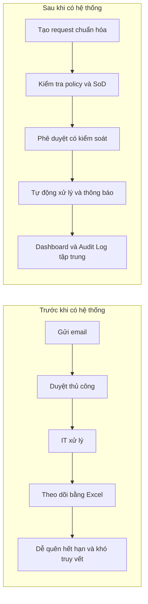
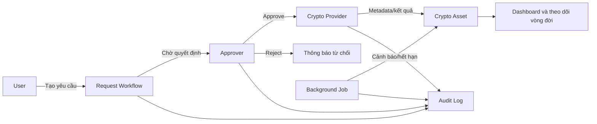
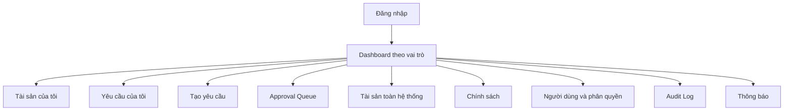

# TỔNG QUAN SẢN PHẨM ĐỒ ÁN

## Hệ thống thông tin quản lý vòng đời khóa mã hóa và chứng thư số

> Tài liệu giới thiệu ngắn gọn sản phẩm, bài toán cần giải quyết, người sử dụng, chức năng chính và giá trị của đồ án. Có thể sử dụng làm nội dung mở đầu báo cáo hoặc phần giới thiệu khi thuyết minh.

---

## 1. Giới thiệu sản phẩm

Sản phẩm là một ứng dụng web giúp tổ chức quản lý tập trung khóa mã hóa và chứng thư số trong suốt vòng đời của chúng. Hệ thống quản lý thông tin về người sở hữu, mục đích sử dụng, trạng thái, ngày hiệu lực, ngày hết hạn và lịch sử xử lý của từng tài sản.

Người dùng có thể gửi yêu cầu cấp mới, gia hạn hoặc thu hồi. Người quản lý xem xét và phê duyệt các yêu cầu. Quản trị viên bảo mật cấu hình chính sách, quản lý phân quyền và kiểm tra Audit Log. Hệ thống tự động cảnh báo khi tài sản sắp hết hạn.

Sản phẩm không nhằm tự xây một thuật toán mã hóa hoặc một Certificate Authority hoàn chỉnh. Trọng tâm của sản phẩm là **quản lý thông tin, quy trình nghiệp vụ, phân quyền, tự động hóa và kiểm toán**.

---

## 2. Bài toán thực tế

Trong nhiều tổ chức, thông tin về khóa và chứng thư có thể được theo dõi bằng email, bảng tính hoặc nhiều công cụ riêng lẻ. Cách quản lý này dẫn đến các vấn đề:

- Không biết chính xác ai đang sở hữu tài sản nào.
- Khó theo dõi ngày hết hạn.
- Dễ quên gia hạn chứng thư quan trọng.
- Quy trình phê duyệt thiếu thống nhất.
- Người yêu cầu có thể tham gia sai vai trò trong quá trình duyệt.
- Khó kiểm tra ai đã tạo, duyệt, thay đổi hoặc thu hồi tài sản.
- Khó lập báo cáo tổng hợp cho quản lý.
- Dữ liệu nhạy cảm có nguy cơ bị lưu không đúng nơi.

### Quy trình trước và sau khi có hệ thống

---

## 3. Mục tiêu của đồ án

- Xây dựng một hệ thống thông tin quản lý tập trung tài sản mật mã.
- Chuẩn hóa quy trình cấp mới, gia hạn và thu hồi.
- Áp dụng nguyên tắc phân tách nhiệm vụ giữa người yêu cầu và người phê duyệt.
- Cảnh báo sớm tài sản sắp hết hạn.
- Hỗ trợ quản trị viên theo dõi tình trạng tài sản toàn tổ chức.
- Cung cấp lịch sử kiểm toán đầy đủ và không cho phép sửa/xóa tùy ý.
- Tạo nền tảng có thể kết nối Vault, KMS hoặc CA thật trong tương lai.

---

## 4. Đối tượng sử dụng

| Đối tượng | Nhu cầu | Chức năng chính |
|---|---|---|
| User / Employee | Có khóa/chứng thư phục vụ công việc | Tạo yêu cầu; xem tài sản; gia hạn; thu hồi |
| Approver / Manager | Kiểm soát yêu cầu trong đơn vị | Xem hàng đợi; phê duyệt; từ chối |
| Security Admin | Quản lý an toàn và tuân thủ | Policy; RBAC; tài sản toàn hệ thống; Audit Log |
| System Job | Tự động hóa công việc định kỳ | Cảnh báo; cập nhật hết hạn; gửi thông báo |

---

## 5. Các chức năng chính

### 5.1. Quản lý tài khoản và phân quyền

- Đăng nhập và quản lý phiên.
- Gán vai trò User, Approver và Security Admin.
- Giới hạn Approver theo phòng ban.
- Khóa hoặc mở tài khoản.
- Ngăn Security Admin tự động có quyền phê duyệt.

### 5.2. Quản lý yêu cầu

- Yêu cầu cấp phát khóa/chứng thư mới.
- Yêu cầu gia hạn tài sản sắp hết hạn.
- Yêu cầu thu hồi khi mất thiết bị hoặc nghi lộ khóa.
- Theo dõi trạng thái và lịch sử xử lý.
- Hiển thị lý do khi yêu cầu bị từ chối.

### 5.3. Phê duyệt

- Hàng đợi phê duyệt theo phạm vi.
- Ưu tiên yêu cầu thu hồi khẩn cấp.
- Kiểm tra policy trước khi đưa ra quyết định.
- Không cho người tạo tự phê duyệt.
- Chống hai người xử lý đồng thời cùng một yêu cầu.

### 5.4. Quản lý tài sản

- Quản lý metadata của khóa và chứng thư.
- Theo dõi owner, phòng ban, thuật toán và mục đích.
- Theo dõi ngày hiệu lực, hết hạn và trạng thái.
- Lưu mối liên kết giữa tài sản cũ và tài sản gia hạn.
- Không cho sửa trạng thái bằng CRUD tùy ý.

### 5.5. Chính sách bảo mật

- Thuật toán được phép.
- Độ dài khóa tối thiểu.
- Thời hạn mặc định và tối đa.
- Các mốc cảnh báo hết hạn.
- Lưu phiên bản policy để truy vết thay đổi.

### 5.6. Cảnh báo tự động

- Quét tài sản định kỳ.
- Cảnh báo theo `warning_days` trong policy gắn tài sản.
- Chuyển trạng thái sang `EXPIRED` khi hết hạn.
- Gửi thông báo trong ứng dụng và xếp hàng email cho owner, Approver đúng phạm vi và Admin đủ điều kiện.
- Giữ một bản ghi theo người nhận, mốc và kênh khi quét lại. Email phụ thuộc SMTP và quy trình đối soát.

### 5.7. Audit Log

- Lưu ai đã thực hiện hành động.
- Lưu hành động gì, trên đối tượng nào và lúc nào.
- Lưu kết quả thành công, thất bại hoặc bị từ chối.
- Không cung cấp API sửa/xóa Audit Log.
- Che token, mật khẩu và private key khỏi log.

---

## 6. Cách sản phẩm hoạt động

Ví dụ:

1. Nhân viên cần chứng thư để ký tài liệu.
2. Nhân viên tạo yêu cầu trên giao diện.
3. Trưởng phòng nhận yêu cầu và xem kết quả kiểm tra chính sách.
4. Trưởng phòng phê duyệt.
5. Hệ thống cấp chứng thư qua Crypto Provider.
6. Nhân viên nhận thông báo và thấy chứng thư trong danh sách tài sản.
7. Trước ngày hết hạn, hệ thống tự động gửi cảnh báo gia hạn.
8. Security Admin có thể truy vết toàn bộ quá trình trong Audit Log.

---

## 7. Các màn hình chính

### User

- Dashboard cá nhân.
- Danh sách và chi tiết tài sản.
- Form tạo yêu cầu.
- Danh sách yêu cầu và timeline.
- Trung tâm thông báo.

### Approver

- Dashboard phê duyệt.
- Approval Queue.
- Chi tiết yêu cầu và policy checklist.
- Dialog phê duyệt/từ chối.
- Lịch sử quyết định.

### Security Admin

- Dashboard toàn tổ chức.
- Quản lý tài sản.
- Quản lý user, role và scope.
- Cấu hình policy.
- Tra cứu Audit Log.

### Sơ đồ điều hướng

---

## 8. Giá trị của sản phẩm

### Đối với người dùng

- Gửi yêu cầu nhanh và theo dõi được trạng thái.
- Nhận cảnh báo trước khi tài sản hết hạn.
- Không cần theo dõi thủ công bằng email hoặc bảng tính.

### Đối với người phê duyệt

- Có hàng đợi tập trung và sắp xếp theo mức ưu tiên.
- Có đủ thông tin và policy check trước khi quyết định.
- Tránh bỏ sót hoặc xử lý trùng yêu cầu.

### Đối với quản trị viên

- Nhìn thấy toàn bộ tài sản trong tổ chức.
- Cấu hình chính sách tập trung.
- Kiểm tra được ai làm gì và khi nào.
- Phát hiện tài sản sắp hết hạn hoặc không tuân thủ.

### Đối với tổ chức

- Chuẩn hóa quy trình.
- Giảm rủi ro gián đoạn do chứng thư hết hạn.
- Thực thi phân tách nhiệm vụ.
- Tăng khả năng kiểm toán và trách nhiệm giải trình.

---

## 9. Điểm nổi bật của đồ án Hệ thống thông tin

| Thành phần HTTT | Cách sản phẩm đáp ứng |
|---|---|
| Con người | Có nhiều tác nhân và trách nhiệm khác nhau |
| Quy trình | Workflow cấp mới, gia hạn, thu hồi và phê duyệt |
| Dữ liệu | Tài khoản, tài sản, yêu cầu, policy, notification và audit |
| Công nghệ | React, Node.js, PostgreSQL, worker và Docker |
| Kiểm soát | RBAC, SoD, policy và Audit Log |
| Hỗ trợ quyết định | Dashboard, cảnh báo, hàng đợi ưu tiên và báo cáo |

Sản phẩm không chỉ thực hiện CRUD mà còn có state machine, transaction, kiểm soát quyền, tự động hóa và báo cáo quản trị.

---

## 10. Phạm vi đồ án hiện hành

### Có trong MVP

- Đăng nhập và RBAC.
- Ba vai trò nghiệp vụ.
- Cấp mới, gia hạn và thu hồi.
- Approval Queue và nguyên tắc SoD.
- Quản lý metadata tài sản.
- Policy và Audit Log.
- Background Job và notification.
- Mock Crypto Provider.
- Docker Compose, dữ liệu demo và Swagger.

### Phần mở rộng đã triển khai

- [MFA TOTP và mã khôi phục](docs/MFA_X01.md) cho vai trò nhạy cảm.
- [Phê duyệt hai cấp](docs/X02_TWO_STAGE_APPROVAL.md) bằng hai Approver khác nhau trong cùng phạm vi.
- [Checkpoint audit ký Ed25519](docs/X05_AUDIT_ANCHOR.md) để xác minh thay đổi so với mốc lưu độc lập.
- [SSO/OIDC với Keycloak](docs/X03_OIDC.md) đã kiểm trên môi trường cách ly.
- [Báo cáo CSV/PDF](docs/X04_REPORT_EXPORTS.md) theo bộ lọc và quyền hiện tại.
- [HTTP bridge sang OpenBao Transit](docs/X06_OPENBAO_TRANSIT.md) đã kiểm sandbox cho khóa ký RSA/ECDSA.

### Hướng phát triển khi có môi trường tổ chức

Kết nối provider/CA và hộp thư bên ngoài, triển khai staging HTTPS, chốt kho checkpoint độc lập và hoàn tất nghiệm thu vận hành. HSM phần cứng hoặc CA thương mại cần adapter và kiểm riêng theo nhà cung cấp được chọn. [Phạm vi bàn giao đồ án](docs/DO_AN.md) giữ rõ các giới hạn của bản local.

---

## 11. Công nghệ đang sử dụng

| Lớp | Công nghệ |
|---|---|
| Frontend | React, TypeScript, Vite, React Router |
| Backend | Node.js, TypeScript, NestJS |
| Database | PostgreSQL 17 qua driver `pg` |
| Job | Worker trong backend, transaction và hàng đợi PostgreSQL |
| API | REST + OpenAPI/Swagger |
| Email | Nodemailer qua SMTP khi được bật |
| Đóng gói | Docker Compose |

Demo chạy với adapter MOCK, PostgreSQL và Nginx trên máy thử. SMTP, provider và môi trường triển khai thật cần được cấu hình và nghiệm thu trước khi đưa tài sản thật vào hệ thống. [Hướng dẫn sử dụng](docs/HUONG_DAN_CRYPTA.md) · [Kiến trúc hiện hành](02_so_do_he_thong_tong_quat.md) · [Nghiệm thu 12 luồng](docs/NGHIEM_THU_UAT.md)

---

## 12. Thông điệp giới thiệu khi thuyết minh

> “Sản phẩm của nhóm là một hệ thống thông tin quản lý vòng đời khóa mã hóa và chứng thư số trong tổ chức. Hệ thống chuẩn hóa quy trình từ yêu cầu, phê duyệt, cấp phát, gia hạn đến thu hồi; đồng thời áp dụng phân quyền, phân tách nhiệm vụ, cảnh báo tự động và Audit Log. Sản phẩm không tự xây thuật toán mã hóa mà tập trung quản lý con người, dữ liệu, quy trình và kiểm soát xung quanh tài sản mật mã.”

Phiên bản nói ngắn trong khoảng 20 giây:

> “Đây là hệ thống giúp tổ chức biết ai đang sở hữu khóa hoặc chứng thư nào, tài sản sắp hết hạn hay chưa, ai đã phê duyệt và toàn bộ lịch sử xử lý. User gửi yêu cầu, Approver duyệt, Admin quản lý chính sách, còn hệ thống tự cảnh báo và ghi Audit Log.”

