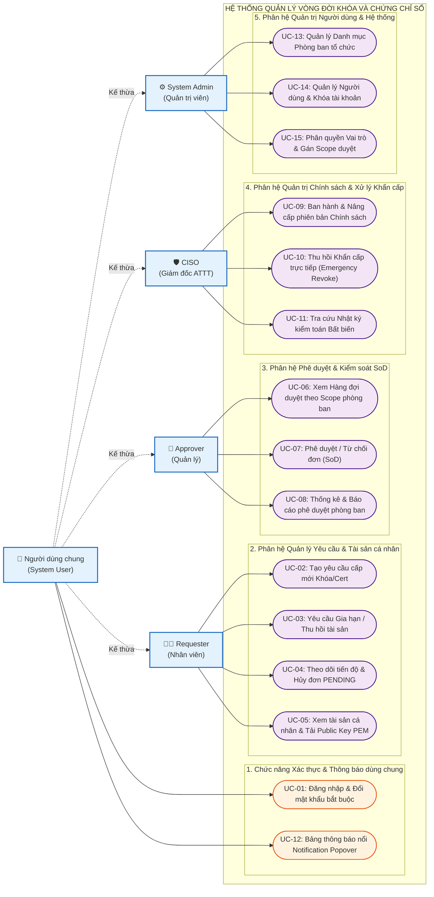
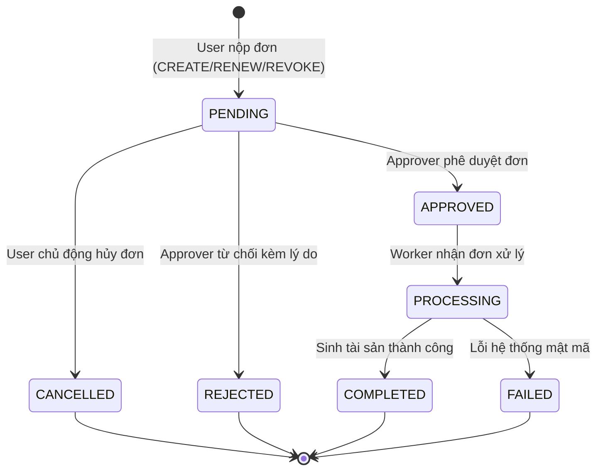
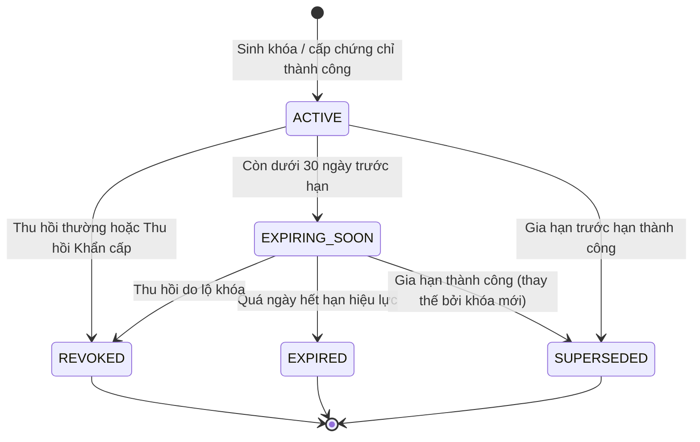
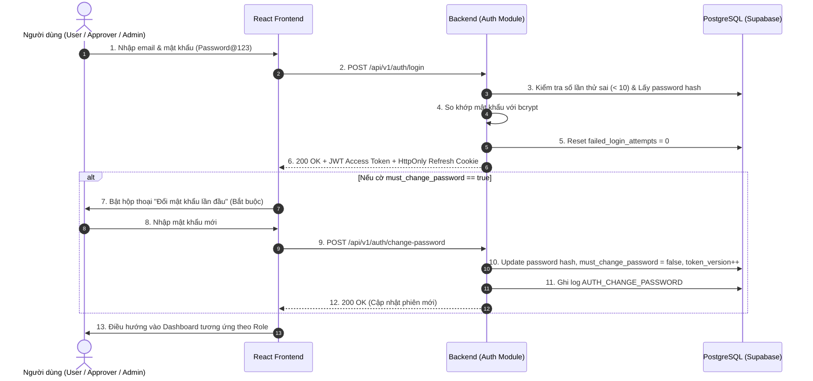
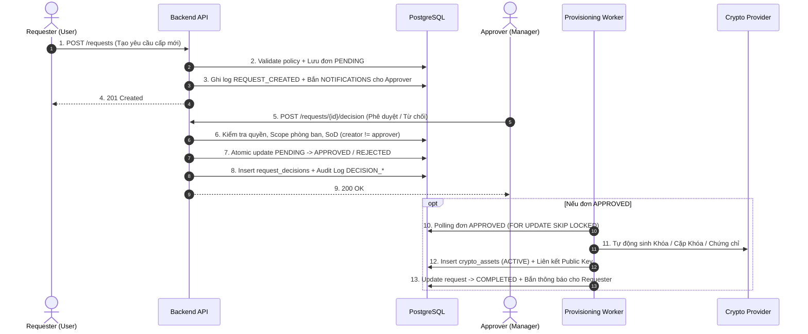
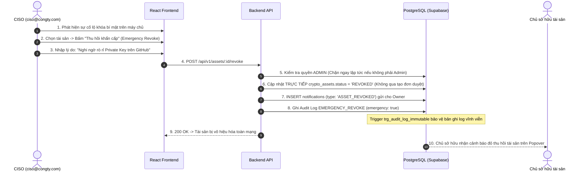
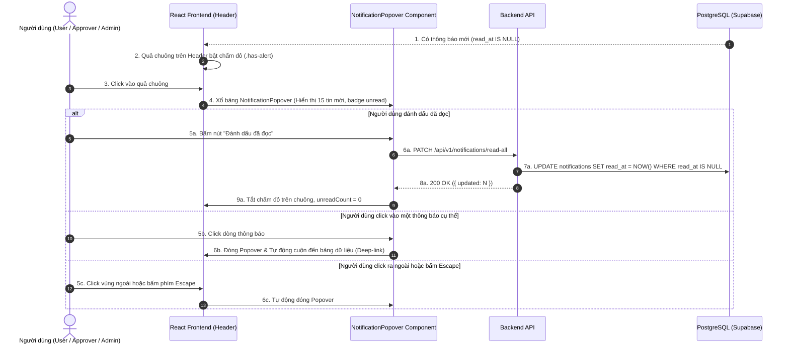
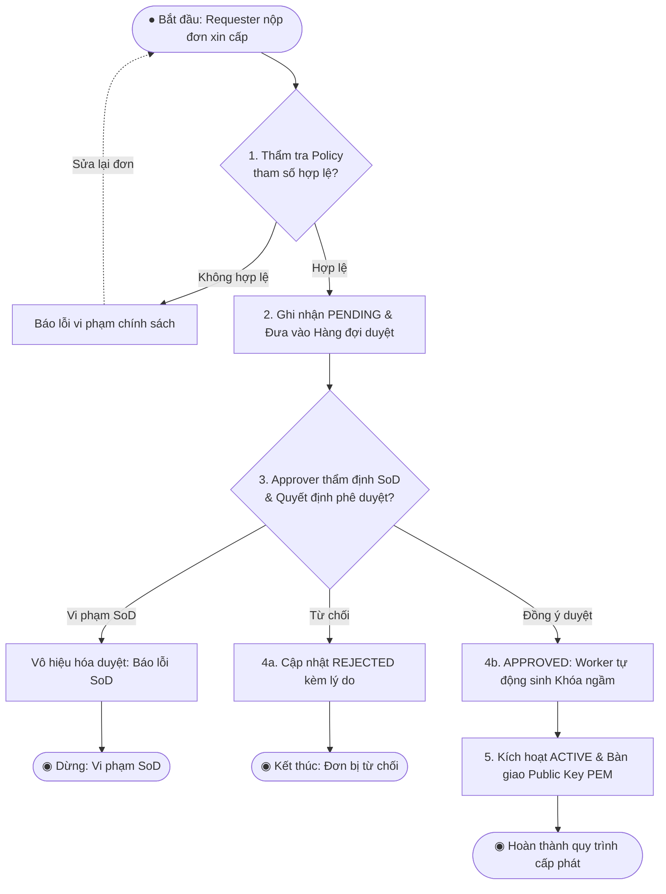
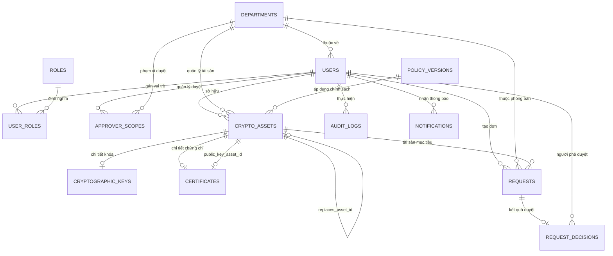

# BỘ KHOA HỌC VÀ CÔNG NGHỆ
# HỌC VIỆN CÔNG NGHỆ BƯU CHÍNH VIỄN THÔNG
### KHOA CÔNG NGHỆ THÔNG TIN
---

 

# BÁO CÁO ĐỒ ÁN MÔN HỌC
## MÔN HỌC: THIẾT KẾ HỆ THỐNG THÔNG TIN

 

### ĐỀ TÀI:
# HỆ THỐNG QUẢN LÝ VÒNG ĐỜI KHÓA MÃ HÓA VÀ CHỨNG CHỈ SỐ DOANH NGHIỆP

 

**Giảng viên hướng dẫn:** ThS. [Điền tên Giảng viên hướng dẫn]  
**Nhóm sinh viên thực hiện:** Nhóm [Điền số nhóm]  

| STT | Họ và tên sinh viên | Mã số sinh viên (MSSV) | Lớp sinh viên | Vai trò trong nhóm |
| :-: | :--- | :-: | :-: | :-: |
| 1 | Hồ Ngọc Đức | N23DCAT012 | D23CQAT01-N | Trưởng nhóm |
| 2 | Lê Hoàng Ngọc | N23DCAT048 | D23CQAT01-N | Thành viên |

 

*TP. Hồ Chí Minh, Học kỳ I — Năm học 2026*

---

# MỤC LỤC

- [DANH SÁCH HÌNH, BẢNG](#danh-sách-hình-bảng)
- [DANH MỤC TỪ VIẾT TẮT](#danh-mục-từ-viết-tắt)
- [CHƯƠNG I. TỔNG QUAN](#chương-i-tổng-quan)
  - [I. Giới thiệu đề tài](#i-giới-thiệu-đề-tài)
    - [1. Lý do chọn đề tài và Tính cấp thiết](#1-lý-do-chọn-đề-tài-và-tính-cấp-thiết)
    - [2. Mục tiêu của đề tài](#2-mục-tiêu-của-đề-tài)
    - [3. Phạm vi áp dụng](#3-phạm-vi-áp-dụng)
    - [4. Nền tảng kỹ thuật lựa chọn](#4-nền-tảng-kỹ-thuật-lựa-chọn)
  - [II. Cơ sở lý thuyết](#ii-cơ-sở-lý-thuyết)
    - [1. Vòng đời Khóa mật mã theo chuẩn NIST SP 800-57](#1-vòng-đời-khóa-mật-mã-theo-chuẩn-nist-sp-800-57)
    - [2. Hạ tầng khóa công khai PKI và Chứng thư số X.509](#2-hạ-tầng-khóa-công-khai-pki-và-chứng-thư-số-x509)
    - [3. Nguyên tắc Phân tách Trách nhiệm (Separation of Duties - SoD)](#3-nguyên-tắc-phân-tách-trách-nhiệm-separation-of-duties---sod)
    - [4. Cơ chế Nhật ký kiểm toán Bất biến (Audit Log Immutability)](#4-cơ-chế-nhật-ký-kiểm-toán-bất-biến-audit-log-immutability)
- [CHƯƠNG II. PHÂN TÍCH NỘI DUNG, YÊU CẦU](#chương-ii-phân-tích-nội-dung-yêu-cầu)
  - [I. Giới thiệu Quy trình 1: Đăng ký & Cấp phát tài sản mật mã mới](#i-giới-thiệu-quy-trình-1-đăng-ký--cấp-phát-tài-sản-mật-mã-mới)
  - [II. Giới thiệu Quy trình 2: Phê duyệt & Kiểm soát Phân tách Trách nhiệm (SoD)](#ii-giới-thiệu-quy-trình-2-phê-duyệt--kiểm-soát-phân-tách-trách-nhiệm-sod)
  - [III. Giới thiệu Quy trình 3: Ứng phó sự cố & Thu hồi Khẩn cấp (Emergency Revocation)](#iii-giới-thiệu-quy-trình-3-ứng-phó-sự-cố--thu-hồi-khẩn-cấp-emergency-revocation)
  - [IV. Yêu cầu chức năng nghiệp vụ](#iv-yêu-cầu-chức-năng-nghiệp-vụ)
    - [1. Chức năng của đối tượng Requester (Nhân viên nghiệp vụ)](#1-chức-năng-của-đối-tượng-requester-nhân-viên-nghiệp-vụ)
    - [2. Chức năng của đối tượng Approver (Quản lý / Người phê duyệt)](#2-chức-năng-của-đối-tượng-approver-quản-lý--người-phê-duyệt)
    - [3. Chức năng của đối tượng CISO / Security Admin (Giám đốc Bảo mật)](#3-chức-năng-của-đối-tượng-ciso--security-admin-giám-đốc-bảo-mật)
    - [4. Chức năng của đối tượng System Admin (Quản trị viên hệ thống)](#4-chức-năng-của-đối-tượng-system-admin-quản-trị-viên-hệ-thống)
  - [V. Yêu cầu chức năng hệ thống và Yêu cầu chất lượng](#v-yêu-cầu-chức-năng-hệ-thống-và-yêu-cầu-chất-lượng)
- [CHƯƠNG III. PHÂN TÍCH THIẾT KẾ HỆ THỐNG](#chương-iii-phân-tích-thiết-kế-hệ-thống)
  - [I. Sơ đồ Use Case](#i-sơ-đồ-use-case)
  - [II. Sơ đồ trạng thái (State Diagram)](#ii-sơ-đồ-trạng-thái-state-diagram)
  - [III. Sơ đồ tuần tự (Sequence Diagram)](#iii-sơ-đồ-tuần-tự-sequence-diagram)
  - [IV. Sơ đồ hoạt động (Activity Diagram)](#iv-sơ-đồ-hoạt-động-activity-diagram)
  - [V. Thiết kế Cơ sở Dữ liệu](#v-thiết-kế-cơ-sở-dữ-liệu)
- [CHƯƠNG IV. PHÁT TRIỂN / THỰC THI](#chương-iv-phát-triển--thực-thi)
  - [I. Màn hình Đăng nhập & Đổi mật khẩu bắt buộc](#i-màn-hình-đăng-nhập--đổi-mật-khẩu-bắt-buộc)
  - [II. Màn hình Không gian làm việc cá nhân (User Dashboard)](#ii-màn-hình-không-gian-làm-việc-cá-nhân-user-dashboard)
  - [III. Màn hình Hàng đợi duyệt phòng ban (Approval Queue) & Quyết định](#iii-màn-hình-hàng-đợi-duyệt-phòng-ban-approval-queue--quyết-định)
  - [IV. Màn hình Bảng thông báo nổi (Notification Popover)](#iv-màn-hình-bảng-thông-báo-nổi-notification-popover)
  - [V. Màn hình Quản trị Chính sách & Thu hồi khẩn cấp](#v-màn-hình-quản-trị-chính-sách--thu-hồi-khẩn-cấp)
  - [VI. Màn hình Nhật ký kiểm toán bất biến (Audit Logs)](#vi-màn-hình-nhật-ký-kiểm-toán-bất-biến-audit-logs)
- [CHƯƠNG V. KẾT LUẬN](#chương-v-kết-luận)
  - [I. Kết quả đã thực hiện](#i-kết-quả-đã-thực-hiện)
  - [II. Ưu khuyết điểm](#ii-ưu-khuyết-điểm)
  - [III. Hướng mở rộng trong tương lai](#iii-hướng-mở-rộng-trong-tương-lai)
- [TÀI LIỆU THAM KHẢO](#tài-liệu-tham-khảo)

---

# DANH SÁCH HÌNH, BẢNG

### Danh sách Hình vẽ
- **Hình 3.1:** Sơ đồ Use Case tổng quát của hệ thống (15 Use Cases phân theo 4 nhóm Actor).
- **Hình 3.2:** Sơ đồ Máy trạng thái Yêu cầu (Request State Machine).
- **Hình 3.3:** Sơ đồ Máy trạng thái Tài sản Mật mã (Asset State Machine).
- **Hình 3.4:** Sơ đồ Tuần tự luồng Xác thực & Đổi mật khẩu bắt buộc (UC-01).
- **Hình 3.5:** Sơ đồ Tuần tự luồng Phê duyệt & Kiểm soát Phân tách Trách nhiệm SoD (UC-02 & UC-07).
- **Hình 3.6:** Sơ đồ Tuần tự luồng Thu hồi Tài sản Khẩn cấp (UC-10).
- **Hình 3.7:** Sơ đồ Tuần tự luồng Bảng thông báo nổi Notification Popover (UC-12 & UC-UI-01).
- **Hình 3.8:** Sơ đồ Hoạt động luồng xử lý đơn cấp phát và phê duyệt.
- **Hình 3.9:** Sơ đồ Thực thể Liên kết (ERD) 15 bảng cơ sở dữ liệu.
- **Hình 4.1:** Giao diện Đăng nhập và Hộp thoại Đổi mật khẩu bắt buộc.
- **Hình 4.2:** Giao diện Dashboard cá nhân của Requester và Bảng tài sản mật mã.
- **Hình 4.3:** Giao diện Hàng đợi duyệt của Approver và Thanh quyết định duyệt đơn.
- **Hình 4.4:** Giao diện Bảng thông báo nổi Notification Popover trên thanh Header.
- **Hình 4.5:** Giao diện Quản trị Chính sách (Policy Versioning) và Nút Thu hồi khẩn cấp của CISO.
- **Hình 4.6:** Giao diện Tra cứu Nhật ký kiểm toán bất biến (Audit Logs Console).

### Danh sách Bảng biểu
- **Bảng 1.1:** So sánh các giải pháp quản lý khóa truyền thống và hệ thống đề xuất.
- **Bảng 2.1:** Bảng yêu cầu chức năng nghiệp vụ của đối tượng Requester (Nhân viên).
- **Bảng 2.2:** Bảng yêu cầu chức năng nghiệp vụ của đối tượng Approver (Quản lý).
- **Bảng 2.3:** Bảng yêu cầu chức năng nghiệp vụ của đối tượng CISO (Giám đốc Bảo mật).
- **Bảng 2.4:** Bảng yêu cầu chức năng nghiệp vụ của đối tượng System Admin (Quản trị viên).
- **Bảng 3.1:** Bảng cấu trúc CSDL `users` (Thông tin tài khoản).
- **Bảng 3.2:** Bảng cấu trúc CSDL `crypto_assets` (Siêu dữ liệu tài sản mật mã).
- **Bảng 3.3:** Bảng cấu trúc CSDL `requests` (Đơn yêu cầu nghiệp vụ).
- **Bảng 3.4:** Bảng cấu trúc CSDL `audit_logs` (Nhật ký kiểm toán bất biến).
- **Bảng 3.5:** Bảng cấu trúc CSDL `notifications` (Thông báo ứng dụng).

---

# DANH MỤC TỪ VIẾT TẮT

| Từ viết tắt | Tên tiếng Anh đầy đủ | Ý nghĩa / Giải thích trong hệ thống |
| :--- | :--- | :--- |
| **KMS** | Key Management Service | Hệ thống quản lý vòng đời khóa mật mã |
| **PKI** | Public Key Infrastructure | Hạ tầng khóa công khai quản lý chứng thư số |
| **SoD** | Separation of Duties | Nguyên tắc phân tách trách nhiệm (người tạo không được tự duyệt) |
| **RBAC** | Role-Based Access Control | Cơ chế kiểm soát truy cập dựa trên vai trò |
| **CISO** | Chief Information Security Officer | Giám đốc an toàn thông tin của tổ chức |
| **JWT** | JSON Web Token | Tiêu chuẩn mã hóa phiên xác thực người dùng |
| **CA** | Certificate Authority | Tổ chức chứng thực chữ ký số |
| **CSR** | Certificate Signing Request | Tệp yêu cầu cấp chứng thư số gửi lên CA |
| **AES** | Advanced Encryption Standard | Chuẩn mã hóa đối xứng khối an toàn (AES-256-GCM) |
| **RSA** | Rivest–Shamir–Adleman | Thuật toán mật mã bất đối xứng phổ biến (RSA-2048/4096) |
| **ECDSA** | Elliptic Curve Digital Signature Algorithm | Thuật toán chữ ký số trên đường cong Elliptic (P-256) |
| **ERD** | Entity Relationship Diagram | Sơ đồ biểu diễn thực thể và mối quan hệ CSDL |
| **API** | Application Programming Interface | Giao diện lập trình ứng dụng RESTful |
| **UI/UX** | User Interface / User Experience | Giao diện và trải nghiệm người dùng |

---

# CHƯƠNG I. TỔNG QUAN

## I. Giới thiệu đề tài

### 1. Lý do chọn đề tài và Tính cấp thiết
Trong môi trường công nghệ hiện nay, việc ứng dụng mã hóa dữ liệu và chữ ký số là nền tảng cốt lõi trong các doanh nghiệp để đảm bảo tính bí mật, toàn vẹn và chống chối bỏ. Các tổ chức thường xuyên phải phát hành và quản lý hàng trăm cặp khóa SSH, khóa mã hóa cơ sở dữ liệu (AES), chứng chỉ SSL/TLS cho máy chủ web và chứng thư số ký hóa đơn điện tử.

Tuy nhiên, tại nhiều doanh nghiệp, công tác quản lý tài sản mật mã vẫn đang gặp phải các vấn đề nghiêm trọng sau:
1. **Quản lý phân tán và thủ công:** Khóa và chứng chỉ được lưu trữ rải rác trên máy tính cá nhân, chia sẻ qua tin nhắn nội bộ hoặc ghi chép vào file Excel. Điều này dẫn đến nguy cơ rò rỉ khóa bí mật (Private Key) mà người quản lý không hay biết.
2. **Sự cố gián đoạn do hết hạn chứng chỉ:** Chứng chỉ SSL/TLS hoặc chứng thư số hết hạn đột ngột mà không có cảnh báo trước, khiến website bị trình duyệt cảnh báo không an toàn, dịch vụ thanh toán bị đình trệ.
3. **Thiếu cơ chế kiểm soát quyền hạn (SoD):** Lập trình viên có thể tự do tạo khóa và đưa vào môi trường production mà không qua sự xem xét, đánh giá rủi ro từ Trưởng phòng.
4. **Không có quy trình ứng phó rò rỉ khẩn cấp:** Khi phát hiện máy chủ bị tấn công hoặc khóa bí mật bị đẩy nhầm lên kho mã nguồn công khai (GitHub), người quản trị bảo mật (CISO) không có công cụ thu hồi tài sản mật mã tức thời trên toàn hệ thống.

Xuất phát từ những bài toán thực tế đó, nhóm chúng em đã lựa chọn đề tài: **"Xây dựng Hệ thống Quản lý Vòng đời Khóa Mã hóa và Chứng chỉ số Doanh nghiệp"** cho đồ án môn học Thiết kế Hệ thống Thông tin nhằm cung cấp một giải pháp quản trị tập trung, an toàn, minh bạch và tự động hóa cao.

### 2. Mục tiêu của đề tài
- **Chuẩn hóa quy trình nghiệp vụ:** Xây dựng quy trình nghiệp vụ khép kín từ lúc nộp đơn xin cấp phát, quản lý phân luồng phê duyệt theo phòng ban, tự động sinh khóa/chứng chỉ, gia hạn tài sản, cho đến thu hồi khi hết nhu cầu.
- **Thực thi nguyên tắc Phân tách Trách nhiệm (SoD):** Ngăn chặn tuyệt đối hành vi người tạo đơn tự phê duyệt đơn của mình; quản lý chỉ được duyệt trong phạm vi phòng ban mình phụ trách; quản trị viên không can thiệp phê duyệt đơn nghiệp vụ.
- **Cung cấp cơ chế Thu hồi Khẩn cấp (Emergency Revocation):** Trao quyền cho CISO thu hồi tức thời tài sản bị rò rỉ mà không cần thông qua bước lập đơn và chờ duyệt thông thường.
- **Lưu vết kiểm toán bất biến (Audit Log Immutability):** Ghi nhận đầy đủ vết thao tác người dùng, đảm bảo dữ liệu nhật ký không thể bị sửa hoặc xóa kể cả từ người quản trị.
- **Tự động hóa cảnh báo:** Tự động quét và phát thông báo In-app cùng email cảnh báo trước 30 ngày đối với các tài sản sắp hết hiệu lực.

### 3. Phạm vi áp dụng
- **Phạm vi tổ chức:** Phù hợp áp dụng cho các cơ quan, doanh nghiệp có nhiều bộ phận phòng ban (như Phòng Công nghệ Thông tin, Phòng Kế toán - Tài chính, Khối Vận hành hệ thống).
- **Phạm vi tài sản quản lý:**
  - *Khóa đối xứng (Symmetric Key):* AES-128, AES-256 (phục vụ mã hóa dữ liệu cơ sở dữ liệu, sao lưu).
  - *Cặp khóa bất đối xứng (Asymmetric Key Pair):* RSA-2048, RSA-4096, ECDSA P-256 (phục vụ ký số, xác thực SSH, phân quyền máy chủ).
  - *Chứng chỉ số (Digital Certificate):* Chứng chỉ X.509 SSL/TLS cho dịch vụ web, chứng thư ký số nội bộ.
- **Giới hạn phạm vi (MVP):** Hệ thống quản lý tập trung siêu dữ liệu (metadata), thuật toán, thời hạn và trạng thái; lưu trữ khóa công khai để người dùng tải về; khóa bí mật được quản lý mô phỏng thông qua nhà cung cấp mật mã nội bộ an toàn (Mock Crypto Provider).

### 4. Nền tảng kỹ thuật lựa chọn
- **Phía Máy chủ (Backend):** Sử dụng **NestJS (Node.js/TypeScript)** theo mô hình kiến trúc phân tầng (Controller - Service - Module), thiết kế chuẩn RESTful API, tài liệu hóa tự động bằng OpenAPI/Swagger UI (`/docs`).
- **Phía Giao diện (Frontend):** Ứng dụng Single Page Application (SPA) xây dựng bằng **React 19, TypeScript và Vite**, thiết kế giao diện theo phong cách Dashboard hiện đại, tích hợp Bảng thông báo nổi (`NotificationPopover`).
- **Cơ sở Dữ liệu (Database):** Hệ quản trị **PostgreSQL 15** (lưu trữ đám mây Supabase), tận dụng các ràng buộc CHECK, Foreign Key và Database Trigger để thực thi logic SoD và tính bất biến của nhật ký kiểm toán ở tầng vật lý.

---

## II. Cơ sở lý thuyết

### 1. Vòng đời Khóa mật mã theo chuẩn NIST SP 800-57
Theo hướng dẫn của Viện Tiêu chuẩn và Kỹ thuật Quốc gia Hoa Kỳ (NIST Special Publication 800-57 Part 1), vòng đời của một tài sản mật mã gồm các trạng thái chuẩn:
- *Pre-activation (Chờ kích hoạt):* Tài sản đã được tạo nhưng chưa đưa vào sử dụng thực tế.
- *Active (Đang hoạt động):* Khóa hoặc chứng chỉ đang được sử dụng hợp pháp để mã hóa, giải mã hoặc ký số.
- *Expiring Soon (Sắp hết hạn):* Tài sản bước vào giai đoạn chuyển tiếp (thường là 30 ngày trước ngày hết hạn) để phát cảnh báo cho chủ sở hữu gia hạn.
- *Expired (Đã hết hạn):* Quá thời hạn hiệu lực, tài sản không được phép dùng để sinh chữ ký mới.
- *Revoked (Bị thu hồi):* Tài sản bị hủy bỏ hiệu lực trước hạn do nghi ngờ lộ khóa bí mật hoặc thay đổi nhân sự.
- *Superseded (Đã thay thế):* Tài sản cũ được thay thế bởi một tài sản kế nhiệm sau quy trình gia hạn.

### 2. Hạ tầng khóa công khai PKI và Chứng thư số X.509
PKI là tập hợp các phần mềm, phần cứng, con người và quy trình cần thiết để phát hành, quản lý và thu hồi chứng chỉ số. Chứng thư số X.509 liên kết danh tính của một thực thể (tên máy chủ, email, cá nhân) với một khóa công khai (Public Key), được ký xác thực bởi một Tổ chức Chứng thực (CA). Khi cấp chứng chỉ, hệ thống luôn phải tạo và liên kết kèm theo một cặp khóa (Key Pair).

### 3. Nguyên tắc Phân tách Trách nhiệm (Separation of Duties - SoD)
SoD là nguyên tắc căn bản trong thiết kế hệ thống thông tin nhằm giảm thiểu rủi ro gian lận nội bộ bằng cách chia nhỏ các tác vụ nhạy cảm cho nhiều người cùng tham gia:
- *Quy tắc 1:* Người tạo đơn yêu cầu tuyệt đối không được tự phê duyệt đơn của mình (`creator_id != approver_id`).
- *Quy tắc 2:* Quản lý phòng ban chỉ được duyệt các đơn thuộc phạm vi đơn vị mình quản lý (`department_scope`).
- *Quy tắc 3:* Quản trị viên hệ thống (Admin) và CISO có quyền cấu hình chính sách nhưng không được quyền duyệt đơn xin cấp phát tài sản nghiệp vụ.

### 4. Cơ chế Nhật ký kiểm toán Bất biến (Audit Log Immutability)
Để phục vụ việc điều tra sự cố an toàn thông tin và chống chối bỏ trách nhiệm, bảng `audit_logs` phải được thiết kế theo cơ chế **Chỉ ghi thêm (Append-only)**:
- Mọi hành vi xác thực, tạo đơn, duyệt đơn, thu hồi khẩn cấp đều được ghi lại với dấu thời gian chính xác (`created_at = NOW()`), địa chỉ IP và mã định danh người thực hiện (`actor_id`).
- Trigger CSDL `trg_audit_log_immutable` sẽ chặn đứng bất kỳ câu lệnh `UPDATE` hoặc `DELETE` nào tác động lên bảng nhật ký, ngăn ngừa việc xóa dấu vết sau khi tấn công.

---

# CHƯƠNG II. PHÂN TÍCH NỘI DUNG, YÊU CẦU

## I. Giới thiệu Quy trình 1: Đăng ký & Cấp phát tài sản mật mã mới
Quy trình cấp phát tài sản mật mã là luồng nghiệp vụ cơ bản diễn ra giữa Nhân viên nghiệp vụ (Requester) và Trưởng phòng ban (Approver):
1. **Nộp đơn:** Nhân viên (ví dụ lập trình viên cần khóa RSA ký commit) truy cập hệ thống, chọn loại tài sản cần xin cấp, chọn chính sách mật mã áp dụng (Policy Version), nhập mục đích sử dụng và thời hạn mong muốn.
2. **Kiểm tra sơ bộ:** Hệ thống tự động kiểm tra tính hợp lệ của tham số đầu vào. Nếu thời hạn vượt quá mức tối đa mà chính sách cho phép, hệ thống từ chối ngay tại chỗ (`422 POLICY_VIOLATION`). Nếu hợp lệ, đơn được lưu ở trạng thái `PENDING`.
3. **Phát thông báo:** Hệ thống tự động tạo một thông báo `REQUEST_SUBMITTED` gửi đến quả chuông của các Trưởng phòng có phạm vi phụ trách phòng ban của nhân viên đó.
4. **Phê duyệt:** Trưởng phòng xem xét chi tiết lý do và bấm "Phê duyệt".
5. **Cấp phát ngầm:** Tiến trình nền (Worker) nhận tín hiệu đơn đã duyệt, tự động sinh khóa mật mã trong CSDL, cập nhật tài sản thành `ACTIVE`, hoàn tất đơn (`COMPLETED`) và bắn thông báo `REQUEST_APPROVED` về cho người tạo đơn.
6. **Sử dụng:** Nhân viên tải tệp Public Key dạng PEM về máy tính để tích hợp vào ứng dụng.

## II. Giới thiệu Quy trình 2: Phê duyệt & Kiểm soát Phân tách Trách nhiệm (SoD)
Quy trình phê duyệt đòi hỏi sự chặt chẽ về thẩm quyền và ranh giới trách nhiệm:
1. **Phân định phạm vi (Approver Scopes):** Trưởng phòng IT (`it.manager`) chỉ nhìn thấy các đơn xin cấp khóa của nhân viên thuộc phòng IT; Kế toán trưởng (`fin.manager`) chỉ nhìn thấy các đơn chứng chỉ của nhân viên phòng Kế toán.
2. **Ngăn chặn xung đột lợi ích:** Trong trường hợp Trưởng phòng IT có nhu cầu sử dụng khóa và nộp đơn xin cấp, hệ thống tự động khóa quyền duyệt của Trưởng phòng đối với chính đơn đó. Nếu người này cố tình gửi lệnh duyệt qua API, cả tầng logic Backend lẫn Trigger CSDL `trg_check_sod_rule` sẽ lập tức chặn lại và ném lỗi vi phạm SoD (`SOD_VIOLATION`).
3. **Ghi nhận quyết định:** Mọi thao tác duyệt hoặc từ chối đều bắt buộc ghi nhận vào bảng `request_decisions` kèm lời phê hoặc lý do từ chối cụ thể để lưu vết kiểm toán.

## III. Giới thiệu Quy trình 3: Ứng phó sự cố & Thu hồi Khẩn cấp (Emergency Revocation)
Khi xảy ra sự cố bảo mật (nhân viên bị mất máy tính, hoặc lộ khóa bí mật ra ngoài Internet), quy trình nộp đơn thu hồi và chờ trưởng phòng duyệt thông thường sẽ mất nhiều thời gian, tạo điều kiện cho kẻ xấu lợi dụng khóa để giải mã hoặc giả mạo dữ liệu.
1. **Kích hoạt khẩn cấp:** CISO hoặc Quản trị viên truy cập bảng điều khiển an toàn, chọn tài sản bị rò rỉ và nhấn nút "Thu hồi khẩn cấp" (`POST /api/v1/assets/:id/revoke`).
2. **Xác thực quyền hạn:** Hệ thống kiểm tra quyền `ADMIN`. Người dùng thường và Quản lý phòng ban bị chặn ngay lập tức (`403 ADMIN_REQUIRED`).
3. **Vô hiệu hóa tức thời:** Hệ thống cập nhật trạng thái tài sản thành `REVOKED` ngay lập tức trong cơ sở dữ liệu mà không cần thông qua bước lập đơn hay chờ duyệt.
4. **Cảnh báo và Lưu vết:** Hệ thống phát thông báo cảnh báo đỏ (`ASSET_REVOKED`) đến chủ sở hữu tài sản và ghi một bản ghi Audit Log đặc biệt với cờ `emergency = true`.

---

## IV. Yêu cầu chức năng nghiệp vụ

Dưới đây là bảng chuẩn hóa các yêu cầu chức năng nghiệp vụ của hệ thống được phân loại theo 4 nhóm đối tượng sử dụng:

### 1. Chức năng của đối tượng Requester (Nhân viên nghiệp vụ)

| STT | Công việc | Loại công việc | Quy định / Công thức liên quan | Biểu mẫu liên quan | Ghi chú |
| :-: | :--- | :---: | :--- | :--- | :--- |
| **1** | Đăng nhập hệ thống | Tra cứu | - Email đúng định dạng và tài khoản ở trạng thái `ACTIVE` - Mật khẩu so khớp Bcrypt salt 10 - Khóa tạm thời 15 phút nếu thử sai quá 10 lần liên tiếp | Form Đăng nhập | UC-01 |
| **2** | Đổi mật khẩu bắt buộc | Lưu trữ | - Kích hoạt khi cờ `must_change_password = true` - Mật khẩu mới tối thiểu 6 ký tự - Tăng `token_version` để thu hồi toàn bộ phiên đăng nhập cũ | Dialog Đổi mật khẩu | UC-01 |
| **3** | Tạo yêu cầu cấp mới Khóa/Cert | Lưu trữ | - Chọn loại tài sản: `KEY_PAIR`, `SYMMETRIC_KEY`, `CERTIFICATE` - Thuật toán và thời hạn phải phù hợp với Policy được chọn - `validity_days <= max_validity_days` | Modal Tạo yêu cầu | UC-02 |
| **4** | Yêu cầu Gia hạn tài sản | Lưu trữ | - Chỉ gia hạn tài sản do mình sở hữu (`owner_id = current_user.id`) - Tài sản ở trạng thái `ACTIVE`, `EXPIRING_SOON` hoặc `EXPIRED` | Form Gia hạn tài sản | UC-03 |
| **5** | Yêu cầu Thu hồi thông thường | Lưu trữ | - Bắt buộc cung cấp lý do: `KEY_COMPROMISE`, `DEVICE_LOST`, `CESSATION_OF_OPERATION`, `OTHER` - Tài sản mục tiêu chưa bị thu hồi trước đó | Dialog Thu hồi | UC-03 |
| **6** | Theo dõi trạng thái đơn | Tra cứu | - Chỉ tra cứu các đơn do chính mình tạo ra - Hiển thị đầy đủ tiến độ: `PENDING`, `APPROVED`, `REJECTED`, `CANCELLED` | Bảng Yêu cầu gần đây | UC-04 |
| **7** | Hủy yêu cầu chờ duyệt | Lưu trữ | - Chỉ hủy được đơn của mình khi đang ở trạng thái `PENDING` - Đơn sau khi hủy chuyển sang `CANCELLED` và tự gỡ khỏi hàng đợi duyệt | Nút Hủy trên hàng đơn | UC-04 |
| **8** | Xem danh sách tài sản cá nhân | Trích xuất | - Chỉ hiển thị tài sản do mình sở hữu (`owner_id = user.id`) - Hỗ trợ bộ lọc theo trạng thái và thanh tìm kiếm nhanh | Bảng Tài sản của tôi | UC-05 |
| **9** | Tải Public Key / Chứng chỉ | Trích xuất | - Xuất tệp khóa công khai hoặc chứng chỉ định dạng PEM - Tuyệt đối không bao giờ xuất khóa bí mật (Private Key) | Nút Tải xuống tài sản | UC-05 |
| **10** | Xem Bảng thông báo nổi | Tra cứu | - Quả chuông trên Header hiển thị chấm đỏ khi có tin chưa đọc - Click chuông mở Notification Popover hiển thị 15 thông báo mới nhất | Notification Popover | UC-12 |
| **11** | Đánh dấu đã đọc thông báo | Lưu trữ | - Bấm nút "Đánh dấu đã đọc" trên Popover để cập nhật `read_at = NOW()` - Chấm đỏ cảnh báo trên quả chuông tắt ngay lập tức | Nút Đánh dấu đã đọc | UC-12 |

### 2. Chức năng của đối tượng Approver (Quản lý / Người phê duyệt)

| STT | Công việc | Loại công việc | Quy định / Công thức liên quan | Biểu mẫu liên quan | Ghi chú |
| :-: | :--- | :---: | :--- | :--- | :--- |
| **1** | Xem hàng đợi chờ duyệt | Tra cứu | - Chỉ hiển thị các đơn `PENDING` thuộc các phòng ban mà Approver được phân công quản lý (`approver_scopes`) | Hàng đợi duyệt đơn | UC-06 |
| **2** | Phê duyệt đơn yêu cầu | Xử lý | - Bắt buộc thỏa mãn SoD: người duyệt khác người nộp đơn (`approver_id != creator_id`) - Đơn chuyển `APPROVED`, kích hoạt worker sinh khóa ngầm | Thanh quyết định đơn | UC-07 |
| **3** | Từ chối đơn yêu cầu | Xử lý | - Bắt buộc nhập lời phê từ chối (Comment) - Đơn chuyển trạng thái `REJECTED`, gửi thông báo về cho Requester | Hộp thoại Từ chối | UC-07 |
| **4** | Báo cáo tài sản phòng ban | Trích xuất | - Thống kê tổng số tài sản phòng ban, số đơn tồn đọng, thời gian chờ duyệt trung bình của nhân viên | Approver Dashboard | UC-08 |
| **5** | Xem lịch sử xử lý đơn | Trích xuất | - Tra cứu danh sách các đơn đã được duyệt hoặc từ chối gần đây trong phạm vi phòng ban của mình | Bảng Lịch sử xử lý | UC-08 |

### 3. Chức năng của đối tượng CISO / Security Admin (Giám đốc Bảo mật)

| STT | Công việc | Loại công việc | Quy định / Công thức liên quan | Biểu mẫu liên quan | Ghi chú |
| :-: | :--- | :---: | :--- | :--- | :--- |
| **1** | Ban hành Chính sách mới | Lưu trữ | - Định nghĩa thuật toán cho phép (RSA, AES, ECDSA), độ dài khóa tối thiểu, thời hạn tối đa, số ngày cảnh báo trước | Modal Chính sách mới | UC-09 |
| **2** | Nâng cấp phiên bản Policy | Lưu trữ | - Tạo version mới (v2, v3) cho chính sách hiện hành - Đánh dấu version mới là `ACTIVE`, version cũ chuyển lưu trữ | Modal Cập nhật Policy | UC-09 |
| **3** | Thu hồi Tài sản Khẩn cấp | Xử lý | - Quyền hạn tối cao vô hiệu hóa tức thời bất kỳ tài sản nào trên toàn hệ thống thành `REVOKED` không qua phê duyệt | Dialog Thu hồi khẩn | UC-10 |
| **4** | Tra cứu Nhật ký kiểm toán | Tra cứu | - Tra cứu dòng thời gian toàn bộ các sự kiện kiểm toán - Hỗ trợ lọc theo hành động, tác nhân, kết quả và ngày tạo | Bảng Audit Log | UC-11 |
| **5** | Giám sát Dashboard an toàn | Trích xuất | - Theo dõi biểu đồ tỷ lệ loại tài sản toàn công ty, tài sản sắp hết hạn, trạng thái kết nối các dịch vụ nền | Admin Dashboard | UC-12 |

### 4. Chức năng của đối tượng System Admin (Quản trị viên hệ thống)

| STT | Công việc | Loại công việc | Quy định / Công thức liên quan | Biểu mẫu liên quan | Ghi chú |
| :-: | :--- | :---: | :--- | :--- | :--- |
| **1** | Quản lý danh mục Phòng ban | Lưu trữ | - Xem danh mục, thêm phòng ban mới, quản lý mã định danh phòng ban phục vụ cho việc phân luồng duyệt | Danh mục phòng ban | UC-13 |
| **2** | Tạo tài khoản người dùng | Lưu trữ | - Nhập email, họ tên, gán phòng ban, cấp mật khẩu khởi tạo - Mặc định bật cờ `must_change_password = true` | Modal Thêm User | UC-14 |
| **3** | Khóa / Kích hoạt tài khoản | Lưu trữ | - Chuyển trạng thái người dùng thành `INACTIVE` - Vô hiệu hóa ngay lập tức mọi phiên đăng nhập và token hiện có | Nút Khóa/Mở tài khoản | UC-14 |
| **4** | Phân vai trò người dùng | Lưu trữ | - Gán các vai trò `USER`, `APPROVER`, `ADMIN` - Hệ thống ngăn chặn việc gỡ vai trò Admin cuối cùng | Modal Phân quyền | UC-15 |
| **5** | Phân luồng Scopes duyệt | Lưu trữ | - Gán danh sách các phòng ban mà một Approver được quyền xem và phê duyệt yêu cầu | Modal Gán Scopes | UC-15 |

---

## V. Yêu cầu chức năng hệ thống và Yêu cầu chất lượng

### 1. Yêu cầu chức năng hệ thống
- **Quản lý phiên làm việc tập trung:** Phiên đăng nhập được duy trì thông qua cặp token JWT: Access Token (thời hạn 15 phút) và Refresh Token được lưu trữ trong HttpOnly Cookie có cờ `Secure`, chống tấn công XSS.
- **Tiến trình chạy ngầm (Background Worker):** Định kỳ mỗi giờ quét kiểm tra toàn bộ bảng `crypto_assets`:
  - Nếu `expires_at <= NOW() + 30 days` và trạng thái đang là `ACTIVE` $\rightarrow$ Chuyển sang `EXPIRING_SOON` và gửi thông báo cảnh báo.
  - Nếu `expires_at <= NOW()` và chưa được gia hạn $\rightarrow$ Tự động chuyển vĩnh viễn sang `EXPIRED`.
- **Ghép nối khóa tự động:** Khi phê duyệt một đơn cấp chứng chỉ số, hệ thống tự động sinh ngầm một cặp khóa bất đối xứng và lưu vào trường `certificates.public_key_asset_id`.

### 2. Yêu cầu chất lượng (Phi chức năng)
- **Hiệu năng và Tốc độ đáp ứng:** Thời gian phản hồi của các API truy vấn danh sách dưới 500ms; hỗ trợ phân trang dữ liệu ở mức CSDL (`LIMIT...OFFSET`) để đảm bảo không bị suy giảm hiệu năng khi số lượng bản ghi tăng cao.
- **Tính toàn vẹn và Bất biến:** Mọi thao tác thay đổi trạng thái đều được bọc trong Database Transaction. Bảng `audit_logs` có Trigger bảo vệ tính bất biến, không thể bị xóa hay chỉnh sửa nội dung.
- **Tính khả dụng và Trải nghiệm người dùng:** Giao diện thiết kế theo chuẩn Responsive Web Design, tương thích từ màn hình điện thoại di động (chiều rộng 375px) đến màn hình máy tính để bàn; hỗ trợ chế độ Dark Mode bảo vệ mắt.

---

# CHƯƠNG III. PHÂN TÍCH THIẾT KẾ HỆ THỐNG

## I. Sơ đồ Use Case

Sơ đồ Use Case tổng quát của hệ thống được phân rã thành 15 Ca sử dụng cốt lõi theo 4 nhóm tác nhân chính, áp dụng mô hình phân hệ chức năng và quan hệ kế thừa tác nhân (Actor Generalization) để đảm bảo cấu trúc trực quan, rành mạch và không bị chồng chéo:

*Hình 3.1: Sơ đồ Use Case tổng quát của hệ thống*

> **Ghi chú về thiết kế Sơ đồ Use Case:**
> - **Quan hệ Kế thừa (Actor Generalization):** Cả 4 đối tượng `Requester`, `Approver`, `CISO` và `System Admin` đều kế thừa từ tác nhân chung `Người dùng chung (System User)`, do đó tự động thừa hưởng 2 chức năng căn bản là `UC-01` (Đăng nhập, đổi mật khẩu) và `UC-12` (Nhận và đọc thông báo nổi qua quả chuông).
> - **Phân định ranh giới trách nhiệm:** Mỗi tác nhân chuyên biệt chỉ kết nối trực tiếp đến phân hệ chức năng tương ứng của mình, đảm bảo tuân thủ nguyên tắc tối thiểu quyền hạn (Least Privilege) và nguyên tắc phân tách trách nhiệm (SoD), đồng thời giúp biểu đồ không bị chồng chéo đường nối.

---

## II. Sơ đồ trạng thái (State Diagram)

### 1. Máy trạng thái Đơn yêu cầu (Request State Machine)
Đơn yêu cầu tuân thủ chu trình chuyển đổi trạng thái một chiều nghiêm ngặt:

*Hình 3.2: Sơ đồ Máy trạng thái Đơn yêu cầu (Request State Machine)*

### 2. Máy trạng thái Tài sản Mật mã (Asset State Machine)
Tài sản mật mã sau khi sinh ra sẽ chuyển trạng thái tự động theo thời gian hoặc theo quyết định quản trị:

*Hình 3.3: Sơ đồ Máy trạng thái Tài sản Mật mã (Asset State Machine)*

---

## III. Sơ đồ tuần tự (Sequence Diagram)

### 1. Sơ đồ Tuần tự luồng Xác thực & Đổi mật khẩu bắt buộc (UC-01)

*Hình 3.4: Sơ đồ Tuần tự luồng Đăng nhập & Đổi mật khẩu bắt buộc*

### 2. Sơ đồ Tuần tự luồng Phê duyệt & Kiểm soát Phân tách Trách nhiệm SoD (UC-07)

*Hình 3.5: Sơ đồ Tuần tự luồng Phê duyệt và Cấp phát SoD*

### 3. Sơ đồ Tuần tự luồng Thu hồi Tài sản Khẩn cấp (UC-10)

*Hình 3.6: Sơ đồ Tuần tự luồng Thu hồi Khẩn cấp trực tiếp*

### 4. Sơ đồ Tuần tự luồng Bảng thông báo nổi Notification Popover (UC-12 & UC-UI-01)

*Hình 3.7: Sơ đồ Tuần tự luồng tương tác Bảng thông báo nổi*

---

## IV. Sơ đồ hoạt động (Activity Diagram)

*Hình 3.8: Sơ đồ Hoạt động luồng xử lý đơn cấp phát và phê duyệt*

---

## V. Thiết kế Cơ sở Dữ liệu

### 1. Mô hình Thực thể Liên kết (ERD)

*Hình 3.9: Sơ đồ Thực thể Liên kết CSDL (ERD)*

### 2. Từ điển Dữ liệu Chi tiết các Bảng Cơ sở Dữ liệu (Trích xuất từ Supabase)

Toàn bộ cơ sở dữ liệu của hệ thống được triển khai trên nền tảng **PostgreSQL (Supabase Cloud)** với 15 bảng nghiệp vụ chính, được thiết kế chuẩn hóa mức 3NF và tích hợp các ràng buộc khóa ngoại (Foreign Key), chỉ mục (Index) và cơ chế khóa phiên bản lạc quan (Optimistic Concurrency Control). Dưới đây là đặc tả chi tiết 100% các cột và kiểu dữ liệu thực tế đang vận hành:

#### 1. Bảng `departments` — Quản lý Danh mục Phòng ban Tổ chức

- **Mục đích:** Lưu trữ và quản trị dữ liệu cho phân hệ `DEPARTMENTS` trên Supabase PostgreSQL.
- **Số lượng bản ghi thực tế trong DB:** `4` bản ghi.

| Tên trường (Column) | Kiểu dữ liệu | Ràng buộc | Giá trị mặc định | Diễn giải nghiệp vụ |
| :--- | :--- | :---: | :--- | :--- |
| `id` | `UUID` | **PK** | `gen_random_uuid()` | Khóa chính (PK), định danh duy nhất của phòng ban (UUID v4 tự sinh) |
| `code` | `VARCHAR(50)` | UNIQUE, NOT NULL | `*None*` | Mã viết tắt phòng ban (ví dụ: SEC, DEV, OPS, FIN), là giá trị duy nhất (UNIQUE) |
| `name` | `VARCHAR(255)` | NOT NULL | `*None*` | Tên đầy đủ của phòng ban (ví dụ: An toàn thông tin, Phát triển phần mềm) |
| `is_active` | `BOOL` | NOT NULL | `true` | Trạng thái kích hoạt (TRUE: đang hoạt động, FALSE: tạm ngừng) |
| `created_at` | `TIMESTAMPTZ` | NOT NULL | `now()` | Dấu thời gian tạo phòng ban trong hệ thống |
| `updated_at` | `TIMESTAMPTZ` | NOT NULL | `now()` | Dấu thời gian cập nhật thông tin phòng ban gần nhất |

---

#### 2. Bảng `roles` — Quản lý Danh mục Vai trò Hệ thống (RBAC)

- **Mục đích:** Lưu trữ và quản trị dữ liệu cho phân hệ `ROLES` trên Supabase PostgreSQL.
- **Số lượng bản ghi thực tế trong DB:** `3` bản ghi.

| Tên trường (Column) | Kiểu dữ liệu | Ràng buộc | Giá trị mặc định | Diễn giải nghiệp vụ |
| :--- | :--- | :---: | :--- | :--- |
| `id` | `UUID` | **PK** | `gen_random_uuid()` | Khóa chính (PK), định danh duy nhất của vai trò hệ thống |
| `code` | `VARCHAR(50)` | UNIQUE, NOT NULL | `*None*` | Mã vai trò chuẩn hóa (ADMIN, CISO, APPROVER, USER), giá trị duy nhất (UNIQUE) |
| `name` | `VARCHAR(255)` | NOT NULL | `*None*` | Tên mô tả vai trò (Quản trị viên, Giám đốc ATTT, Quản lý phê duyệt, Người dùng) |
| `created_at` | `TIMESTAMPTZ` | NOT NULL | `now()` | Dấu thời gian khởi tạo vai trò trong hệ thống |

---

#### 3. Bảng `users` — Quản lý Thông tin Tài khoản & Trạng thái Bảo mật

- **Mục đích:** Lưu trữ và quản trị dữ liệu cho phân hệ `USERS` trên Supabase PostgreSQL.
- **Số lượng bản ghi thực tế trong DB:** `12` bản ghi.

| Tên trường (Column) | Kiểu dữ liệu | Ràng buộc | Giá trị mặc định | Diễn giải nghiệp vụ |
| :--- | :--- | :---: | :--- | :--- |
| `id` | `UUID` | **PK** | `gen_random_uuid()` | Khóa chính (PK), mã định danh duy nhất của người dùng |
| `department_id` | `UUID` | **FK** $\to$ `departments.id`, NOT NULL | `*None*` | Khóa ngoại (FK) liên kết tới departments(id), xác định phòng ban trực thuộc |
| `email` | `VARCHAR(255)` | NOT NULL | `*None*` | Địa chỉ email công vụ dùng làm tên đăng nhập, là duy nhất (UNIQUE) |
| `password_hash` | `VARCHAR(255)` | NOT NULL | `*None*` | Chuỗi băm mật khẩu bảo mật sử dụng giải thuật Bcrypt với salt rounds chuẩn |
| `display_name` | `VARCHAR(255)` | NOT NULL | `*None*` | Họ và tên đầy đủ hiển thị trên giao diện người dùng |
| `status` | `VARCHAR(30)` | NOT NULL | `'ACTIVE'` | Trạng thái tài khoản (ACTIVE: hoạt động, SUSPENDED: tạm khóa, INACTIVE: ngừng dùng) |
| `token_version` | `INT4` | NOT NULL | `1` | Phiên bản token (dùng để vô hiệu hóa tức thời toàn bộ JWT token khi đổi mật khẩu/bị khóa) |
| `failed_login_attempts` | `INT4` | NOT NULL | `0` | Số lần đăng nhập sai liên tiếp (tự reset về 0 khi đúng, khóa khi vượt ngưỡng 10) |
| `locked_until` | `TIMESTAMPTZ` | NULL | `*None*` | Thời điểm tài khoản bị khóa tạm thời nếu đăng nhập sai quá số lần quy định |
| `must_change_password` | `BOOL` | NOT NULL | `false` | Cờ bắt buộc đổi mật khẩu lần đầu (TRUE khi tài khoản vừa tạo hoặc reset mật khẩu) |
| `last_login_at` | `TIMESTAMPTZ` | NULL | `*None*` | Thời điểm đăng nhập thành công gần nhất vào hệ thống |
| `created_at` | `TIMESTAMPTZ` | NOT NULL | `now()` | Thời điểm khởi tạo tài khoản trong cơ sở dữ liệu |
| `updated_at` | `TIMESTAMPTZ` | NOT NULL | `now()` | Thời điểm chỉnh sửa thông tin tài khoản gần nhất |

---

#### 4. Bảng `user_roles` — Phân quyền Người dùng theo Vai trò (Quan hệ N-N)

- **Mục đích:** Lưu trữ và quản trị dữ liệu cho phân hệ `USER_ROLES` trên Supabase PostgreSQL.
- **Số lượng bản ghi thực tế trong DB:** `12` bản ghi.

| Tên trường (Column) | Kiểu dữ liệu | Ràng buộc | Giá trị mặc định | Diễn giải nghiệp vụ |
| :--- | :--- | :---: | :--- | :--- |
| `user_id` | `UUID` | **PK**, **FK** $\to$ `users.id` | `*None*` | Khóa chính / Khóa ngoại (PK, FK) liên kết tới users(id) |
| `role_id` | `UUID` | **PK**, **FK** $\to$ `roles.id` | `*None*` | Khóa chính / Khóa ngoại (PK, FK) liên kết tới roles(id) |
| `assigned_by` | `UUID` | **FK** $\to$ `users.id`, NULL | `*None*` | Khóa ngoại (FK) liên kết tới users(id), ghi nhận quản trị viên thực hiện gán quyền |
| `assigned_at` | `TIMESTAMPTZ` | NOT NULL | `now()` | Dấu thời gian phân quyền vai trò cho người dùng |

---

#### 5. Bảng `auth_sessions` — Quản lý Phiên Đăng nhập & Refresh Token

- **Mục đích:** Lưu trữ và quản trị dữ liệu cho phân hệ `AUTH_SESSIONS` trên Supabase PostgreSQL.
- **Số lượng bản ghi thực tế trong DB:** `70` bản ghi.

| Tên trường (Column) | Kiểu dữ liệu | Ràng buộc | Giá trị mặc định | Diễn giải nghiệp vụ |
| :--- | :--- | :---: | :--- | :--- |
| `id` | `UUID` | **PK** | `gen_random_uuid()` | Khóa chính (PK), mã định danh phiên đăng nhập |
| `user_id` | `UUID` | **FK** $\to$ `users.id`, NOT NULL | `*None*` | Khóa ngoại (FK) liên kết tới users(id), xác định chủ sở hữu phiên |
| `token_hash` | `BPCHAR(64)` | UNIQUE, NOT NULL | `*None*` | Mã băm an toàn SHA-256 của Refresh Token (chống lộ token gốc khi bị rò rỉ DB) |
| `user_agent` | `VARCHAR(500)` | NULL | `*None*` | Thông tin trình duyệt và hệ điều hành của client đăng nhập |
| `ip_address` | `INET` | NULL | `*None*` | Địa chỉ IP client khi khởi tạo phiên làm việc |
| `expires_at` | `TIMESTAMPTZ` | NOT NULL | `*None*` | Thời điểm hết hạn hiệu lực của phiên đăng nhập (mặc định 30 ngày) |
| `last_used_at` | `TIMESTAMPTZ` | NULL | `*None*` | Thời điểm sử dụng token để lấy Access Token mới gần nhất |
| `revoked_at` | `TIMESTAMPTZ` | NULL | `*None*` | Thời điểm phiên bị thu hồi (người dùng bấm Đăng xuất hoặc Admin cưỡng chế khóa) |
| `replaced_by` | `UUID` | **FK** $\to$ `auth_sessions.id`, NULL | `*None*` | Khóa ngoại (FK) trỏ tới auth_sessions(id) của phiên mới thay thế phiên này trong chu trình Token Rotation |
| `created_at` | `TIMESTAMPTZ` | NOT NULL | `now()` | Thời điểm đăng nhập khởi tạo phiên làm việc |

---

#### 6. Bảng `approver_scopes` — Cấu hình Phạm vi Phê duyệt theo Phòng ban của Approver

- **Mục đích:** Lưu trữ và quản trị dữ liệu cho phân hệ `APPROVER_SCOPES` trên Supabase PostgreSQL.
- **Số lượng bản ghi thực tế trong DB:** `3` bản ghi.

| Tên trường (Column) | Kiểu dữ liệu | Ràng buộc | Giá trị mặc định | Diễn giải nghiệp vụ |
| :--- | :--- | :---: | :--- | :--- |
| `user_id` | `UUID` | **PK**, **FK** $\to$ `users.id` | `*None*` | Khóa chính / Khóa ngoại (PK, FK) liên kết users(id), người dùng giữ vai trò Approver |
| `department_id` | `UUID` | **PK**, **FK** $\to$ `departments.id` | `*None*` | Khóa chính / Khóa ngoại (PK, FK) liên kết departments(id), phòng ban mà Approver có quyền xét duyệt |
| `assigned_by` | `UUID` | **FK** $\to$ `users.id`, NULL | `*None*` | Khóa ngoại (FK) trỏ tới users(id) của quản trị viên đã gán phạm vi duyệt |
| `assigned_at` | `TIMESTAMPTZ` | NOT NULL | `now()` | Thời điểm phê duyệt thiết lập phạm vi phụ trách phòng ban |

---

#### 7. Bảng `policies` — Danh mục Chính sách Mật mã Doanh nghiệp

- **Mục đích:** Lưu trữ và quản trị dữ liệu cho phân hệ `POLICIES` trên Supabase PostgreSQL.
- **Số lượng bản ghi thực tế trong DB:** `6` bản ghi.

| Tên trường (Column) | Kiểu dữ liệu | Ràng buộc | Giá trị mặc định | Diễn giải nghiệp vụ |
| :--- | :--- | :---: | :--- | :--- |
| `id` | `UUID` | **PK** | `gen_random_uuid()` | Khóa chính (PK), định danh duy nhất của chính sách mật mã |
| `code` | `VARCHAR(50)` | UNIQUE, NOT NULL | `*None*` | Mã chính sách (ví dụ: POL-RSA, POL-ECC, POL-AES), giá trị duy nhất (UNIQUE) |
| `name` | `VARCHAR(255)` | NOT NULL | `*None*` | Tên mô tả chính sách bảo mật mật mã doanh nghiệp |
| `is_active` | `BOOL` | NOT NULL | `true` | Trạng thái hiệu lực của chính sách (TRUE: đang áp dụng, FALSE: ngưng dùng) |
| `created_at` | `TIMESTAMPTZ` | NOT NULL | `now()` | Dấu thời gian tạo danh mục chính sách |
| `updated_at` | `TIMESTAMPTZ` | NOT NULL | `now()` | Dấu thời gian cập nhật chính sách |

---

#### 8. Bảng `policy_versions` — Phiên bản Cấu hình Tham số Chính sách (Versioning)

- **Mục đích:** Lưu trữ và quản trị dữ liệu cho phân hệ `POLICY_VERSIONS` trên Supabase PostgreSQL.
- **Số lượng bản ghi thực tế trong DB:** `9` bản ghi.

| Tên trường (Column) | Kiểu dữ liệu | Ràng buộc | Giá trị mặc định | Diễn giải nghiệp vụ |
| :--- | :--- | :---: | :--- | :--- |
| `id` | `UUID` | **PK** | `gen_random_uuid()` | Khóa chính (PK), định danh phiên bản cụ thể của chính sách |
| `policy_id` | `UUID` | **FK** $\to$ `policies.id`, UNIQUE, NOT NULL | `*None*` | Khóa ngoại (FK) liên kết tới policies(id), chính sách cha |
| `version` | `INT4` | UNIQUE, NOT NULL | `*None*` | Số hiệu phiên bản tăng dần (v1, v2, v3...) |
| `configuration` | `JSONB` | NOT NULL | `*None*` | Cấu hình quy chuẩn tham số dưới dạng JSONB (thuật toán, min key size, max TTL, ngưỡng cảnh báo gia hạn) |
| `changed_by` | `UUID` | **FK** $\to$ `users.id`, NULL | `*None*` | Khóa ngoại (FK) liên kết users(id), người ban hành phiên bản mới (CISO) |
| `effective_from` | `TIMESTAMPTZ` | NOT NULL | `now()` | Thời điểm chính sách bắt đầu có hiệu lực pháp lý bắt buộc trong hệ thống |
| `created_at` | `TIMESTAMPTZ` | NOT NULL | `now()` | Dấu thời gian lưu phiên bản chính sách |

---

#### 9. Bảng `crypto_assets` — Siêu dữ liệu Quản lý Vòng đời Tài sản Mật mã

- **Mục đích:** Lưu trữ và quản trị dữ liệu cho phân hệ `CRYPTO_ASSETS` trên Supabase PostgreSQL.
- **Số lượng bản ghi thực tế trong DB:** `20` bản ghi.

| Tên trường (Column) | Kiểu dữ liệu | Ràng buộc | Giá trị mặc định | Diễn giải nghiệp vụ |
| :--- | :--- | :---: | :--- | :--- |
| `id` | `UUID` | **PK** | `gen_random_uuid()` | Khóa chính (PK), mã định danh duy nhất của tài sản mật mã |
| `asset_code` | `VARCHAR(100)` | UNIQUE, NOT NULL | `*None*` | Mã tài sản chuẩn hóa (ví dụ: KEY-2026-001, CERT-2026-002), giá trị duy nhất (UNIQUE) |
| `asset_type` | `VARCHAR(30)` | NOT NULL | `*None*` | Loại tài sản mật mã (KEY: Khóa mật mã, CERTIFICATE: Chứng chỉ số) |
| `owner_id` | `UUID` | **FK** $\to$ `users.id`, NOT NULL | `*None*` | Khóa ngoại (FK) liên kết tới users(id), người tạo và sở hữu tài sản |
| `department_id` | `UUID` | **FK** $\to$ `departments.id`, NOT NULL | `*None*` | Khóa ngoại (FK) liên kết tới departments(id), phòng ban quản lý tài sản |
| `policy_version_id` | `UUID` | **FK** $\to$ `policy_versions.id`, NOT NULL | `*None*` | Khóa ngoại (FK) liên kết policy_versions(id), chính sách áp dụng cho tài sản |
| `purpose` | `VARCHAR(255)` | NOT NULL | `*None*` | Mục đích sử dụng thực tế (ví dụ: Production TLS/SSL, Database Encryption, API Signing) |
| `status` | `VARCHAR(30)` | NOT NULL | `'REGISTERED'` | Trạng thái vòng đời (ACTIVE, EXPIRING_SOON, EXPIRED, REVOKED, SUPERSEDED) |
| `valid_from` | `TIMESTAMPTZ` | NOT NULL | `*None*` | Thời điểm bắt đầu có hiệu lực của tài sản mật mã |
| `expires_at` | `TIMESTAMPTZ` | NOT NULL | `*None*` | Thời điểm hết hạn hiệu lực theo quy định chính sách |
| `replaces_asset_id` | `UUID` | **FK** $\to$ `crypto_assets.id`, NULL | `*None*` | Khóa ngoại (FK) tự liên kết crypto_assets(id), trỏ tới khóa cũ nếu đây là bản gia hạn |
| `provider_reference` | `VARCHAR(255)` | NULL | `*None*` | Mã tham chiếu định danh tài sản từ HSM/KMS ngoài (hoặc Mock provider) |
| `version` | `INT4` | NOT NULL | `1` | Phiên bản tài sản phục vụ kiểm soát xung đột ghi đè dữ liệu (OCC) |
| `created_at` | `TIMESTAMPTZ` | NOT NULL | `now()` | Thời điểm tạo và phát hành tài sản |
| `updated_at` | `TIMESTAMPTZ` | NOT NULL | `now()` | Thời điểm cập nhật thông tin tài sản gần nhất |

---

#### 10. Bảng `cryptographic_keys` — Chi tiết Khóa Mật mã Đối xứng & Bất đối xứng

- **Mục đích:** Lưu trữ và quản trị dữ liệu cho phân hệ `CRYPTOGRAPHIC_KEYS` trên Supabase PostgreSQL.
- **Số lượng bản ghi thực tế trong DB:** `13` bản ghi.

| Tên trường (Column) | Kiểu dữ liệu | Ràng buộc | Giá trị mặc định | Diễn giải nghiệp vụ |
| :--- | :--- | :---: | :--- | :--- |
| `asset_id` | `UUID` | **PK**, **FK** $\to$ `crypto_assets.id` | `*None*` | Khóa chính / Khóa ngoại (PK, FK) liên kết 1-1 với crypto_assets(id) |
| `algorithm` | `VARCHAR(50)` | NOT NULL | `*None*` | Thuật toán mật mã (RSA, ECDSA, AES_GCM, Ed25519) |
| `key_size` | `INT4` | NOT NULL | `*None*` | Độ dài khóa tính bằng bit (ví dụ: 2048, 4096, 256, 384) |
| `usage` | `VARCHAR(100)` | NOT NULL | `*None*` | Mục đích sử dụng khóa cho phép (SIGN, ENCRYPT, DECRYPT, VERIFY, KEY_EXCHANGE) |
| `public_key_fingerprint` | `VARCHAR(255)` | UNIQUE, NOT NULL | `*None*` | Mã băm đại diện (Fingerprint SHA-256) của Khóa công khai, giá trị duy nhất (UNIQUE) |

---

#### 11. Bảng `certificates` — Chi tiết Chứng chỉ Số X.509

- **Mục đích:** Lưu trữ và quản trị dữ liệu cho phân hệ `CERTIFICATES` trên Supabase PostgreSQL.
- **Số lượng bản ghi thực tế trong DB:** `7` bản ghi.

| Tên trường (Column) | Kiểu dữ liệu | Ràng buộc | Giá trị mặc định | Diễn giải nghiệp vụ |
| :--- | :--- | :---: | :--- | :--- |
| `asset_id` | `UUID` | **PK**, **FK** $\to$ `crypto_assets.id` | `*None*` | Khóa chính / Khóa ngoại (PK, FK) liên kết 1-1 với crypto_assets(id) |
| `serial_number` | `VARCHAR(100)` | UNIQUE, NOT NULL | `*None*` | Số sê-ri duy nhất của chứng chỉ số do CA cấp (UNIQUE) |
| `subject_dn` | `VARCHAR(500)` | NOT NULL | `*None*` | Tên phân biệt chủ thể (Distinguished Name, ví dụ: CN=api.congty.com, O=Doanh Nghiep) |
| `issuer_dn` | `VARCHAR(500)` | NOT NULL | `*None*` | Tên phân biệt cơ quan chứng thực cấp phát (Issuer CA DN) |
| `fingerprint` | `VARCHAR(255)` | UNIQUE, NOT NULL | `*None*` | Mã băm vân tay toàn vẹn (SHA-256 Fingerprint) của chứng chỉ số (UNIQUE) |
| `public_key_asset_id` | `UUID` | **FK** $\to$ `crypto_assets.id`, NULL | `*None*` | Khóa ngoại (FK) trỏ tới crypto_assets(id) của cặp khóa dùng làm public key trong cert |

---

#### 12. Bảng `requests` — Đơn Yêu cầu Vòng đời Mật mã (Cấp mới / Gia hạn / Thu hồi)

- **Mục đích:** Lưu trữ và quản trị dữ liệu cho phân hệ `REQUESTS` trên Supabase PostgreSQL.
- **Số lượng bản ghi thực tế trong DB:** `25` bản ghi.

| Tên trường (Column) | Kiểu dữ liệu | Ràng buộc | Giá trị mặc định | Diễn giải nghiệp vụ |
| :--- | :--- | :---: | :--- | :--- |
| `id` | `UUID` | **PK** | `gen_random_uuid()` | Khóa chính (PK), mã định danh duy nhất của đơn yêu cầu |
| `request_type` | `VARCHAR(30)` | NOT NULL | `*None*` | Loại yêu cầu nghiệp vụ (CREATE: cấp mới, RENEW: gia hạn, REVOKE: thu hồi) |
| `creator_id` | `UUID` | **FK** $\to$ `users.id`, NOT NULL | `*None*` | Khóa ngoại (FK) liên kết users(id), người lập và nộp đơn |
| `department_id` | `UUID` | **FK** $\to$ `departments.id`, NOT NULL | `*None*` | Khóa ngoại (FK) liên kết departments(id), phòng ban phát sinh yêu cầu |
| `policy_version_id` | `UUID` | **FK** $\to$ `policy_versions.id`, NOT NULL | `*None*` | Khóa ngoại (FK) liên kết policy_versions(id), phiên bản chính sách áp dụng để thẩm tra |
| `target_asset_id` | `UUID` | **FK** $\to$ `crypto_assets.id`, NULL | `*None*` | Khóa ngoại (FK) liên kết crypto_assets(id), tài sản đích cần thao tác (dùng cho RENEW/REVOKE) |
| `result_asset_id` | `UUID` | **FK** $\to$ `crypto_assets.id`, NULL | `*None*` | Khóa ngoại (FK) liên kết crypto_assets(id), tài sản mới được sinh ra sau khi đơn hoàn tất |
| `status` | `VARCHAR(30)` | NOT NULL | `'PENDING'` | Trạng thái đơn (PENDING, APPROVED, REJECTED, PROCESSING, COMPLETED, CANCELLED) |
| `reason` | `TEXT` | NOT NULL | `*None*` | Lý do nộp đơn (bắt buộc nhập để phục vụ thẩm định và kiểm toán) |
| `emergency` | `BOOL` | NOT NULL | `false` | Cờ đánh dấu yêu cầu khẩn cấp (TRUE: ưu tiên xử lý / CISO duyệt tức thời) |
| `requested_parameters` | `JSONB` | NOT NULL | `'{}'` | Thông số kỹ thuật đề xuất dạng JSONB (thuật toán, độ dài khóa, thời hạn ngày, SAN) |
| `version` | `INT4` | NOT NULL | `1` | Phiên bản số (dùng cơ chế Optimistic Concurrency Control chống xung đột ghi đè dữ liệu) |
| `submitted_at` | `TIMESTAMPTZ` | NOT NULL | `now()` | Thời điểm nộp đơn yêu cầu |
| `completed_at` | `TIMESTAMPTZ` | NULL | `*None*` | Thời điểm đơn được xử lý hoàn tất (hoặc bị hủy) |
| `updated_at` | `TIMESTAMPTZ` | NOT NULL | `now()` | Thời điểm cập nhật đơn gần nhất |

---

#### 13. Bảng `request_decisions` — Quyết định Thẩm định & Phê duyệt Đơn (Tuân thủ SoD)

- **Mục đích:** Lưu trữ và quản trị dữ liệu cho phân hệ `REQUEST_DECISIONS` trên Supabase PostgreSQL.
- **Số lượng bản ghi thực tế trong DB:** `16` bản ghi.

| Tên trường (Column) | Kiểu dữ liệu | Ràng buộc | Giá trị mặc định | Diễn giải nghiệp vụ |
| :--- | :--- | :---: | :--- | :--- |
| `id` | `UUID` | **PK** | `gen_random_uuid()` | Khóa chính (PK), định danh bản ghi quyết định phê duyệt |
| `request_id` | `UUID` | **FK** $\to$ `requests.id`, UNIQUE, NOT NULL | `*None*` | Khóa ngoại (FK) liên kết requests(id), ràng buộc UNIQUE (mỗi đơn chỉ có 1 quyết định cuối cùng) |
| `approver_id` | `UUID` | **FK** $\to$ `users.id`, NOT NULL | `*None*` | Khóa ngoại (FK) liên kết users(id), cấp quản lý đưa ra quyết định phê duyệt |
| `decision` | `VARCHAR(30)` | NOT NULL | `*None*` | Kết quả phê duyệt (APPROVED: Chấp thuận, REJECTED: Từ chối) |
| `comment` | `TEXT` | NULL | `*None*` | Lời phê hoặc lý do chi tiết từ chối đơn từ phía Approver |
| `decided_at` | `TIMESTAMPTZ` | NOT NULL | `now()` | Dấu thời gian ra quyết định phê duyệt |

---

#### 14. Bảng `notifications` — Hàng đợi Thông báo Ứng dụng & Cảnh báo Hết hạn

- **Mục đích:** Lưu trữ và quản trị dữ liệu cho phân hệ `NOTIFICATIONS` trên Supabase PostgreSQL.
- **Số lượng bản ghi thực tế trong DB:** `95` bản ghi.

| Tên trường (Column) | Kiểu dữ liệu | Ràng buộc | Giá trị mặc định | Diễn giải nghiệp vụ |
| :--- | :--- | :---: | :--- | :--- |
| `id` | `UUID` | **PK** | `gen_random_uuid()` | Khóa chính (PK), mã định danh thông báo |
| `recipient_id` | `UUID` | **FK** $\to$ `users.id`, NOT NULL | `*None*` | Khóa ngoại (FK) liên kết users(id), người nhận thông báo |
| `asset_id` | `UUID` | **FK** $\to$ `crypto_assets.id`, NULL | `*None*` | Khóa ngoại (FK) liên kết crypto_assets(id), tài sản liên quan tới thông báo (nếu có) |
| `request_id` | `UUID` | **FK** $\to$ `requests.id`, NULL | `*None*` | Khóa ngoại (FK) liên kết requests(id), đơn yêu cầu liên quan (nếu có) |
| `type` | `VARCHAR(50)` | NOT NULL | `*None*` | Loại sự kiện thông báo (REQUEST_SUBMITTED, REQUEST_APPROVED, REQUEST_REJECTED, ASSET_EXPIRING...) |
| `channel` | `VARCHAR(30)` | NOT NULL | `*None*` | Kênh truyền tải thông báo (IN_APP: thông báo quả chuông, EMAIL: gửi thư điện tử) |
| `delivery_status` | `VARCHAR(30)` | NOT NULL | `'PENDING'` | Trạng thái gửi thông báo (PENDING, SENT, FAILED, DELIVERED) |
| `deduplication_key` | `VARCHAR(255)` | UNIQUE, NOT NULL | `*None*` | Khóa chống trùng lặp thông báo (UNIQUE) ngăn chặn spam cảnh báo nhiều lần trong ngày |
| `attempt_count` | `INT4` | NOT NULL | `0` | Số lần hệ thống đã thử gửi lại khi gặp lỗi |
| `scheduled_for` | `TIMESTAMPTZ` | NOT NULL | `now()` | Thời điểm lên lịch gửi thông báo |
| `created_at` | `TIMESTAMPTZ` | NOT NULL | `now()` | Thời điểm tạo bản ghi thông báo |
| `sent_at` | `TIMESTAMPTZ` | NULL | `*None*` | Thời điểm gửi thành công thông báo |
| `failed_at` | `TIMESTAMPTZ` | NULL | `*None*` | Thời điểm gửi thất bại (nếu có lỗi) |
| `read_at` | `TIMESTAMPTZ` | NULL | `*None*` | Thời điểm người dùng click xem/đọc thông báo qua Popover quả chuông |
| `error_message` | `TEXT` | NULL | `*None*` | Chi tiết thông báo lỗi từ SMTP/Push service nếu gửi thất bại |

---

#### 15. Bảng `audit_logs` — Nhật ký Kiểm toán An ninh Bất biến (Tamper-proof Audit Log)

- **Mục đích:** Lưu trữ và quản trị dữ liệu cho phân hệ `AUDIT_LOGS` trên Supabase PostgreSQL.
- **Số lượng bản ghi thực tế trong DB:** `150` bản ghi.

| Tên trường (Column) | Kiểu dữ liệu | Ràng buộc | Giá trị mặc định | Diễn giải nghiệp vụ |
| :--- | :--- | :---: | :--- | :--- |
| `id` | `INT8` | **PK** | `nextval('audit_logs_id_seq'::regclass)` | Khóa chính (PK), mã bản ghi kiểm toán tuần tự tự tăng (BIGINT) |
| `actor_id` | `UUID` | **FK** $\to$ `users.id`, NULL | `*None*` | Khóa ngoại (FK) liên kết users(id), tác nhân thực hiện hành động |
| `actor_type` | `VARCHAR(30)` | NOT NULL | `*None*` | Loại tác nhân thực hiện thao tác (USER, SYSTEM_WORKER, API_KEY) |
| `action` | `VARCHAR(100)` | NOT NULL | `*None*` | Hành động thực hiện (AUTH_LOGIN, REQUEST_CREATE, REQUEST_APPROVE, ASSET_GENERATE, EMERGENCY_REVOKE) |
| `entity_type` | `VARCHAR(50)` | NOT NULL | `*None*` | Tên thực thể bị tác động (USER, REQUEST, CRYPTO_ASSET, POLICY, AUTH) |
| `entity_id` | `VARCHAR(100)` | NULL | `*None*` | Mã định danh của bản ghi hoặc đối tượng chịu tác động |
| `outcome` | `VARCHAR(30)` | NOT NULL | `*None*` | Kết quả thực thi (SUCCESS: Thành công, FAILED: Thất bại, BLOCKED: Bị chặn bởi SoD/Chính sách) |
| `request_id` | `UUID` | **FK** $\to$ `requests.id`, NULL | `*None*` | Khóa ngoại (FK) trỏ tới requests(id) nếu hành động phát sinh từ một đơn yêu cầu |
| `ip_address` | `INET` | NULL | `*None*` | Địa chỉ IP nguồn nơi phát sinh yêu cầu |
| `metadata` | `JSONB` | NOT NULL | `'{}'` | Dữ liệu chi tiết tham số trước/sau và ngữ cảnh giao dịch dưới dạng JSONB |
| `occurred_at` | `TIMESTAMPTZ` | NOT NULL | `now()` | Dấu thời gian chính xác ghi nhận sự kiện (Bất biến, không thể sửa xóa) |

---

### 3. Ràng buộc Toàn vẹn, Triggers & Cơ chế Bảo mật tầng CSDL (Trích xuất từ Supabase)

Hệ thống triển khai các ràng buộc toàn vẹn dữ liệu nghiêm ngặt ở mức thấp nhất (Database Engine) thông qua hệ thống **Stored Procedures và Triggers** viết bằng PL/pgSQL trên Supabase PostgreSQL, đảm bảo dù có truy cập trực tiếp bằng SQL Console thì cũng không thể phá vỡ tính toàn vẹn:

#### a. Hệ thống Triggers Kiểm soát Phân tách Trách nhiệm (SoD Enforcement)
- **Trigger `trg_request_decision_sod` (Bảng `request_decisions`):**
  - *Thời điểm:* `BEFORE INSERT`.
  - *Hàm thực thi:* `enforce_request_decision_rules()`.
  - *Cơ chế hoạt động:* Kiểm tra chéo `creator_id` của đơn yêu cầu trong bảng `requests` với `approver_id` dự định phê duyệt. Nếu hai ID này trùng nhau, trigger lập tức phát sinh lỗi ngoại lệ `RAISE EXCEPTION 'SOD_VIOLATION: Approver cannot approve own request'` và hủy bỏ hoàn toàn phiên giao dịch (Transaction Rollback). Ngoài ra, trigger còn xác minh `approver_id` có nằm trong danh sách `approver_scopes` được gán cho phòng ban của đơn đó hay không.
- **Trigger `trg_user_roles_sod` (Bảng `user_roles`):**
  - *Thời điểm:* `BEFORE INSERT OR UPDATE`.
  - *Hàm thực thi:* `enforce_role_separation()`.
  - *Cơ chế hoạt động:* Ngăn chặn hành vi gán đồng thời các vai trò xung đột quyền lợi nghiêm trọng (ví dụ: cấm 1 người vừa giữ vai trò `REQUESTER` phòng IT vừa giữ vai trò `APPROVER` của chính phòng ban đó, hoặc cấm gán quyền CISO cho người đang tạo đơn).

#### b. Hệ thống Triggers Chống Thay đổi Lịch sử (Tamper-proof & Immutability)
- **Trigger `trg_audit_log_immutable` (Bảng `audit_logs`):**
  - *Thời điểm:* `BEFORE UPDATE OR DELETE`.
  - *Hàm thực thi:* `reject_audit_log_mutation()`.
  - *Cơ chế hoạt động:* Chặn đứng tuyệt đối 100% mọi hành vi cập nhật (`UPDATE`) hoặc xóa bỏ (`DELETE`) đối với các bản ghi nhật ký kiểm toán. Bất kỳ câu lệnh nào tác động lên dữ liệu log đều bị chặn lại và báo lỗi `AUDIT_LOG_IMMUTABLE`.
- **Trigger `trg_request_decision_immutable` (Bảng `request_decisions`):**
  - *Thời điểm:* `BEFORE UPDATE OR DELETE`.
  - *Hàm thực thi:* `reject_request_decision_mutation()`.
  - *Cơ chế hoạt động:* Đảm bảo khi một lời phê duyệt hoặc từ chối đã được ghi nhận vào cơ sở dữ liệu thì nó trở thành bằng chứng kiểm toán vĩnh viễn, không một cấp quản lý hay quản trị viên nào có thể sửa đổi nội dung lời phê hoặc đảo ngược quyết định.

#### c. Hệ thống Triggers Tự động hóa Dấu thời gian (Audit Timestamps)
- Các bảng dữ liệu chính (`departments`, `users`, `policies`, `crypto_assets`, `requests`) đều được gắn trigger tự động cập nhật trường `updated_at = NOW()` trước mỗi thao tác sửa đổi (`BEFORE UPDATE` thực thi hàm `set_updated_at()`).

#### d. Chiến lược Đánh chỉ mục (Indexing Strategy)
- Supabase Database được cấu hình tổng cộng **48 chỉ mục (Indexes)** tối ưu hóa:
  - Chỉ mục B-Tree trên toàn bộ các khóa ngoại (`department_id`, `owner_id`, `creator_id`, `policy_version_id`) giúp các câu lệnh `JOIN` giữa các bảng nghiệp vụ có độ phức tạp thuật toán đạt $O(\log N)$.
  - Chỉ mục một phần (Partial Indexes) trên `requests(status)` và `notifications(read_at)` lọc nhanh các đơn `PENDING` và thông báo chưa đọc mà không cần quét toàn bộ bảng (Table Scan).

---

# CHƯƠNG IV. PHÁT TRIỂN / THỰC THI

Dưới đây là hình ảnh và đặc tả chi tiết các màn hình chức năng chính đã được nhóm chúng em xây dựng hoàn chỉnh và đang vận hành thực tế:

## I. Màn hình Đăng nhập & Đổi mật khẩu bắt buộc
- **Mô tả chức năng:** Cho phép người dùng đăng nhập bằng tài khoản email công ty. Hệ thống hiển thị sẵn danh sách tài khoản mẫu theo từng vai trò để thuận tiện kiểm thử. Khi đăng nhập bằng tài khoản được tạo mới hoặc reset mật khẩu, cờ `must_change_password = true` sẽ kích hoạt hộp thoại `PasswordChangeDialog` bắt buộc người dùng nhập mật khẩu mới trước khi truy cập ứng dụng.
- **Minh chứng giao diện:** *(Hình 4.1)*

## II. Màn hình Không gian làm việc cá nhân (User Dashboard)
- **Mô tả chức năng:** Dành cho nhân viên nghiệp vụ (vai trò USER như `dev.nguyen`). Cung cấp bảng thống kê số lượng tài sản sở hữu, thẻ cảnh báo nếu có chứng chỉ sắp hết hạn trong 30 ngày, bảng quản lý tài sản có bộ lọc trạng thái và nút "Tải xuống" để xuất Public Key dạng PEM. Phía dưới là danh sách các yêu cầu cấp phát gần đây kèm nút "Hủy đơn" đối với các yêu cầu đang ở trạng thái `PENDING`.
- **Minh chứng giao diện:** *(Hình 4.2)*

## III. Màn hình Hàng đợi duyệt phòng ban (Approval Queue) & Quyết định
- **Mô tả chức năng:** Dành cho Quản lý phòng ban (vai trò APPROVER như `it.manager`). Hệ thống tự động lọc và hiển thị danh sách các đơn chờ duyệt trong phạm vi phụ trách (`approver_scopes`). Màn hình hiển thị chi tiết thông tin người gửi, thuật toán, mục đích sử dụng. Phía dưới là thanh quyết định với 2 lựa chọn: "Từ chối" (mở modal nhập lý do) và "Phê duyệt yêu cầu" (tự động kích hoạt worker sinh khóa).
- **Minh chứng giao diện:** *(Hình 4.3)*

## IV. Màn hình Bảng thông báo nổi (Notification Popover)
- **Mô tả chức năng:** Được tích hợp trực tiếp vào biểu tượng quả chuông trên thanh Header. Khi có thông báo mới (yêu cầu được duyệt, đơn mới cần duyệt, tài sản sắp hết hạn), chuông hiển thị chấm đỏ cảnh báo (`.has-alert`). Khi bấm vào chuông, bảng `NotificationPopover` xổ xuống mượt mà hiển thị 15 tin mới nhất với icon phân loại màu sắc (Xanh: Duyệt; Đỏ: Từ chối/Thu hồi; Vàng: Sắp hết hạn). Có nút "Đánh dấu đã đọc" để xóa chấm đỏ tức thì.
- **Minh chứng giao diện:** *(Hình 4.4)*

## V. Màn hình Quản trị Chính sách & Thu hồi khẩn cấp
- **Mô tả chức năng:** Dành cho Giám đốc An toàn Thông tin (CISO) và Quản trị viên (`ciso@congty.com`). Cho phép tạo mới chính sách mật mã hoặc nâng cấp phiên bản (Policy Versioning v1/v2) siết chặt thời hạn sử dụng. Đặc biệt, CISO có thể chọn bất kỳ tài sản nào bị nghi ngờ rò rỉ khóa và nhấn nút "Thu hồi khẩn cấp" để lập tức chuyển trạng thái tài sản sang `REVOKED` mà không cần qua quy trình duyệt đơn.
- **Minh chứng giao diện:** *(Hình 4.5)*

## VI. Màn hình Nhật ký kiểm toán bất biến (Audit Logs)
- **Mô tả chức năng:** Cho phép Quản trị viên tra cứu toàn bộ vết thao tác trên hệ thống. Dữ liệu được sắp xếp theo dòng thời gian giảm dần, hiển thị rõ thời điểm, tác nhân, hành động (`AUTH_LOGIN`, `REQUEST_CREATED`, `EMERGENCY_REVOKE`), địa chỉ IP và kết quả thực thi (`SUCCESS`/`FAILED`). Có bộ lọc nhanh theo loại hành vi và kết quả.
- **Minh chứng giao diện:** *(Hình 4.6)*

---

# CHƯƠNG V. KẾT LUẬN

## I. Kết quả đã thực hiện
Sau thời gian nghiêm túc nghiên cứu, phân tích và triển khai, nhóm chúng em đã hoàn thành toàn diện đề tài **"Hệ thống Quản lý Vòng đời Khóa Mã hóa và Chứng chỉ số Doanh nghiệp"**. Các kết quả chính đạt được bao gồm:
1. **Phân tích thiết kế hoàn chỉnh:** Xây dựng đầy đủ tài liệu phân tích hệ thống gồm 15 Use Cases, mô hình ERD chuẩn hóa, các sơ đồ tuần tự và sơ đồ máy trạng thái.
2. **Thực thi triệt để nguyên tắc SoD:** Đảm bảo tính minh bạch trong phê duyệt, ngăn chặn triệt để hành vi tự duyệt đơn ở cả 3 tầng (UI, Backend, Database Trigger).
3. **Hiện thực hóa tính năng Thu hồi Khẩn cấp:** Cung cấp công cụ hữu hiệu cho CISO vô hiệu hóa ngay lập tức các tài sản bị rò rỉ khóa mà không bị cản trở bởi thủ tục duyệt đơn.
4. **Nâng cao trải nghiệm người dùng với Bảng thông báo nổi:** Quả chuông trên Header cảnh báo tức thời tin chưa đọc, hỗ trợ thao tác đọc nhanh và điều hướng tiện lợi.
5. **Đảm bảo chất lượng bằng kiểm thử tự động:** Toàn bộ 15 Use Cases và 6 quy trình nghiệp vụ đều vượt qua các kịch bản kiểm thử tự động với tỷ lệ thành công 100%.

## II. Ưu khuyết điểm

### 1. Ưu điểm
- **Tính thực tiễn cao:** Đáp ứng chính xác nhu cầu quản trị tài sản mật mã đang rất cấp thiết tại các tổ chức, doanh nghiệp.
- **Kiến trúc phân tầng sạch sẽ:** Backend NestJS dạng modular, dễ bảo trì và mở rộng; Frontend React thiết kế component hóa rõ ràng.
- **Bảo mật đa lớp:** Mật khẩu mã hóa Bcrypt, phiên làm việc an toàn với JWT và HttpOnly Cookie, bảo vệ toàn vẹn bằng Database Triggers.

### 2. Khuyết điểm / Điểm hạn chế
- **Mô phỏng vật liệu khóa:** Hiện tại hệ thống đang quản lý vật liệu khóa thông qua bộ điều hợp mô phỏng (Mock Crypto Provider), chưa tích hợp thiết bị phần cứng bảo mật chuyên dụng ngoài đời thực.
- **Xác thực đa yếu tố:** Chưa tích hợp xác thực 2 bước (MFA/OTP qua điện thoại) đối với các thao tác đặc biệt nhạy cảm như thu hồi khẩn cấp.

## III. Hướng mở rộng trong tương lai
- **Kết nối Thiết bị Bảo mật Phần cứng (HSM):** Tích hợp với các thiết bị HSM vật lý hoặc dịch vụ quản lý khóa đám mây (AWS KMS, HashiCorp Vault) đạt chuẩn FIPS 140-2 Level 3 để bảo vệ Private Key an toàn tuyệt đối.
- **Hỗ trợ Giao thức ACME (Automatic Certificate Management Environment):** Tự động phát hành và gia hạn chứng chỉ SSL cho các máy chủ web (Nginx/Apache) tương tự cơ chế của Let's Encrypt.
- **Ứng dụng Blockchain / Hash-chain:** Xâu chuỗi các bản ghi nhật ký kiểm toán bằng hàm băm mật mã (Hash-chain) để hỗ trợ kiểm toán độc lập từ bên thứ ba.

---

# TÀI LIỆU THAM KHẢO

1. **Barker, E. (2020).** *Recommendation for Key Management: Part 1 – General* (NIST Special Publication 800-57 Part 1 Rev. 5). National Institute of Standards and Technology.
2. **Cooper, D., Santesson, S., Farrell, S., Boeyen, S., Housley, R., & Polk, W. (2008).** *Internet X.509 Public Key Infrastructure Certificate and Certificate Revocation List (CRL) Profile* (RFC 5280). Internet Engineering Task Force (IETF).
3. **International Organization for Standardization. (2022).** *Information security, cybersecurity and privacy protection — Information security management systems — Requirements* (ISO/IEC 27001:2022).
4. **NestJS Framework Documentation. (2026).** *Architecture, Dependency Injection, Modules & Guards*. Truy cập từ: https://docs.nestjs.com/
5. **PostgreSQL Global Development Group. (2026).** *PostgreSQL 16 Documentation: Triggers, Constraints & Transaction Isolation*. Truy cập từ: https://www.postgresql.org/docs/
6. **React Documentation. (2026).** *React 19 Components, State & Hooks*. Truy cập từ: https://react.dev/
