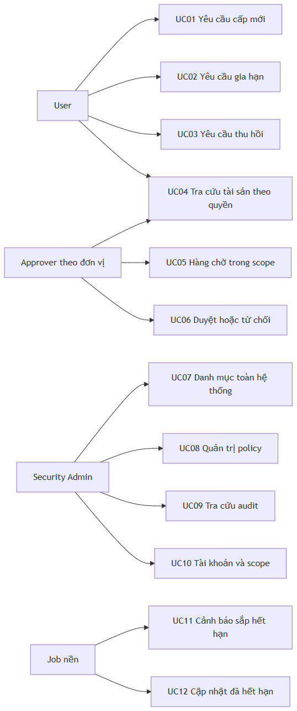
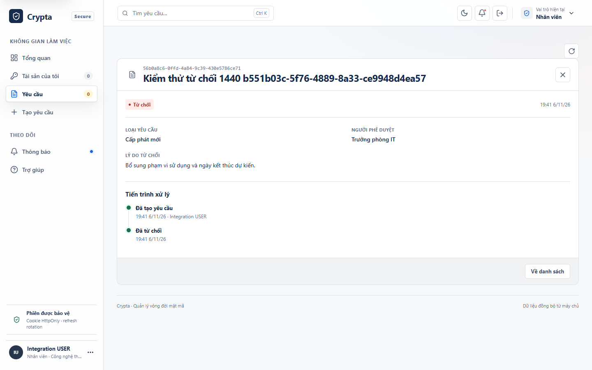

# Báo cáo đồ án Crypta

## 1 Bối cảnh và mục tiêu

Khóa mật mã và chứng thư có thời hạn sử dụng, chủ sở hữu và quy trình thay đổi riêng. Khi theo dõi bằng bảng tính và trao đổi thủ công, người vận hành khó xác định ai đã yêu cầu gia hạn, ai phê duyệt và thao tác nào thực sự được thực thi. Việc tự duyệt hoặc gửi lại một thao tác sau timeout cũng có thể làm sai quy trình hoặc tạo tài sản ngoài ý muốn.

Crypta giải quyết bài toán quản lý metadata và vòng đời tài sản bằng ứng dụng web có ba vai trò User, Approver và Security Admin. Mục tiêu là đưa yêu cầu qua quyết định có kiểm quyền, xử lý nền, cập nhật trạng thái và lưu dấu vết kiểm tra. Phiên bản đồ án chạy cục bộ với PostgreSQL và provider MOCK. Các adapter, kiểm SMTP và cấu hình triển khai được xây để giải thích ranh giới tích hợp và thử nghiệm cách ly.

Báo cáo mô tả mã nguồn trên nhánh `codex/crypta-release-candidate-20261107`. Bằng chứng ứng dụng được đối chiếu tại commit `54929c9e59e61799454c2039a78e5563ccd1d4a7`. Commit `7c7a45e` cập nhật ERD và demo theo schema 027. [Repo và PR](https://github.com/Eyblcat12/Cryta/pull/1) · [Phạm vi bàn giao](DO_AN.md).

## 2 Cơ sở lý thuyết

### Vòng đời khóa và chứng thư

Quản lý khóa bao gồm các quy tắc về mục đích sử dụng, bảo vệ, thời hạn và thay đổi trạng thái. NIST SP 800-57 Part 1 Rev. 5 cung cấp cơ sở tham khảo về quản lý vật liệu khóa và bảo vệ thông tin mật mã. Crypta chỉ triển khai lớp quản lý quy trình và metadata. Ứng dụng không tự viết thuật toán mật mã và không lưu private key của tài sản trong các bảng nghiệp vụ. [NIST SP 800-57](https://csrc.nist.gov/pubs/sp/800/57/pt1/r5/final).

Chứng thư X.509 gắn khóa công khai với thông tin định danh và các thuộc tính do bên phát hành ký. RFC 5280 mô tả profile chứng thư và danh sách thu hồi trong PKI. Trong đồ án, trường serial, issuer, fingerprint và thời hạn là metadata để theo dõi. Dữ liệu MOCK không chứng minh có chứng thư được CA công cộng tin cậy. [RFC 5280](https://www.rfc-editor.org/rfc/rfc5280).

### Phân quyền và tách nhiệm vụ

RBAC gắn quyền với vai trò. Crypta bổ sung scope đơn vị để Approver chỉ xem và quyết định trong phạm vi được giao. Tách nhiệm vụ SoD chặn người tạo tự duyệt và chặn Security Admin tham gia quyết định nghiệp vụ. Việc ẩn nút ở frontend chỉ hỗ trợ trải nghiệm. API kiểm lại vai trò, phạm vi, ownership, trạng thái và phiên bản ngay khi nhận lệnh.

### Tính nguyên tử và kết quả chưa xác định

Transaction PostgreSQL bảo vệ các thay đổi trong database. Transaction không thể hoàn tác một thao tác đã thành công ở provider hoặc SMTP bên ngoài. Vì vậy hệ thống cần sổ thao tác, mã định danh ổn định, biên nhận và trạng thái đối soát. Timeout phía trình duyệt cũng không chứng minh server chưa ghi. Giao diện giữ trạng thái chưa rõ và cho đọc lại dữ liệu trước khi người dùng xác nhận kết thúc theo dõi.

## 3 Yêu cầu và 12 use case

[Sơ đồ và nguồn Mermaid](USE_CASES.md) đi cùng đặc tả từng ca dưới đây.

| Mã | Người dùng chính | Chức năng | Kết quả quan sát |
| --- | --- | --- | --- |
| UC01 | User | Yêu cầu cấp mới, lưu nháp và gửi | Yêu cầu được duyệt tạo tài sản, có policy version và owner |
| UC02 | User và Approver | Gia hạn | Tài sản mới liên kết tài sản cũ, tài sản cũ chuyển Đã thay thế |
| UC03 | User và Approver | Thu hồi thường hoặc khẩn | Quyết định hợp lệ dẫn tới thu hồi và lưu lịch sử |
| UC04 | User và Approver | Tra tài sản theo quyền | Count, phân trang và chi tiết cùng phạm vi, link ngoài quyền bị chặn |
| UC05 | Approver | Hàng chờ theo đơn vị | Có tìm kiếm, phân trang và phân biệt yêu cầu khẩn |
| UC06 | Approver | Duyệt hoặc từ chối | Một quyết định hợp lệ cho mỗi cấp, lý do từ chối hiển thị với User |
| UC07 | Security Admin | Danh mục toàn hệ thống | Lọc và xem metadata, giữ nguyên ràng buộc quyền quyết định |
| UC08 | Security Admin | Quản trị policy | Phát hành phiên bản bất biến, lịch sử yêu cầu giữ phiên bản đã gắn |
| UC09 | Security Admin | Điều tra audit | Tìm theo actor, hành động, đối tượng, thời gian và correlation ID |
| UC10 | Security Admin | Tài khoản, vai trò, đơn vị và scope | Thay đổi được kiểm nguyên tử, thu hồi phiên khi cần |
| UC11 | Các vai trò có quyền | Cảnh báo sắp hết hạn | Chủ sở hữu, Approver đúng scope và Admin nhận thông báo |
| UC12 | Worker và người xem | Hết hạn tài sản | Chuyển trạng thái đúng mốc, không tạo lặp thông báo |

Các nhánh lỗi quan trọng gồm tự duyệt, duyệt chéo đơn vị, dữ liệu lỗi thời, quyết định đồng thời, mất kết nối sau khi server ghi, provider không rõ kết quả và thu hồi quyền trong lúc xử lý. [Kịch bản kiểm và ma trận bằng chứng](NGHIEM_THU_UAT.md).

Yêu cầu phi chức năng bao gồm truy vấn có phân trang phía server, kiểm đầu vào, phiên có thể thu hồi, audit đã lọc dữ liệu nhạy cảm, xử lý nền có phục hồi, giao diện mobile/light/dark và khả năng khởi động bằng Docker. Kiểm hiệu năng, sao lưu và nâng cấp được thực hiện trên stack cách ly, có giới hạn cấu hình được ghi trong từng báo cáo.

## 4 Kiến trúc và threat model

Trình duyệt chạy React và TypeScript. Nginx phục vụ frontend, thực hiện SPA fallback cho đường dẫn giao diện và proxy `/api/` tới NestJS. Backend tổ chức module theo auth, tài khoản, đơn vị, yêu cầu, tài sản, policy, audit, báo cáo và thông báo. PostgreSQL lưu dữ liệu và hàng đợi. Worker dùng cùng các quy tắc nghiệp vụ để thực thi yêu cầu đã được duyệt, gửi thông báo và quét hết hạn. [Sơ đồ đầy đủ](../02_so_do_he_thong_tong_quat.md).

Ba ranh giới tin cậy chính là trình duyệt–API, API–database và backend–dịch vụ ngoài. ID do trình duyệt gửi không quyết định ownership. Credential database runtime bị giới hạn riêng trong cấu hình production. Provider chỉ trả metadata và reference theo hợp đồng. OpenBao được nối qua một HTTP bridge, còn Keycloak là IdP cho luồng OIDC tùy chọn.

| Đe dọa | Biện pháp trong mã nguồn | Giới hạn cần lưu ý |
| --- | --- | --- |
| Đổi ID để đọc hoặc duyệt chéo đơn vị | Scope và ownership trong truy vấn, kiểm quyền lại khi ghi | Cần cấu hình scope đúng khi đưa vào tổ chức |
| Tự duyệt hoặc dùng Admin để duyệt | Kiểm SoD, creator và vai trò tại server | Việc cấp quyền Admin vẫn cần người quản trị đáng tin cậy |
| Gửi hai quyết định đồng thời | Khóa bản ghi, kiểm version, constraint từng cấp | Client nhận conflict phải đọc lại dữ liệu |
| Gửi lại provider sau crash | Ledger, lease, operation ID và đối soát | Không hứa exactly once khi provider không hỗ trợ hợp đồng tương ứng |
| Lộ token qua log hoặc artifact | Hash token phiên, redaction, allowlist CI và secret scan | Cấu hình secret bên ngoài do người vận hành quản lý |
| Người có quyền DB cao sửa audit | Trigger/quyền runtime và checkpoint Ed25519 | Khóa ký và checkpoint phải lưu độc lập để chống sửa bởi cùng một quản trị viên |
| Gửi lại email khi SMTP đã nhận nhưng mất phản hồi | Trạng thái chưa rõ, Message-ID và quy trình đối soát | Phải có chứng cứ SMTP trước khi lên lịch gửi lại |

## 5 Dữ liệu và trạng thái

Catalog schema `027_email_worker_status` được đọc trực tiếp từ PostgreSQL 17 trên stack mới. Schema hiện hành có **28 bảng, 234 cột và 40 khóa ngoại**. Snapshot công khai chỉ chứa metadata cấu trúc. [Catalog](evidence/schema-027.json) · [ERD](ERD_HIEN_HANH.md) · [draw.io](../erd_QuanLyKhoa_HTTT.drawio).

Các bảng `users`, `roles`, `user_roles`, `departments` và `approver_scopes` xác định danh tính và phạm vi. `policies` và `policy_versions` tách policy khỏi phiên bản bất biến. `requests` lưu yêu cầu, version, tham số và tài sản liên quan. `request_decisions` lưu từng cấp quyết định. `crypto_assets`, `cryptographic_keys` và `certificates` tách metadata chung và metadata theo loại. `provider_operations` theo dõi tác động bên ngoài. `notifications`, `expiry_scan_status` và `email_worker_status` hỗ trợ xử lý nền và quan sát. Các bảng còn lại quản lý phiên, MFA/OIDC, hành động tài khoản, báo cáo và audit.

Yêu cầu có các trạng thái `DRAFT`, `PENDING`, `APPROVED`, `REJECTED`, `PROCESSING`, `COMPLETED`, `FAILED`, `CANCELLED` và `RECONCILIATION_REQUIRED`. Nháp thuộc người tạo. Quyết định cấp một của policy hai cấp giữ yêu cầu ở `PENDING`. Chỉ sau đủ cấp hợp lệ mới chuyển sang `APPROVED`. Worker claim yêu cầu và chuyển sang `PROCESSING`, rồi hoàn tất hoặc ghi lỗi theo kết quả đã biết. Mất bằng chứng kết quả của dịch vụ ngoài dẫn tới đối soát. [Luồng và state machine](../01_luong_hoat_dong_he_thong.md).

Gia hạn tạo tài sản kế tiếp và liên kết tài sản cũ. Thu hồi và hết hạn là các sự kiện khác nhau. Policy version của lịch sử được giữ để thay đổi policy hiện tại không làm sai nội dung yêu cầu đã gửi. Các ràng buộc trạng thái nằm đồng thời ở service và constraint/trigger database theo migration.

## 6 Thiết kế API và giao diện

Các endpoint nghiệp vụ có prefix `/api/v1`. Controller nhận DTO, pipe kiểm ID và guard phiên trước khi gọi service. Danh sách áp scope trước count và pagination. Đường dẫn chi tiết kiểm quyền độc lập để tránh truy cập bằng link trực tiếp.

| Method và đường dẫn | Mục đích |
| --- | --- |
| `GET /requests` | Danh sách theo owner hoặc scope được cấp |
| `GET /requests/:id` | Chi tiết yêu cầu trong quyền xem |
| `POST /requests` | Tạo yêu cầu cấp mới, gia hạn hoặc thu hồi |
| `PUT /requests/drafts/:id` | Lưu hoặc sửa nháp của người tạo |
| `POST /requests/:id/submit` | Gửi nháp với version hiện tại |
| `POST /requests/:id/decision` | Quyết định sau kiểm SoD, scope và version |
| `POST /requests/:id/cancel` | Người tạo hủy nháp hoặc yêu cầu còn được phép hủy |

Swagger được sinh từ controller/DTO. Workflow kiểm OpenAPI để phát hiện sai lệch hợp đồng. Các ví dụ trên được đối chiếu với `backend/src/requests/requests.controller.ts`. [Hợp đồng OpenAPI xuất từ build hiện hành](openapi.json) · [Hướng dẫn API](HUONG_DAN_CRYPTA.md).

Giao diện dùng điều hướng phía client. Sidebar giữ nguyên khi chuyển trang, URL chứa bộ lọc và trang để hỗ trợ Back, Forward và tải lại. Màn hình có loading, empty, lỗi và retry. Refresh cùng ngữ cảnh có thể giữ snapshot cũ nhưng phải ghi rõ, khóa lệnh ghi trong lúc chưa chắc dữ liệu. Chuyển query hoặc mất quyền loại bỏ snapshot ngoài ngữ cảnh.

*Hình 1. Chi tiết yêu cầu của User trong lượt kiểm UAT-01. Đây là ảnh bằng chứng của lượt sửa tương ứng, không phải ảnh khẳng định mọi lượt CI có cùng dữ liệu.*

Các lệnh nhạy cảm có xác nhận, lý do hoặc kiểm lại mật khẩu/MFA theo luồng. Khi mất phản hồi sau lệnh ghi, UI giữ theo dõi kết quả chưa rõ. **Kiểm tra dữ liệu** chỉ đọc. Kết thúc theo dõi cần xác nhận và không tự gửi lại. Theo dõi trong bộ nhớ mất khi đóng hoặc reload tab, vì vậy lịch sử server là nguồn đối chiếu chính.

## 7 Chi tiết triển khai

### Auth và quản trị

Backend dùng JWT access token và vòng đời refresh có rotation. Phiên refresh được hash. Logout và thay đổi quyền hoặc trạng thái thu hồi phiên theo quy tắc. Chức năng bảo vệ Admin cuối tránh vô hiệu hóa quản trị hợp lệ còn lại. Thay đổi đơn vị kiểm phạm vi, thu hồi phiên và giữ lịch sử. Mời tài khoản và reset mật khẩu dùng liên kết một lần có thời hạn khi bật email tài khoản.

### Yêu cầu và quyết định

DTO kiểm loại thao tác, policy và tham số. Service kiểm quyền trên dữ liệu đang khóa thay vì tin vào lần đọc trước đó. Version giúp phát hiện xung đột. Ghi quyết định, audit và thông báo liên quan được đặt trong transaction. Từ chối kết thúc tiến trình duyệt và không đưa yêu cầu sang worker. Chi tiết đọc lại người quyết định, thời gian và lý do.

### Worker và provider

Worker claim công việc trong database và dùng lease để nhận biết tiến trình đang xử lý. Sổ thao tác được ghi quanh lần gọi provider. API HTTP mang operation ID và khóa idempotency. Biên nhận đã có có thể dùng phục hồi ghi nhận DB. Khi chưa xác định provider đã thực thi hay chưa, hệ thống chờ đối soát. Admin ghi chứng cứ và lý do trước thao tác phục hồi. Hệ thống không dùng timeout như bằng chứng đủ để cấp lại.

### Hết hạn và email

Quét hết hạn dùng policy version và mốc thời gian của tài sản. Bộ quét xác định người nhận có quyền, dedup theo người/kênh và lưu kết quả. Email được đưa vào hàng đợi thay vì gửi đồng bộ trong transaction nghiệp vụ. Worker SMTP kiểm lại người nhận và điều kiện trước khi gửi. Mất phản hồi sau khi gửi chuyển sang đối soát. Chức năng lên lịch gửi lại yêu cầu chứng cứ thư chưa được SMTP chấp nhận, chờ ít nhất hai phút và giữ giới hạn năm lượt.

### Chức năng nâng cao

X01 triển khai TOTP sáu số, mười mã khôi phục dùng một lần và xác nhận lại trước thay đổi. TOTP là cơ chế OTP dựa trên thời gian, có cơ sở tham khảo RFC 6238. X02 dùng hai Approver khác nhau trong cùng scope, thời hạn theo policy version với mặc định 48 giờ. X03 tích hợp OIDC với Keycloak cách ly, liên kết issuer/subject, nối MFA và giữ tài khoản local được phép. [RFC 6238](https://www.rfc-editor.org/rfc/rfc6238) · [X01](MFA_X01.md) · [X02](X02_TWO_STAGE_APPROVAL.md) · [X03](X03_OIDC.md).

X04 xuất CSV/PDF theo bộ lọc và quyền hiện tại, kiểm lại khi xử lý và tải. Giới hạn là 10.000 dòng CSV hoặc 1.000 dòng PDF, thời gian tải một giờ. Nội dung tệp nằm trong `report_exports.content` và được dọn khi hết hạn. X05 ký checkpoint Ed25519, xác minh thay đổi chuỗi audit và hỗ trợ xoay khóa. X06 là bridge HTTP sang OpenBao Transit cho khóa ký RSA/ECDSA đã kiểm sandbox. [X04](X04_REPORT_EXPORTS.md) · [X05](X05_AUDIT_ANCHOR.md) · [X06](X06_OPENBAO_TRANSIT.md).

## 8 Cơ chế bảo mật

Ràng buộc quyền được áp dụng tại API và truy vấn DB. Kiểm quản trị và quyết định nghiệp vụ tách nhau. Các yêu cầu nhạy cảm dùng version, khóa bản ghi và constraint để chống ghi đè dữ liệu lỗi thời. Cấu hình production tách credential migration và runtime. Startup từ chối schema thiếu hoặc không biết migration thay vì chạy trên cấu trúc không khớp.

Audit có mã truy vết và dữ liệu thay đổi đã lọc. Đường ghi lỗi sau rollback dùng cơ chế riêng để giữ sự kiện thất bại. Log và artifact CI có kiểm dữ liệu nhạy cảm. Secret scan chạy trên revision được checkout. Quét dependency và image là các lớp kiểm bổ sung, không phải chứng nhận không có mọi lỗ hổng.

Private key của tài sản không đi vào frontend hoặc metadata DB. Các bí mật hạ tầng và MFA là loại dữ liệu khác, phải quản lý bằng cấu hình bảo vệ tương ứng. Môi trường demo dùng dữ liệu và tài khoản mẫu. Không mang tài khoản mẫu hoặc `.env` vào môi trường xử lý dữ liệu thật.

## 9 Kiểm thử và kết quả

Hai lượt GitHub Actions của commit `54929c9` gồm push `43016090235` và PR `43016096992` đều đạt năm job. Đã tải ba ZIP của mỗi lượt, kiểm SHA-256 theo digest GitHub, rồi đọc báo cáo bên trong. Manifest của PR mang synthetic merge revision `1b9652bb63b0b11d48f06912a9ddfe8849691ea1`. Điều này được phân biệt với head revision của nhánh.

| Bộ bằng chứng đã đọc ở mỗi lượt | Kết quả | Phạm vi chứng minh |
| --- | --- | --- |
| Nháp và mất phản hồi | 18/18 | UI thật, PostgreSQL, desktop sáng và mobile tối, không gửi lặp sau đối chiếu |
| Chromium qua Nginx/API/PostgreSQL | 66/66 | Các kịch bản nghiệp vụ, trạng thái, quyền và phục hồi trong bộ tích hợp |
| Chromium với API fixture | 197/197 | Điều hướng, giao diện, bàn phím và trạng thái mô phỏng, không thay test DB |
| Image security | Hai image, 0 High/Critical | Đúng image ID trong manifest, scanner và database tại lượt chạy |
| Cleanup | Đạt | Stack test được dọn, danh tính container bên ngoài được giữ |

[CI push](https://github.com/Eyblcat12/Cryta/actions/runs/43016090235) · [CI PR](https://github.com/Eyblcat12/Cryta/actions/runs/43016096992) · [Bản ghi đối chiếu](evidence/ci-54929c9.json).

Ca mất phản hồi cố tình cho server hoàn tất ghi và cắt phản hồi trước khi client nhận. Bộ kiểm đọc DB trước và sau bước kiểm tra dữ liệu, đối chiếu request/version/audit/notification/provider, xác nhận một POST và không phát sinh tác động lặp. Đây là kiểm transaction thật, khác với việc chỉ mock lỗi mạng trên frontend.

Các lượt diễn tập riêng đã kiểm backup/restore, nâng cấp, quyền runtime, lỗi worker/provider/SMTP, tick quét theo giờ và proxy khi backend đổi IP. Số đo tải dùng fixture 50.000 tài sản, 40.000 yêu cầu và 250.000 audit. Hai lượt tại mức 16 request đồng thời đạt 11/11 nhóm, mức 32 có kết quả khác nhau theo lượt. Không dùng các số này để cam kết công suất của máy khác. [Báo cáo tải](../T50_CAPACITY_2026-11-06.md) · [Lịch sử CI](CI_REMOTE_2026-11-07.md).

Schema được kiểm trực tiếp có 28 bảng/234 cột/40 FK, bộ sinh ERD cho kết quả lặp lại giống nhau và giữ trang draw.io ban đầu. Cả 20 sơ đồ Mermaid render đạt. Video 57,04 giây có 12 chương, đã kiểm từng khung và phát đến cuối. [Manifest video](media/crypta-demo-manifest.json).

Chưa công bố phần trăm coverage toàn dự án. Các số trên là số ca hoặc nhóm kiểm đã chạy. NVDA chưa xác nhận đủ hai hành vi đọc thành tiếng của menu mobile. Kiểm tự động chưa thay biên bản chạy thử của người tiếp nhận hoặc giảng viên.

## 10 Triển khai và trình diễn

Máy Windows cần Docker engine đang hoạt động. Chạy `start-crypta.cmd` để tạo cấu hình local, dựng image và chờ readiness, rồi mở `http://localhost:8080`. Dừng bằng `stop-crypta.cmd` để giữ database. Launcher hỗ trợ chẩn đoán và đổi cổng theo README. Mật khẩu database và JWT secret được tạo ngẫu nhiên khi chưa có `.env`. [Khởi động và tài khoản mẫu](../README.md).

Buổi demo bắt đầu bằng User gửi yêu cầu cấp mới. Approver ở đúng đơn vị duyệt. User mở tài sản mới, gửi gia hạn rồi thu hồi. Một yêu cầu khác bị từ chối để kiểm lịch sử. Admin xem policy, scope và Audit Log. Phần hết hạn dùng dữ liệu giả sát mốc và gọi bộ quét chủ động để không chờ một giờ trong lớp. Video dự phòng ghi rõ cách chuẩn bị này.

[Slide](media/crypta-bao-ve.pptx) đi cùng [ghi chú thuyết trình](THUYET_TRINH.md). [Video dự phòng](media/crypta-demo.webm) và [12 mốc demo](DEMO_VA_BAN_GIAO.md) giúp tiếp tục trình bày khi Docker hoặc mạng có sự cố. Trước buổi bảo vệ, nhóm cần tự chạy toàn bài hai lần và bổ sung thông tin trường, môn học, thành viên, giảng viên theo quy định. Không có thông tin cá nhân nào được tự điền thay người nộp.

## 11 Kết quả và hướng phát triển

Đồ án đã xây dựng luồng quản lý vòng đời qua ba vai trò, metadata tài sản, policy phiên bản, xử lý nền, audit và thông báo. Các chức năng nâng cao MFA, duyệt hai cấp, OIDC, báo cáo, checkpoint audit và adapter OpenBao có mã nguồn cùng bằng chứng kiểm cách ly. Bộ bàn giao có hướng dẫn, ERD hiện hành, demo dự phòng và CI trên GitHub.

Phạm vi chạy lớp học dùng provider MOCK và SMTP tắt mặc định. Việc kết nối CA/KMS và hộp thư Internet thật, kiểm trên staging của tổ chức, chốt người trực và ký nghiệm thu production là bước tiếp theo khi có môi trường. Cần hoàn tất kiểm trình đọc màn hình, đánh giá tải trên cấu hình đích và quản lý khóa checkpoint độc lập trước các tuyên bố vận hành tương ứng. [Cổng vận hành gốc](CONG_NGHIEM_THU_RELEASE.md) giữ nguyên để tránh lẫn bản đồ án với hệ thống dùng tài sản thật.

## Tài liệu tham khảo và nguồn đối chiếu

1. Elaine Barker. NIST SP 800-57 Part 1 Rev. 5. Recommendation for Key Management. 2020. https://csrc.nist.gov/pubs/sp/800/57/pt1/r5/final
2. D. Cooper và cộng sự. RFC 5280. Internet X.509 Public Key Infrastructure Certificate and CRL Profile. 2008. https://www.rfc-editor.org/rfc/rfc5280
3. D. M'Raihi và cộng sự. RFC 6238. TOTP Time-Based One-Time Password Algorithm. 2011. https://www.rfc-editor.org/rfc/rfc6238
4. [Mã nguồn và PR bàn giao](https://github.com/Eyblcat12/Cryta/pull/1), [catalog schema 027](evidence/schema-027.json), [CI đã đối chiếu](evidence/ci-54929c9.json).
5. [Kịch bản UAT](NGHIEM_THU_UAT.md), [kiến trúc](../02_so_do_he_thong_tong_quat.md), [state machine](../01_luong_hoat_dong_he_thong.md), [runbook](../RELEASE_RUNBOOK.md).
