# ERD hiện hành của Crypta

Schema sau migration `027_email_worker_status`, đối chiếu từ PostgreSQL 17 trên stack cách ly. Có 28 bảng, 234 cột và 40 khóa ngoại. Trang đầu của tệp draw.io chứa schema hiện hành. Trang thiết kế ban đầu được giữ để tra lịch sử. [ERD chỉnh sửa được](../erd_QuanLyKhoa_HTTT.drawio) · [Kiến trúc](../02_so_do_he_thong_tong_quat.md)

`PK` là cột khóa chính, `FK` là cột khóa ngoại. `nullable` cho biết cột cho phép NULL. Các điều kiện trạng thái và tính bất biến nằm trong constraint, trigger và service. Yêu cầu nháp có thể thiếu policy và tài sản đích.

```mermaid
erDiagram
    DEPARTMENTS {
        uuid id PK
        character_varying_50_ code
        character_varying_255_ name
        boolean is_active
        timestamp_with_time_zone created_at
        timestamp_with_time_zone updated_at
        integer version
    }
    ROLES {
        uuid id PK
        character_varying_50_ code
        character_varying_255_ name
        timestamp_with_time_zone created_at
    }
    USERS {
        uuid id PK
        uuid department_id FK
        character_varying_255_ email
        character_varying_255_ password_hash
        character_varying_255_ display_name
        character_varying_30_ status
        integer token_version
        integer failed_login_attempts
        timestamp_with_time_zone locked_until
        boolean must_change_password
        timestamp_with_time_zone last_login_at
        timestamp_with_time_zone created_at
        timestamp_with_time_zone updated_at
        boolean invitation_pending
    }
    USER_ROLES {
        uuid user_id PK,FK
        uuid role_id PK,FK
        uuid assigned_by FK
        timestamp_with_time_zone assigned_at
    }
    APPROVER_SCOPES {
        uuid user_id PK,FK
        uuid department_id PK,FK
        uuid assigned_by FK
        timestamp_with_time_zone assigned_at
    }
    AUTH_SESSIONS {
        uuid id PK
        uuid user_id FK
        character_64_ token_hash
        character_varying_500_ user_agent
        inet ip_address
        timestamp_with_time_zone expires_at
        timestamp_with_time_zone last_used_at
        timestamp_with_time_zone revoked_at
        uuid replaced_by FK
        timestamp_with_time_zone created_at
        integer mfa_token_version
        uuid oidc_session_id FK
    }
    ACCOUNT_ACTIONS {
        uuid id PK
        uuid user_id FK
        character_varying_30_ purpose
        character_64_ token_hash
        integer token_version
        timestamp_with_time_zone created_at
        timestamp_with_time_zone expires_at
        timestamp_with_time_zone used_at
        timestamp_with_time_zone revoked_at
    }
    ACCOUNT_ACTION_LIMITS {
        character_varying_80_ bucket_key PK
        integer attempt_count
        timestamp_with_time_zone expires_at
    }
    AUTH_MFA {
        uuid user_id PK,FK
        uuid credential_id
        text sealed_secret
        bigint last_step
        text__ recovery_hashes
        integer failed_attempts
        timestamp_with_time_zone locked_until
    }
    AUTH_MFA_CHALLENGES {
        uuid user_id PK,FK
        character_64_ token_hash
        integer token_version
        text purpose
        timestamp_with_time_zone expires_at
        uuid pending_id
        text pending_secret
        bigint pending_step
        text__ pending_hashes
        uuid oidc_session_id FK
    }
    AUTH_OIDC_LINKS {
        uuid user_id PK,FK
        character_varying_2048_ issuer
        character_varying_255_ subject
        timestamp_with_time_zone linked_at
        timestamp_with_time_zone revoked_at
    }
    AUTH_OIDC_FLOWS {
        character_64_ ticket_hash PK
        character_64_ browser_hash
        text phase
        text sealed_payload
        timestamp_with_time_zone expires_at
    }
    AUTH_OIDC_SESSIONS {
        uuid id PK
        uuid user_id FK
        character_varying_2048_ issuer
        character_varying_255_ subject
        character_varying_255_ sid
        text sealed_tokens
        timestamp_with_time_zone access_expires_at
        timestamp_with_time_zone authenticated_at
        timestamp_with_time_zone expires_at
        timestamp_with_time_zone revoked_at
    }
    AUTH_OIDC_REVOCATIONS {
        character_varying_2048_ issuer PK
        character_varying_255_ sid PK
        timestamp_with_time_zone revoked_at
    }
    REPORT_EXPORTS {
        uuid id PK
        uuid request_key
        uuid requester_id FK
        integer token_version
        text dataset
        text format
        jsonb filters
        jsonb scope
        text state
        timestamp_with_time_zone created_at
        timestamp_with_time_zone finished_at
        timestamp_with_time_zone expires_at
        timestamp_with_time_zone lease_until
        uuid claim_token
        smallint attempts
        integer row_count
        text failure_code
        bytea content
    }
    POLICIES {
        uuid id PK
        character_varying_50_ code
        character_varying_255_ name
        boolean is_active
        timestamp_with_time_zone created_at
        timestamp_with_time_zone updated_at
    }
    POLICY_VERSIONS {
        uuid id PK
        uuid policy_id FK
        integer version
        jsonb configuration
        uuid changed_by FK
        timestamp_with_time_zone effective_from
        timestamp_with_time_zone created_at
    }
    CRYPTO_ASSETS {
        uuid id PK
        character_varying_100_ asset_code
        character_varying_30_ asset_type
        uuid owner_id FK
        uuid department_id FK
        uuid policy_version_id FK
        character_varying_255_ purpose
        character_varying_30_ status
        timestamp_with_time_zone valid_from
        timestamp_with_time_zone expires_at
        uuid replaces_asset_id FK
        character_varying_255_ provider_reference
        integer version
        timestamp_with_time_zone created_at
        timestamp_with_time_zone updated_at
        character_varying_64_ provider_scope
    }
    CRYPTOGRAPHIC_KEYS {
        uuid asset_id PK,FK
        character_varying_50_ algorithm
        integer key_size
        character_varying_100_ usage
        character_varying_255_ public_key_fingerprint
    }
    CERTIFICATES {
        uuid asset_id PK,FK
        character_varying_100_ serial_number
        character_varying_500_ subject_dn
        character_varying_500_ issuer_dn
        character_varying_255_ fingerprint
        uuid public_key_asset_id FK
    }
    REQUESTS {
        uuid id PK
        character_varying_30_ request_type
        uuid creator_id FK
        uuid department_id FK
        uuid policy_version_id FK
        uuid target_asset_id FK
        uuid result_asset_id FK
        character_varying_30_ status
        text reason
        boolean emergency
        jsonb requested_parameters
        integer version
        timestamp_with_time_zone submitted_at
        timestamp_with_time_zone completed_at
        timestamp_with_time_zone updated_at
        text cancellation_reason
    }
    REQUEST_DECISIONS {
        uuid id PK
        uuid request_id FK
        uuid approver_id FK
        character_varying_30_ decision
        text comment
        timestamp_with_time_zone decided_at
        smallint approval_level
    }
    PROVIDER_OPERATIONS {
        uuid request_id PK,FK
        character_varying_30_ operation_type
        character_varying_30_ status
        integer attempt_count
        character_varying_255_ provider_reference
        character_varying_100_ last_error_code
        timestamp_with_time_zone created_at
        timestamp_with_time_zone updated_at
        integer claim_version
        integer retry_count
        timestamp_with_time_zone retry_after
        character_varying_30_ failure_class
        timestamp_with_time_zone sent_at
        timestamp_with_time_zone receipt_at
        character_64_ input_digest
        jsonb receipt
    }
    AUDIT_LOGS {
        bigint id PK
        uuid actor_id FK
        character_varying_30_ actor_type
        character_varying_100_ action
        character_varying_50_ entity_type
        character_varying_100_ entity_id
        character_varying_30_ outcome
        uuid request_id FK
        inet ip_address
        jsonb metadata
        timestamp_with_time_zone occurred_at
    }
    NOTIFICATIONS {
        uuid id PK
        uuid recipient_id FK
        uuid asset_id FK
        uuid request_id FK
        character_varying_50_ type FK
        character_varying_30_ channel
        character_varying_30_ delivery_status
        character_varying_255_ deduplication_key
        integer attempt_count
        timestamp_with_time_zone scheduled_for
        timestamp_with_time_zone claimed_at
        timestamp_with_time_zone created_at
        timestamp_with_time_zone sent_at
        timestamp_with_time_zone failed_at
        timestamp_with_time_zone read_at
        text error_message
        uuid account_action_id FK
    }
    SCHEMA_MIGRATIONS {
        character_varying_100_ version PK
        timestamp_with_time_zone applied_at
        character_64_ checksum
    }
    EXPIRY_SCAN_STATUS {
        boolean singleton PK
        timestamp_with_time_zone initialized_at
        timestamp_with_time_zone last_attempt_at
        timestamp_with_time_zone last_success_at
        boolean last_failed
    }
    EMAIL_WORKER_STATUS {
        boolean singleton PK
        timestamp_with_time_zone initialized_at
        timestamp_with_time_zone last_poll_at
        boolean last_poll_succeeded
    }
    USERS ||--o{ ACCOUNT_ACTIONS : user_id
    USERS o|--o{ APPROVER_SCOPES : assigned_by
    DEPARTMENTS ||--o{ APPROVER_SCOPES : department_id
    USERS ||--o{ APPROVER_SCOPES : user_id
    USERS o|--o{ AUDIT_LOGS : actor_id
    REQUESTS o|--o{ AUDIT_LOGS : request_id
    USERS ||--o| AUTH_MFA : user_id
    AUTH_OIDC_SESSIONS o|--o{ AUTH_MFA_CHALLENGES : oidc_session_id_user_id
    USERS ||--o| AUTH_MFA_CHALLENGES : user_id
    USERS ||--o| AUTH_OIDC_LINKS : user_id
    AUTH_OIDC_LINKS ||--o{ AUTH_OIDC_SESSIONS : user_id
    AUTH_OIDC_SESSIONS o|--o{ AUTH_SESSIONS : oidc_session_id_user_id
    AUTH_SESSIONS o|--o{ AUTH_SESSIONS : replaced_by
    USERS ||--o{ AUTH_SESSIONS : user_id
    CRYPTO_ASSETS ||--o| CERTIFICATES : asset_id
    CRYPTO_ASSETS o|--o{ CERTIFICATES : public_key_asset_id
    DEPARTMENTS ||--o{ CRYPTO_ASSETS : department_id
    USERS ||--o{ CRYPTO_ASSETS : owner_id
    POLICY_VERSIONS ||--o{ CRYPTO_ASSETS : policy_version_id
    CRYPTO_ASSETS o|--o{ CRYPTO_ASSETS : replaces_asset_id
    CRYPTO_ASSETS ||--o| CRYPTOGRAPHIC_KEYS : asset_id
    ACCOUNT_ACTIONS o|--o{ NOTIFICATIONS : account_action_id_recipient_id_type
    CRYPTO_ASSETS o|--o{ NOTIFICATIONS : asset_id
    USERS ||--o{ NOTIFICATIONS : recipient_id
    REQUESTS o|--o{ NOTIFICATIONS : request_id
    USERS o|--o{ POLICY_VERSIONS : changed_by
    POLICIES ||--o{ POLICY_VERSIONS : policy_id
    REQUESTS ||--o| PROVIDER_OPERATIONS : request_id
    USERS ||--o{ REPORT_EXPORTS : requester_id
    USERS ||--o{ REQUEST_DECISIONS : approver_id
    REQUESTS ||--o{ REQUEST_DECISIONS : request_id
    USERS ||--o{ REQUESTS : creator_id
    DEPARTMENTS ||--o{ REQUESTS : department_id
    POLICY_VERSIONS o|--o{ REQUESTS : policy_version_id
    CRYPTO_ASSETS o|--o{ REQUESTS : result_asset_id
    CRYPTO_ASSETS o|--o{ REQUESTS : target_asset_id
    USERS o|--o{ USER_ROLES : assigned_by
    ROLES ||--o{ USER_ROLES : role_id
    USERS ||--o{ USER_ROLES : user_id
    DEPARTMENTS ||--o{ USERS : department_id
```



Các kiểu dữ liệu SQL đầy đủ và constraint được liệt kê theo bảng bên dưới.

## departments

| Cột | Kiểu PostgreSQL | Ràng buộc cột |
| --- | --- | --- |
| `id` | `uuid` | PK, NOT NULL |
| `code` | `character varying(50)` | NOT NULL |
| `name` | `character varying(255)` | NOT NULL |
| `is_active` | `boolean` | NOT NULL |
| `created_at` | `timestamp with time zone` | NOT NULL |
| `updated_at` | `timestamp with time zone` | NOT NULL |
| `version` | `integer` | NOT NULL |

```sql
CHECK ((btrim((code)::text) <> ''::text))
CHECK ((btrim((name)::text) <> ''::text))
CHECK ((version > 0))
UNIQUE (code)
PRIMARY KEY (id)
```

## roles

| Cột | Kiểu PostgreSQL | Ràng buộc cột |
| --- | --- | --- |
| `id` | `uuid` | PK, NOT NULL |
| `code` | `character varying(50)` | NOT NULL |
| `name` | `character varying(255)` | NOT NULL |
| `created_at` | `timestamp with time zone` | NOT NULL |

```sql
CHECK (((code)::text = ANY ((ARRAY['USER'::character varying, 'APPROVER'::character varying, 'ADMIN'::character varying])::text[])))
CHECK ((btrim((name)::text) <> ''::text))
UNIQUE (code)
PRIMARY KEY (id)
```

## users

| Cột | Kiểu PostgreSQL | Ràng buộc cột |
| --- | --- | --- |
| `id` | `uuid` | PK, NOT NULL |
| `department_id` | `uuid` | FK, NOT NULL |
| `email` | `character varying(255)` | NOT NULL |
| `password_hash` | `character varying(255)` | NOT NULL |
| `display_name` | `character varying(255)` | NOT NULL |
| `status` | `character varying(30)` | NOT NULL |
| `token_version` | `integer` | NOT NULL |
| `failed_login_attempts` | `integer` | NOT NULL |
| `locked_until` | `timestamp with time zone` | NULL được phép |
| `must_change_password` | `boolean` | NOT NULL |
| `last_login_at` | `timestamp with time zone` | NULL được phép |
| `created_at` | `timestamp with time zone` | NOT NULL |
| `updated_at` | `timestamp with time zone` | NOT NULL |
| `invitation_pending` | `boolean` | NOT NULL |

```sql
CHECK ((btrim((email)::text) <> ''::text))
CHECK ((failed_login_attempts >= 0))
CHECK ((btrim((display_name)::text) <> ''::text))
CHECK (((NOT invitation_pending) OR (must_change_password AND ((status)::text = ANY ((ARRAY['INACTIVE'::character varying, 'LOCKED'::character varying])::text[])))))
CHECK (((status)::text = ANY ((ARRAY['ACTIVE'::character varying, 'INACTIVE'::character varying, 'LOCKED'::character varying])::text[])))
CHECK ((token_version > 0))
FOREIGN KEY (department_id) REFERENCES departments(id) ON DELETE RESTRICT
PRIMARY KEY (id)
```

## user_roles

| Cột | Kiểu PostgreSQL | Ràng buộc cột |
| --- | --- | --- |
| `user_id` | `uuid` | PK, FK, NOT NULL |
| `role_id` | `uuid` | PK, FK, NOT NULL |
| `assigned_by` | `uuid` | FK |
| `assigned_at` | `timestamp with time zone` | NOT NULL |

```sql
FOREIGN KEY (assigned_by) REFERENCES users(id) ON DELETE SET NULL
PRIMARY KEY (user_id, role_id)
FOREIGN KEY (role_id) REFERENCES roles(id) ON DELETE RESTRICT
FOREIGN KEY (user_id) REFERENCES users(id) ON DELETE CASCADE
```

## approver_scopes

| Cột | Kiểu PostgreSQL | Ràng buộc cột |
| --- | --- | --- |
| `user_id` | `uuid` | PK, FK, NOT NULL |
| `department_id` | `uuid` | PK, FK, NOT NULL |
| `assigned_by` | `uuid` | FK |
| `assigned_at` | `timestamp with time zone` | NOT NULL |

```sql
FOREIGN KEY (assigned_by) REFERENCES users(id) ON DELETE SET NULL
FOREIGN KEY (department_id) REFERENCES departments(id) ON DELETE CASCADE
PRIMARY KEY (user_id, department_id)
FOREIGN KEY (user_id) REFERENCES users(id) ON DELETE CASCADE
```

## auth_sessions

| Cột | Kiểu PostgreSQL | Ràng buộc cột |
| --- | --- | --- |
| `id` | `uuid` | PK, NOT NULL |
| `user_id` | `uuid` | FK, NOT NULL |
| `token_hash` | `character(64)` | NOT NULL |
| `user_agent` | `character varying(500)` | NULL được phép |
| `ip_address` | `inet` | NULL được phép |
| `expires_at` | `timestamp with time zone` | NOT NULL |
| `last_used_at` | `timestamp with time zone` | NULL được phép |
| `revoked_at` | `timestamp with time zone` | NULL được phép |
| `replaced_by` | `uuid` | FK |
| `created_at` | `timestamp with time zone` | NOT NULL |
| `mfa_token_version` | `integer` | NULL được phép |
| `oidc_session_id` | `uuid` | FK |

```sql
CHECK ((mfa_token_version > 0))
FOREIGN KEY (oidc_session_id, user_id) REFERENCES auth_oidc_sessions(id, user_id) ON DELETE RESTRICT
PRIMARY KEY (id)
FOREIGN KEY (replaced_by) REFERENCES auth_sessions(id) ON DELETE SET NULL
UNIQUE (token_hash)
FOREIGN KEY (user_id) REFERENCES users(id) ON DELETE CASCADE
CHECK ((expires_at > created_at))
```

## account_actions

| Cột | Kiểu PostgreSQL | Ràng buộc cột |
| --- | --- | --- |
| `id` | `uuid` | PK, NOT NULL |
| `user_id` | `uuid` | FK, NOT NULL |
| `purpose` | `character varying(30)` | NOT NULL |
| `token_hash` | `character(64)` | NOT NULL |
| `token_version` | `integer` | NOT NULL |
| `created_at` | `timestamp with time zone` | NOT NULL |
| `expires_at` | `timestamp with time zone` | NOT NULL |
| `used_at` | `timestamp with time zone` | NULL được phép |
| `revoked_at` | `timestamp with time zone` | NULL được phép |

```sql
CHECK ((expires_at > created_at))
UNIQUE (id, user_id, purpose)
PRIMARY KEY (id)
CHECK (((purpose)::text = ANY ((ARRAY['INVITATION'::character varying, 'PASSWORD_RESET'::character varying])::text[])))
CHECK ((token_hash ~ '^[a-f0-9]{64}$'::text))
UNIQUE (token_hash)
CHECK ((token_version > 0))
FOREIGN KEY (user_id) REFERENCES users(id) ON DELETE RESTRICT
```

## account_action_limits

| Cột | Kiểu PostgreSQL | Ràng buộc cột |
| --- | --- | --- |
| `bucket_key` | `character varying(80)` | PK, NOT NULL |
| `attempt_count` | `integer` | NOT NULL |
| `expires_at` | `timestamp with time zone` | NOT NULL |

```sql
CHECK ((attempt_count > 0))
PRIMARY KEY (bucket_key)
```

## auth_mfa

| Cột | Kiểu PostgreSQL | Ràng buộc cột |
| --- | --- | --- |
| `user_id` | `uuid` | PK, FK, NOT NULL |
| `credential_id` | `uuid` | NULL được phép |
| `sealed_secret` | `text` | NULL được phép |
| `last_step` | `bigint` | NULL được phép |
| `recovery_hashes` | `text[]` | NOT NULL |
| `failed_attempts` | `integer` | NOT NULL |
| `locked_until` | `timestamp with time zone` | NULL được phép |

```sql
UNIQUE (credential_id)
PRIMARY KEY (user_id)
FOREIGN KEY (user_id) REFERENCES users(id) ON DELETE CASCADE
CHECK ((((credential_id IS NULL) AND (sealed_secret IS NULL) AND (last_step IS NULL) AND (cardinality(recovery_hashes) = 0)) OR ((credential_id IS NOT NULL) AND (sealed_secret IS NOT NULL) AND (last_step IS NOT NULL) AND (last_step >= 0))))
CHECK (((failed_attempts >= 0) AND (failed_attempts <= 5)))
CHECK (((cardinality(recovery_hashes) <= 10) AND (array_position(recovery_hashes, NULL::text) IS NULL)))
```

## auth_mfa_challenges

| Cột | Kiểu PostgreSQL | Ràng buộc cột |
| --- | --- | --- |
| `user_id` | `uuid` | PK, FK, NOT NULL |
| `token_hash` | `character(64)` | NOT NULL |
| `token_version` | `integer` | NOT NULL |
| `purpose` | `text` | NOT NULL |
| `expires_at` | `timestamp with time zone` | NOT NULL |
| `pending_id` | `uuid` | NULL được phép |
| `pending_secret` | `text` | NULL được phép |
| `pending_step` | `bigint` | NULL được phép |
| `pending_hashes` | `text[]` | NULL được phép |
| `oidc_session_id` | `uuid` | FK |

```sql
FOREIGN KEY (oidc_session_id, user_id) REFERENCES auth_oidc_sessions(id, user_id) ON DELETE RESTRICT
UNIQUE (pending_id)
PRIMARY KEY (user_id)
CHECK ((purpose = ANY (ARRAY['VERIFY'::text, 'ENROLL'::text, 'RECOVER'::text, 'REPLACE'::text])))
UNIQUE (token_hash)
CHECK ((token_version > 0))
FOREIGN KEY (user_id) REFERENCES users(id) ON DELETE CASCADE
CHECK (((pending_id IS NULL) = (pending_secret IS NULL)))
CHECK ((((pending_step IS NULL) AND (pending_hashes IS NULL)) OR ((pending_id IS NOT NULL) AND (pending_step IS NOT NULL) AND (pending_step >= 0) AND (pending_hashes IS NOT NULL) AND (cardinality(pending_hashes) = 10) AND (array_position(pending_hashes, NULL::text) IS NULL))))
CHECK (((purpose <> 'VERIFY'::text) OR (pending_id IS NULL)))
```

## auth_oidc_links

| Cột | Kiểu PostgreSQL | Ràng buộc cột |
| --- | --- | --- |
| `user_id` | `uuid` | PK, FK, NOT NULL |
| `issuer` | `character varying(2048)` | NOT NULL |
| `subject` | `character varying(255)` | NOT NULL |
| `linked_at` | `timestamp with time zone` | NOT NULL |
| `revoked_at` | `timestamp with time zone` | NULL được phép |

```sql
UNIQUE (issuer, subject)
PRIMARY KEY (user_id)
FOREIGN KEY (user_id) REFERENCES users(id) ON DELETE RESTRICT
```

## auth_oidc_flows

| Cột | Kiểu PostgreSQL | Ràng buộc cột |
| --- | --- | --- |
| `ticket_hash` | `character(64)` | PK, NOT NULL |
| `browser_hash` | `character(64)` | NOT NULL |
| `phase` | `text` | NOT NULL |
| `sealed_payload` | `text` | NOT NULL |
| `expires_at` | `timestamp with time zone` | NOT NULL |

```sql
CHECK ((phase = ANY (ARRAY['AUTHORIZE'::text, 'HANDOFF'::text])))
PRIMARY KEY (ticket_hash)
```

## auth_oidc_sessions

| Cột | Kiểu PostgreSQL | Ràng buộc cột |
| --- | --- | --- |
| `id` | `uuid` | PK, NOT NULL |
| `user_id` | `uuid` | FK, NOT NULL |
| `issuer` | `character varying(2048)` | NOT NULL |
| `subject` | `character varying(255)` | NOT NULL |
| `sid` | `character varying(255)` | NOT NULL |
| `sealed_tokens` | `text` | NULL được phép |
| `access_expires_at` | `timestamp with time zone` | NOT NULL |
| `authenticated_at` | `timestamp with time zone` | NOT NULL |
| `expires_at` | `timestamp with time zone` | NOT NULL |
| `revoked_at` | `timestamp with time zone` | NULL được phép |

```sql
UNIQUE (id, user_id)
PRIMARY KEY (id)
FOREIGN KEY (user_id) REFERENCES auth_oidc_links(user_id) ON DELETE RESTRICT
```

## auth_oidc_revocations

| Cột | Kiểu PostgreSQL | Ràng buộc cột |
| --- | --- | --- |
| `issuer` | `character varying(2048)` | PK, NOT NULL |
| `sid` | `character varying(255)` | PK, NOT NULL |
| `revoked_at` | `timestamp with time zone` | NOT NULL |

```sql
PRIMARY KEY (issuer, sid)
```

## report_exports

| Cột | Kiểu PostgreSQL | Ràng buộc cột |
| --- | --- | --- |
| `id` | `uuid` | PK, NOT NULL |
| `request_key` | `uuid` | NOT NULL |
| `requester_id` | `uuid` | FK, NOT NULL |
| `token_version` | `integer` | NOT NULL |
| `dataset` | `text` | NOT NULL |
| `format` | `text` | NOT NULL |
| `filters` | `jsonb` | NOT NULL |
| `scope` | `jsonb` | NOT NULL |
| `state` | `text` | NOT NULL |
| `created_at` | `timestamp with time zone` | NOT NULL |
| `finished_at` | `timestamp with time zone` | NULL được phép |
| `expires_at` | `timestamp with time zone` | NULL được phép |
| `lease_until` | `timestamp with time zone` | NULL được phép |
| `claim_token` | `uuid` | NULL được phép |
| `attempts` | `smallint` | NOT NULL |
| `row_count` | `integer` | NULL được phép |
| `failure_code` | `text` | NULL được phép |
| `content` | `bytea` | NULL được phép |

```sql
CHECK (((attempts >= 0) AND (attempts <= 3)))
CHECK (((state = 'RUNNING'::text) = ((claim_token IS NOT NULL) AND (lease_until IS NOT NULL))))
CHECK (((state = 'READY'::text) = (content IS NOT NULL)))
CHECK (((state <> 'READY'::text) OR ((expires_at IS NOT NULL) AND (row_count IS NOT NULL))))
CHECK ((octet_length(content) <= 8388608))
CHECK ((dataset = ANY (ARRAY['ASSETS'::text, 'REQUESTS'::text, 'AUDIT'::text])))
CHECK ((jsonb_typeof(filters) = 'object'::text))
CHECK ((format = ANY (ARRAY['CSV'::text, 'PDF'::text])))
PRIMARY KEY (id)
FOREIGN KEY (requester_id) REFERENCES users(id) ON DELETE RESTRICT
UNIQUE (requester_id, request_key)
CHECK (((row_count >= 1) AND (row_count <= 10000)))
CHECK ((jsonb_typeof(scope) = 'object'::text))
CHECK ((state = ANY (ARRAY['QUEUED'::text, 'RUNNING'::text, 'READY'::text, 'FAILED'::text, 'CANCELLED'::text, 'EXPIRED'::text])))
CHECK ((token_version > 0))
```

## policies

| Cột | Kiểu PostgreSQL | Ràng buộc cột |
| --- | --- | --- |
| `id` | `uuid` | PK, NOT NULL |
| `code` | `character varying(50)` | NOT NULL |
| `name` | `character varying(255)` | NOT NULL |
| `is_active` | `boolean` | NOT NULL |
| `created_at` | `timestamp with time zone` | NOT NULL |
| `updated_at` | `timestamp with time zone` | NOT NULL |

```sql
CHECK ((btrim((code)::text) <> ''::text))
CHECK ((btrim((name)::text) <> ''::text))
UNIQUE (code)
PRIMARY KEY (id)
```

## policy_versions

| Cột | Kiểu PostgreSQL | Ràng buộc cột |
| --- | --- | --- |
| `id` | `uuid` | PK, NOT NULL |
| `policy_id` | `uuid` | FK, NOT NULL |
| `version` | `integer` | NOT NULL |
| `configuration` | `jsonb` | NOT NULL |
| `changed_by` | `uuid` | FK |
| `effective_from` | `timestamp with time zone` | NOT NULL |
| `created_at` | `timestamp with time zone` | NOT NULL |

```sql
CHECK (
CASE
    WHEN ((configuration -> 'approval_levels'::text) = '2'::jsonb) THEN COALESCE(((jsonb_typeof((configuration -> 'approval_deadline_hours'::text)) = 'number'::text) AND ((configuration ->> 'approval_deadline_hours'::text) ~ '^[1-9][0-9]{0,2}$'::text) AND ((((configuration ->> 'approval_deadline_hours'::text))::numeric >= (1)::numeric) AND (((configuration ->> 'approval_deadline_hours'::text))::numeric <= (168)::numeric))), false)
    ELSE (((NOT (configuration ? 'approval_levels'::text)) OR ((configuration -> 'approval_levels'::text) = '1'::jsonb)) AND (NOT (configuration ? 'approval_deadline_hours'::text)))
END)
CHECK ((jsonb_typeof(configuration) = 'object'::text))
CHECK ((version > 0))
FOREIGN KEY (changed_by) REFERENCES users(id) ON DELETE SET NULL
PRIMARY KEY (id)
FOREIGN KEY (policy_id) REFERENCES policies(id) ON DELETE CASCADE
UNIQUE (policy_id, version)
```

## crypto_assets

| Cột | Kiểu PostgreSQL | Ràng buộc cột |
| --- | --- | --- |
| `id` | `uuid` | PK, NOT NULL |
| `asset_code` | `character varying(100)` | NOT NULL |
| `asset_type` | `character varying(30)` | NOT NULL |
| `owner_id` | `uuid` | FK, NOT NULL |
| `department_id` | `uuid` | FK, NOT NULL |
| `policy_version_id` | `uuid` | FK, NOT NULL |
| `purpose` | `character varying(255)` | NOT NULL |
| `status` | `character varying(30)` | NOT NULL |
| `valid_from` | `timestamp with time zone` | NOT NULL |
| `expires_at` | `timestamp with time zone` | NOT NULL |
| `replaces_asset_id` | `uuid` | FK |
| `provider_reference` | `character varying(255)` | NULL được phép |
| `version` | `integer` | NOT NULL |
| `created_at` | `timestamp with time zone` | NOT NULL |
| `updated_at` | `timestamp with time zone` | NOT NULL |
| `provider_scope` | `character varying(64)` | NULL được phép |

```sql
CHECK ((btrim((asset_code)::text) <> ''::text))
CHECK ((expires_at > valid_from))
CHECK (((replaces_asset_id IS NULL) OR (replaces_asset_id <> id)))
CHECK ((btrim((purpose)::text) <> ''::text))
CHECK (((status)::text = ANY ((ARRAY['REGISTERED'::character varying, 'ACTIVE'::character varying, 'EXPIRING_SOON'::character varying, 'EXPIRED'::character varying, 'REVOKED'::character varying, 'SUPERSEDED'::character varying])::text[])))
CHECK (((asset_type)::text = ANY ((ARRAY['KEY'::character varying, 'CERTIFICATE'::character varying])::text[])))
CHECK ((version > 0))
UNIQUE (asset_code)
FOREIGN KEY (department_id) REFERENCES departments(id) ON DELETE RESTRICT
FOREIGN KEY (owner_id) REFERENCES users(id) ON DELETE RESTRICT
PRIMARY KEY (id)
FOREIGN KEY (policy_version_id) REFERENCES policy_versions(id) ON DELETE RESTRICT
CHECK ((((provider_scope)::text = 'MOCK'::text) OR ((provider_scope)::text ~ '^[a-f0-9]{64}$'::text)))
FOREIGN KEY (replaces_asset_id) REFERENCES crypto_assets(id) ON DELETE RESTRICT
```

## cryptographic_keys

| Cột | Kiểu PostgreSQL | Ràng buộc cột |
| --- | --- | --- |
| `asset_id` | `uuid` | PK, FK, NOT NULL |
| `algorithm` | `character varying(50)` | NOT NULL |
| `key_size` | `integer` | NOT NULL |
| `usage` | `character varying(100)` | NOT NULL |
| `public_key_fingerprint` | `character varying(255)` | NOT NULL |

```sql
CHECK (((algorithm)::text = ANY ((ARRAY['RSA'::character varying, 'ECDSA'::character varying, 'ED25519'::character varying, 'AES'::character varying])::text[])))
CHECK ((key_size > 0))
CHECK ((btrim((usage)::text) <> ''::text))
FOREIGN KEY (asset_id) REFERENCES crypto_assets(id) ON DELETE CASCADE
PRIMARY KEY (asset_id)
UNIQUE (public_key_fingerprint)
```

## certificates

| Cột | Kiểu PostgreSQL | Ràng buộc cột |
| --- | --- | --- |
| `asset_id` | `uuid` | PK, FK, NOT NULL |
| `serial_number` | `character varying(100)` | NOT NULL |
| `subject_dn` | `character varying(500)` | NOT NULL |
| `issuer_dn` | `character varying(500)` | NOT NULL |
| `fingerprint` | `character varying(255)` | NOT NULL |
| `public_key_asset_id` | `uuid` | FK |

```sql
FOREIGN KEY (asset_id) REFERENCES crypto_assets(id) ON DELETE CASCADE
UNIQUE (fingerprint)
PRIMARY KEY (asset_id)
FOREIGN KEY (public_key_asset_id) REFERENCES crypto_assets(id) ON DELETE RESTRICT
UNIQUE (serial_number)
CHECK ((btrim((issuer_dn)::text) <> ''::text))
CHECK ((btrim((serial_number)::text) <> ''::text))
CHECK ((btrim((subject_dn)::text) <> ''::text))
```

## requests

| Cột | Kiểu PostgreSQL | Ràng buộc cột |
| --- | --- | --- |
| `id` | `uuid` | PK, NOT NULL |
| `request_type` | `character varying(30)` | NOT NULL |
| `creator_id` | `uuid` | FK, NOT NULL |
| `department_id` | `uuid` | FK, NOT NULL |
| `policy_version_id` | `uuid` | FK |
| `target_asset_id` | `uuid` | FK |
| `result_asset_id` | `uuid` | FK |
| `status` | `character varying(30)` | NOT NULL |
| `reason` | `text` | NOT NULL |
| `emergency` | `boolean` | NOT NULL |
| `requested_parameters` | `jsonb` | NOT NULL |
| `version` | `integer` | NOT NULL |
| `submitted_at` | `timestamp with time zone` | NULL được phép |
| `completed_at` | `timestamp with time zone` | NULL được phép |
| `updated_at` | `timestamp with time zone` | NOT NULL |
| `cancellation_reason` | `text` | NULL được phép |

```sql
CHECK (((cancellation_reason IS NULL) OR (((status)::text = 'CANCELLED'::text) AND ((char_length(btrim(cancellation_reason)) >= 1) AND (char_length(btrim(cancellation_reason)) <= 500)))))
CHECK ((((status)::text <> 'COMPLETED'::text) OR (completed_at IS NOT NULL)))
CHECK ((jsonb_typeof(requested_parameters) = 'object'::text))
CHECK ((((status)::text <> 'COMPLETED'::text) OR (result_asset_id IS NOT NULL)))
CHECK (((status)::text = ANY ((ARRAY['DRAFT'::character varying, 'PENDING'::character varying, 'APPROVED'::character varying, 'REJECTED'::character varying, 'PROCESSING'::character varying, 'COMPLETED'::character varying, 'FAILED'::character varying, 'CANCELLED'::character varying, 'RECONCILIATION_REQUIRED'::character varying])::text[])))
CHECK ((((submitted_at IS NULL) AND ((status)::text = ANY ((ARRAY['DRAFT'::character varying, 'CANCELLED'::character varying])::text[])) AND (result_asset_id IS NULL) AND (completed_at IS NULL)) OR ((submitted_at IS NOT NULL) AND ((status)::text <> 'DRAFT'::text) AND (policy_version_id IS NOT NULL) AND (btrim(reason) <> ''::text))))
CHECK (((((request_type)::text = 'CREATE'::text) AND (target_asset_id IS NULL)) OR (((request_type)::text = ANY ((ARRAY['RENEW'::character varying, 'REVOKE'::character varying])::text[])) AND ((target_asset_id IS NOT NULL) OR (submitted_at IS NULL)))))
CHECK (((request_type)::text = ANY ((ARRAY['CREATE'::character varying, 'RENEW'::character varying, 'REVOKE'::character varying])::text[])))
CHECK ((version > 0))
FOREIGN KEY (creator_id) REFERENCES users(id) ON DELETE RESTRICT
FOREIGN KEY (department_id) REFERENCES departments(id) ON DELETE RESTRICT
PRIMARY KEY (id)
FOREIGN KEY (policy_version_id) REFERENCES policy_versions(id) ON DELETE RESTRICT
FOREIGN KEY (result_asset_id) REFERENCES crypto_assets(id) ON DELETE RESTRICT
FOREIGN KEY (target_asset_id) REFERENCES crypto_assets(id) ON DELETE RESTRICT
```

## request_decisions

| Cột | Kiểu PostgreSQL | Ràng buộc cột |
| --- | --- | --- |
| `id` | `uuid` | PK, NOT NULL |
| `request_id` | `uuid` | FK, NOT NULL |
| `approver_id` | `uuid` | FK, NOT NULL |
| `decision` | `character varying(30)` | NOT NULL |
| `comment` | `text` | NULL được phép |
| `decided_at` | `timestamp with time zone` | NOT NULL |
| `approval_level` | `smallint` | NOT NULL |

```sql
CHECK (((decision)::text = ANY ((ARRAY['APPROVED'::character varying, 'REJECTED'::character varying])::text[])))
CHECK ((((decision)::text <> 'REJECTED'::text) OR (NULLIF(btrim(comment), ''::text) IS NOT NULL)))
CHECK ((approval_level = ANY (ARRAY[1, 2])))
FOREIGN KEY (approver_id) REFERENCES users(id) ON DELETE RESTRICT
PRIMARY KEY (id)
FOREIGN KEY (request_id) REFERENCES requests(id) ON DELETE CASCADE
UNIQUE (request_id, approver_id)
UNIQUE (request_id, approval_level)
```

## provider_operations

| Cột | Kiểu PostgreSQL | Ràng buộc cột |
| --- | --- | --- |
| `request_id` | `uuid` | PK, FK, NOT NULL |
| `operation_type` | `character varying(30)` | NOT NULL |
| `status` | `character varying(30)` | NOT NULL |
| `attempt_count` | `integer` | NOT NULL |
| `provider_reference` | `character varying(255)` | NULL được phép |
| `last_error_code` | `character varying(100)` | NULL được phép |
| `created_at` | `timestamp with time zone` | NOT NULL |
| `updated_at` | `timestamp with time zone` | NOT NULL |
| `claim_version` | `integer` | NULL được phép |
| `retry_count` | `integer` | NOT NULL |
| `retry_after` | `timestamp with time zone` | NULL được phép |
| `failure_class` | `character varying(30)` | NULL được phép |
| `sent_at` | `timestamp with time zone` | NULL được phép |
| `receipt_at` | `timestamp with time zone` | NULL được phép |
| `input_digest` | `character(64)` | NULL được phép |
| `receipt` | `jsonb` | NULL được phép |

```sql
CHECK (((retry_after IS NULL) OR (((status)::text = 'CLAIMED'::text) AND (attempt_count = 0) AND (provider_reference IS NULL) AND (claim_version IS NOT NULL))))
CHECK ((attempt_count >= 0))
CHECK ((claim_version > 0))
CHECK (((failure_class)::text = ANY ((ARRAY['UNSENT_TRANSIENT'::character varying, 'UNSENT_PERMANENT'::character varying, 'OUTCOME_UNKNOWN'::character varying, 'RESULT_RECORDED'::character varying])::text[])))
CHECK ((input_digest ~ '^[a-f0-9]{64}$'::text))
CHECK (((operation_type)::text = ANY ((ARRAY['CREATE'::character varying, 'RENEW'::character varying, 'REVOKE'::character varying])::text[])))
PRIMARY KEY (request_id)
CHECK ((jsonb_typeof(receipt) = 'object'::text))
FOREIGN KEY (request_id) REFERENCES requests(id) ON DELETE RESTRICT
CHECK (((retry_count >= 0) AND (retry_count <= 3)))
CHECK (((status)::text = ANY ((ARRAY['CLAIMED'::character varying, 'SENT'::character varying, 'PROVIDER_SUCCEEDED'::character varying, 'COMPLETED'::character varying, 'RECONCILIATION_REQUIRED'::character varying, 'FAILED'::character varying])::text[])))
```

## audit_logs

| Cột | Kiểu PostgreSQL | Ràng buộc cột |
| --- | --- | --- |
| `id` | `bigint` | PK, NOT NULL |
| `actor_id` | `uuid` | FK |
| `actor_type` | `character varying(30)` | NOT NULL |
| `action` | `character varying(100)` | NOT NULL |
| `entity_type` | `character varying(50)` | NOT NULL |
| `entity_id` | `character varying(100)` | NULL được phép |
| `outcome` | `character varying(30)` | NOT NULL |
| `request_id` | `uuid` | FK |
| `ip_address` | `inet` | NULL được phép |
| `metadata` | `jsonb` | NOT NULL |
| `occurred_at` | `timestamp with time zone` | NOT NULL |

```sql
FOREIGN KEY (actor_id) REFERENCES users(id) ON DELETE SET NULL
PRIMARY KEY (id)
FOREIGN KEY (request_id) REFERENCES requests(id) ON DELETE SET NULL
CHECK (((((actor_type)::text = 'SYSTEM'::text) AND (actor_id IS NULL)) OR (((actor_type)::text = 'USER'::text) AND (actor_id IS NOT NULL))))
CHECK (((actor_type)::text = ANY ((ARRAY['USER'::character varying, 'SYSTEM'::character varying])::text[])))
CHECK ((jsonb_typeof(metadata) = 'object'::text))
CHECK (((outcome)::text = ANY ((ARRAY['SUCCESS'::character varying, 'FAILED'::character varying, 'DENIED'::character varying])::text[])))
```

## notifications

| Cột | Kiểu PostgreSQL | Ràng buộc cột |
| --- | --- | --- |
| `id` | `uuid` | PK, NOT NULL |
| `recipient_id` | `uuid` | FK, NOT NULL |
| `asset_id` | `uuid` | FK |
| `request_id` | `uuid` | FK |
| `type` | `character varying(50)` | FK, NOT NULL |
| `channel` | `character varying(30)` | NOT NULL |
| `delivery_status` | `character varying(30)` | NOT NULL |
| `deduplication_key` | `character varying(255)` | NOT NULL |
| `attempt_count` | `integer` | NOT NULL |
| `scheduled_for` | `timestamp with time zone` | NOT NULL |
| `claimed_at` | `timestamp with time zone` | NULL được phép |
| `created_at` | `timestamp with time zone` | NOT NULL |
| `sent_at` | `timestamp with time zone` | NULL được phép |
| `failed_at` | `timestamp with time zone` | NULL được phép |
| `read_at` | `timestamp with time zone` | NULL được phép |
| `error_message` | `text` | NULL được phép |
| `account_action_id` | `uuid` | FK |

```sql
CHECK ((attempt_count >= 0))
CHECK (((channel)::text = ANY ((ARRAY['IN_APP'::character varying, 'EMAIL'::character varying])::text[])))
CHECK (((delivery_status)::text = ANY ((ARRAY['PENDING'::character varying, 'SENDING'::character varying, 'SENT'::character varying, 'FAILED'::character varying, 'RECONCILIATION_REQUIRED'::character varying])::text[])))
CHECK ((((delivery_status)::text <> 'FAILED'::text) OR (failed_at IS NOT NULL)))
CHECK ((((delivery_status)::text <> 'SENT'::text) OR (sent_at IS NOT NULL)))
CHECK (((((type)::text = ANY ((ARRAY['INVITATION'::character varying, 'PASSWORD_RESET'::character varying])::text[])) AND ((channel)::text = 'EMAIL'::text) AND (account_action_id IS NOT NULL) AND (request_id IS NULL) AND (asset_id IS NULL)) OR (((type)::text = 'PASSWORD_RESET_COMPLETED'::text) AND ((channel)::text = 'EMAIL'::text) AND (account_action_id IS NULL) AND (request_id IS NULL) AND (asset_id IS NULL)) OR (((type)::text <> ALL ((ARRAY['INVITATION'::character varying, 'PASSWORD_RESET'::character varying, 'PASSWORD_RESET_COMPLETED'::character varying])::text[])) AND (account_action_id IS NULL) AND ((asset_id IS NOT NULL) OR (request_id IS NOT NULL)))))
CHECK (((type)::text = ANY ((ARRAY['REQUEST_SUBMITTED'::character varying, 'REQUEST_APPROVED'::character varying, 'REQUEST_REJECTED'::character varying, 'REQUEST_COMPLETED'::character varying, 'REQUEST_RECONCILIATION_REQUIRED'::character varying, 'REQUEST_FAILED'::character varying, 'ASSET_EXPIRING'::character varying, 'ASSET_EXPIRED'::character varying, 'ASSET_REVOKED'::character varying, 'INVITATION'::character varying, 'PASSWORD_RESET'::character varying, 'PASSWORD_RESET_COMPLETED'::character varying, 'MFA_SECURITY_CHANGED'::character varying, 'REQUEST_SECOND_APPROVAL'::character varying])::text[])))
FOREIGN KEY (account_action_id, recipient_id, type) REFERENCES account_actions(id, user_id, purpose) ON DELETE RESTRICT
FOREIGN KEY (asset_id) REFERENCES crypto_assets(id) ON DELETE CASCADE
UNIQUE (deduplication_key)
PRIMARY KEY (id)
FOREIGN KEY (recipient_id) REFERENCES users(id) ON DELETE CASCADE
FOREIGN KEY (request_id) REFERENCES requests(id) ON DELETE CASCADE
```

## schema_migrations

| Cột | Kiểu PostgreSQL | Ràng buộc cột |
| --- | --- | --- |
| `version` | `character varying(100)` | PK, NOT NULL |
| `applied_at` | `timestamp with time zone` | NOT NULL |
| `checksum` | `character(64)` | NULL được phép |

```sql
PRIMARY KEY (version)
```

## expiry_scan_status

| Cột | Kiểu PostgreSQL | Ràng buộc cột |
| --- | --- | --- |
| `singleton` | `boolean` | PK, NOT NULL |
| `initialized_at` | `timestamp with time zone` | NOT NULL |
| `last_attempt_at` | `timestamp with time zone` | NULL được phép |
| `last_success_at` | `timestamp with time zone` | NULL được phép |
| `last_failed` | `boolean` | NOT NULL |

```sql
PRIMARY KEY (singleton)
CHECK (singleton)
```

## email_worker_status

| Cột | Kiểu PostgreSQL | Ràng buộc cột |
| --- | --- | --- |
| `singleton` | `boolean` | PK, NOT NULL |
| `initialized_at` | `timestamp with time zone` | NOT NULL |
| `last_poll_at` | `timestamp with time zone` | NULL được phép |
| `last_poll_succeeded` | `boolean` | NULL được phép |

```sql
CHECK (((last_poll_at IS NULL) = (last_poll_succeeded IS NULL)))
PRIMARY KEY (singleton)
CHECK (singleton)
```
