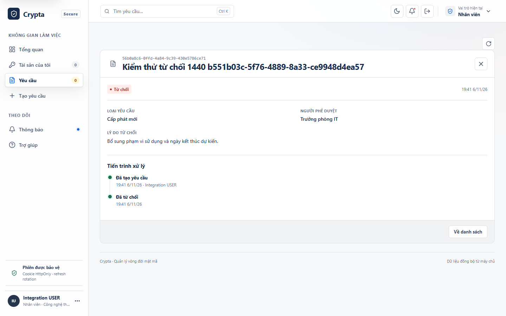
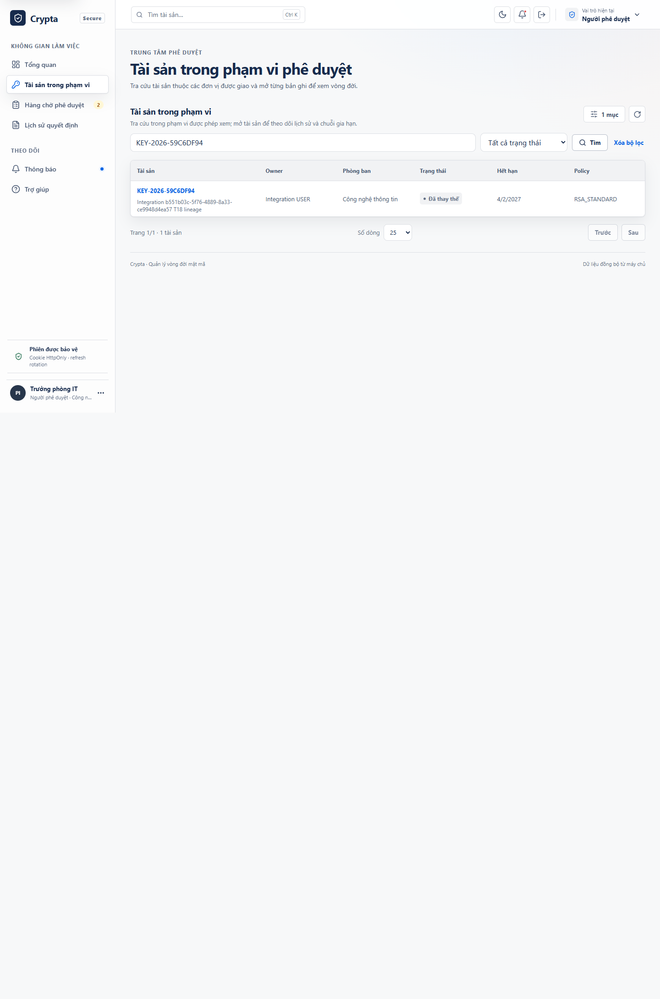
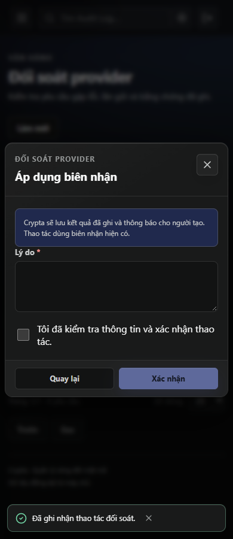

# Sử dụng và vận hành Crypta

## Chạy thử trên Windows

1. Mở Docker Desktop và đợi engine chạy. Trong thư mục dự án, mở `start-crypta.cmd`.
2. Khi trình duyệt mở, đăng nhập tại `http://localhost:8080`. Nếu đã đổi `APP_PORT`, dùng cổng hiện trong cửa sổ khởi động.
3. Chọn tài khoản demo tương ứng trong bảng. Cả ba dùng `Password@123` trên dữ liệu mẫu. Dùng cửa sổ riêng hoặc đăng xuất giữa các lượt thử vai trò.

| Vai trò | Email demo | Việc cần kiểm tra |
| --- | --- | --- |
| User | `dev.nguyen@congty.com` | Lưu nháp, gửi yêu cầu và xem tài sản cá nhân |
| Approver | `it.manager@congty.com` | Xử lý yêu cầu của đơn vị được giao và xem lịch sử tài sản |
| Security Admin | `admin@congty.com` | Quản lý tài khoản, đơn vị, chính sách và đối soát |

Bản mặc định dùng dữ liệu seed, provider `MOCK` và tắt SMTP. Dùng dữ liệu giả trong toàn bộ buổi thử. Cửa sổ khởi động tạo `.env` chứa secret riêng cho máy khi tệp chưa tồn tại. [Khởi động và cấu hình local](../README.md)

## User

1. Mở **Tạo yêu cầu**. Chọn cấp mới, gia hạn hoặc thu hồi. Cấp mới cần chính sách đang hoạt động. Gia hạn và thu hồi cần tài sản đủ điều kiện. Nhập mục đích và kiểm tra thông số hiển thị theo policy.
2. Chọn **Lưu bản nháp** để tiếp tục sau hoặc **Gửi yêu cầu** để đưa vào hàng chờ. Với thu hồi, đọc tác động ở bước xác nhận cuối. Chỉ bật cờ khẩn khi tình huống thực sự cần ưu tiên.
3. Mở **Yêu cầu**, chọn bản ghi để xem trạng thái. Từ chi tiết có thể sửa nháp hoặc **Hủy yêu cầu** khi giao diện còn cho phép. Nếu máy chủ báo phiên bản đã đổi, tải lại để xem trạng thái mới trước khi quyết định.
4. Sau phê duyệt, chờ worker xử lý. Khi hoàn tất, vào **Tài sản của tôi** để kiểm tra trạng thái, thời hạn, policy và lịch sử. Gia hạn tạo tài sản kế tiếp khi xử lý thành công. Thu hồi chấm dứt hiệu lực của tài sản đã chọn.

Khi bị từ chối, mở chi tiết để đọc tên người duyệt, thời điểm và lý do. Tiến trình kết thúc ở **Đã từ chối**.



Vào **Thông báo** để xem kết quả và cảnh báo tài sản. Cảnh báo sắp hết hạn và đã hết hạn gửi cho chủ sở hữu, Approver đúng phạm vi và Security Admin đủ điều kiện. Email phụ thuộc cấu hình SMTP. Quyền xem khi mở liên kết được kiểm tra lại theo phiên hiện tại. [Bằng chứng kiểm thử cảnh báo](../T27_HARDENING_2026-11-06.md)

Nếu thấy **Quên mật khẩu?**, nhập email và mở liên kết trong hộp thư để đặt mật khẩu mới. Màn hình tiếp nhận có cùng phản hồi với email hợp lệ về định dạng. Link đã dùng hoặc hết hạn cần yêu cầu mới. Khi luồng email chưa bật, liên hệ Security Admin. [Vòng đời lời mời và đặt lại mật khẩu](../T07_ACCOUNT_ACTIONS_2026-11-06.md)

## Approver

1. Mở **Hàng chờ phê duyệt** và chọn yêu cầu trong đơn vị được giao. Kiểm tra người gửi, lý do, loại thao tác, policy, tài sản đích và cờ khẩn.
2. Chọn **Phê duyệt** hoặc **Từ chối**. Khi từ chối, nhập lý do cụ thể ít nhất 10 ký tự. Xác nhận quyết định. Máy chủ kiểm tra phạm vi, phiên bản và phân tách nhiệm vụ. Người gửi không được tự duyệt yêu cầu của mình.
3. Mở **Lịch sử quyết định** để tra kết quả. Trong **Tài sản trong phạm vi**, chọn tài sản để xem lịch sử, các mốc provider và tài sản trước hoặc sau trong chuỗi gia hạn nếu bạn có quyền xem.



## Security Admin

| Việc cần làm | Màn hình và cách thực hiện |
| --- | --- |
| Thêm hoặc mời tài khoản | Mở **Người dùng & vai trò**, tab **Tài khoản**. Khi bật `ACCOUNT_ACTIONS_ENABLED=true` và đã cấu hình SMTP, chọn **Mời tài khoản** để gửi link kích hoạt. Khi tắt, chọn **Thêm người dùng** và cấp mật khẩu tạm qua kênh riêng. |
| Sửa đơn vị hoặc quyền | Dùng tab **Đơn vị** để quản lý tổ chức, và **Mở phân quyền** để quản lý vai trò và đơn vị Approver phụ trách. Khi chuyển tài khoản, đọc xác nhận thu hồi phiên và kiểm tra phạm vi sau khi chuyển. Lịch sử cũ vẫn gắn với đơn vị tại thời điểm phát sinh. |
| Quản lý policy | Trong **Chính sách**, tạo policy, phát hành phiên bản, so sánh hai bản trong **Lịch sử** hoặc xác nhận **Ngừng áp dụng**. Phiên bản mới có hiệu lực ngay với yêu cầu tiếp theo. Yêu cầu đã gửi và tài sản đã cấp giữ phiên bản đã gắn. |
| Tra sự kiện | Mở **Audit Log**. Dùng mã yêu cầu nghiệp vụ để lần theo vòng đời, hoặc dùng mã `req_…` để đối chiếu một lần gọi API. |
| Kiểm tra email | Mở **Vận hành email**, chọn **Gửi thử**, nhập hộp thư thử đã được chỉ định và kiểm tra nhận thư. Với lỗi mơ hồ, đối chiếu `Message-ID` theo runbook trước khi thực hiện bước tiếp. |

### Xử lý yêu cầu cần đối soát

1. Mở **Đối soát provider**. Chọn yêu cầu và ghi lại mã yêu cầu, lần gửi, thời điểm, mã lỗi và trạng thái biên nhận.
2. Đối chiếu với nhật ký hoặc kênh tra cứu provider bằng `operationId`. Nếu đã có biên nhận phù hợp, chọn **Áp dụng biên nhận** để lưu kết quả đã ghi. Nếu Crypta có bằng chứng chưa gửi và lỗi đủ điều kiện, hệ thống cho lên lịch thử lại hoặc dừng theo hành động hiển thị.
3. Nhập lý do, tick xác nhận rồi gửi. Nếu không có hành động phù hợp, giữ yêu cầu trong danh sách đối soát và chuyển thông tin cho người phụ trách provider. Với `409`, mở lại chi tiết và đọc trạng thái mới.



Ảnh chụp từ bản tích hợp Chrome ngày 06/11/2026 với dữ liệu giả. Bản frontend phục vụ `index-BDI-K94F.js` và `index-DIi5GvX9.css`. [Đối soát provider](../T15_PROVIDER_RECOVERY_2026-11-06.md) · [Truy vết tài sản](../T18_ASSET_LINEAGE_2026-11-06.md)

## API và truy vết

[Hợp đồng OpenAPI trong bộ đồ án](openapi.json) được xuất từ build hiện hành và đã kiểm 68 đường dẫn, 74 thao tác, 31 JSON body.

API đi qua Nginx dưới `/api/v1`. Swagger UI tại `/docs` và JSON tại `/docs-json` thuộc cổng nội bộ backend. Lấy spec từ thư mục dự án khi stack đang chạy.

```powershell
docker compose exec -T backend wget -qO- http://127.0.0.1:3000/docs-json |
    Set-Content -Encoding utf8 crypta-openapi.json
```

Đăng nhập qua `POST /api/v1/auth/login` với JSON có `email` và `password`. Dùng `data.accessToken` trong `Authorization: Bearer <token>` khi gọi API được bảo vệ. Giữ cookie `crypta_refresh` do máy chủ cấp để gọi `POST /api/v1/auth/refresh` và cập nhật cookie sau mỗi lần làm mới. `GET /api/v1/auth/me` cho biết quyền và phạm vi của phiên. Token giám sát của `/api/v1/operations/signals` được cấu hình riêng.

Phản hồi thành công có `data` và `requestId`. Phản hồi lỗi có `error.code`, `error.message`, `error.details`, `requestId`, `timestamp` và `path`. Đọc `x-request-id` để truy vết. Lọc danh sách qua query của endpoint. Thêm `page=1&pageSize=25` để yêu cầu `data.items`, `data.total`, `data.page` và `data.pageSize` ở các danh sách hỗ trợ phân trang. Dùng `search` trong API khi endpoint hỗ trợ. Giao diện dùng `q` trong URL trình duyệt.

| Mã HTTP | Việc cần kiểm tra |
| --- | --- |
| `400` | Đọc `error.code` và kiểm tra trường, enum hoặc giới hạn phân trang trong Swagger. |
| `401` | Đăng nhập lại nếu phiên đã hết hạn hoặc bị thu hồi. |
| `403` hoặc `404` | Kiểm tra role, đơn vị và ID trước khi gửi lại. |
| `409` | Đọc lại trạng thái và phiên bản hiện tại của đối tượng. |
| `503` hoặc mất kết nối khi ghi | Kiểm tra dữ liệu và nhật ký bằng mã truy vết trước khi quyết định có gửi lại. |

## Phần mở rộng

MFA, OIDC và provider OpenBao cần cấu hình tương ứng trước khi sử dụng. Hướng dẫn riêng có thao tác đăng ký/khôi phục, phạm vi và các ca kiểm. [TOTP](MFA_X01.md) · [Duyệt hai cấp](X02_TWO_STAGE_APPROVAL.md) · [SSO Keycloak](X03_OIDC.md) · [Xuất CSV/PDF](X04_REPORT_EXPORTS.md) · [Checkpoint audit](X05_AUDIT_ANCHOR.md) · [OpenBao](X06_OPENBAO_TRANSIT.md).

## Vận hành hệ thống

| Container | Vai trò và dữ liệu |
| --- | --- |
| `frontend` | Nginx phục vụ giao diện và chuyển `/api/` vào backend. |
| `backend` | NestJS API, worker tài sản, quét hết hạn và hàng đợi email. Cổng `3000` nằm trong mạng Compose. |
| `postgres` | Giữ tài khoản, metadata, audit, migration và hàng đợi trong volume `crypta_postgres_data` của project Compose. |
| `mailhog` | Hộp thư thử chỉ khởi động khi bật profile `local-mail`. Operator phải cấu hình SMTP tương ứng để nhận thư thử. |

`stop-crypta.cmd` dừng các container và giữ volume. Sau khi bật lại, kiểm trạng thái bằng `start-crypta.ps1 -Diagnose`, rồi xem hàng đợi và mục đối soát trước khi thao tác. Sau khi cập nhật mã, chạy lại `start-crypta.cmd` để build image và chờ API xác nhận kết nối PostgreSQL. Cấu hình Compose hiện dùng PostgreSQL cho các job. Container Redis từ bản cũ, nếu có, cần được vận hành xem xét riêng.

Khi dừng bình thường qua Docker, API trả `503 APP_SHUTTING_DOWN` cho readiness và yêu cầu nghiệp vụ mới. Các worker ngừng nhận việc và chờ lượt đang xử lý ghi kết quả. API đóng kết nối PostgreSQL sau khi hoàn tất các lượt đó và các kết nối HTTP đang phục vụ. Compose cho backend tối đa 150 giây để dừng. Nếu tiến trình bị buộc dừng, kiểm hàng đợi và mục đối soát trước khi xử lý lại tác vụ có kết quả provider hoặc SMTP chưa rõ.

Log cục bộ dùng driver `local`, tối đa ba tệp 10 MB mỗi container. Tra log bằng `docker compose logs backend frontend`. Nếu cần lưu lâu hơn, cấu hình nơi thu thập log phù hợp với môi trường triển khai. [Tùy chọn Docker Compose](https://docs.docker.com/reference/compose-file/services/#stop_grace_period)

```powershell
docker compose ps
Invoke-RestMethod http://localhost:8080/api/v1/health/live
Invoke-RestMethod http://localhost:8080/api/v1/health/ready
docker compose logs --since 15m --tail 100 backend frontend
```

Nếu cổng không mở, xem `docker compose ps` và log. Nếu readiness trả `503`, xem PostgreSQL, migration và quyền của runtime. Khi SMTP khởi động lỗi, kiểm tra host, TLS và credential với người quản lý cấu hình. Nếu tác vụ ghi dữ liệu mất phản hồi, dùng **Kiểm tra dữ liệu** và đối chiếu kết quả trước khi gửi lại.

Khi gửi log cho người hỗ trợ, lấy đoạn quanh thời điểm lỗi và giữ mã sự kiện, status và `requestId`. Che mật khẩu, cookie, token, địa chỉ email thật, định danh nhạy cảm và tham số URL chứa secret. Giữ `.env`, dump database và private key trong kênh lưu trữ được phân quyền.

- **Email và provider.** Đặt `APP_URL` đúng domain HTTPS của người dùng và cấu hình `APP_ORIGIN`, cookie bảo mật, SMTP và adapter theo môi trường. Xác minh thư trong hộp thư thử và thao tác provider trên sandbox trước khi dùng dữ liệu thật. [Cấu hình dịch vụ](../CAU_HINH_DICH_VU_THAT.md) · [Vận hành email](../EMAIL_OPERATIONS.md)
- **Backup và phục hồi.** Tạo dump kèm manifest, xác minh SHA-256 rồi thử phục hồi vào database mới. Lưu kết quả và thời gian phục hồi. Vòng đời khóa của provider cần backup theo quy trình riêng. [Quy trình backup, restore và rollback](../RELEASE_RUNBOOK.md)
- **Cập nhật.** Xác minh phiên bản image, backup, chạy migration bằng tài khoản riêng, kiểm readiness rồi smoke UI và API. Nếu lỗi và schema mới không tương thích với image cũ, phục hồi snapshot vào database khác và kiểm tra trước khi chuyển lưu lượng. [Quyền và migration](../DATABASE_MIGRATIONS.md) · [Quy trình release](../RELEASE_RUNBOOK.md)

## Lượt đọc thử để nghiệm thu

Người mới mở tài liệu trên máy có Docker, chạy bản mẫu, lưu và gửi một yêu cầu với User, duyệt bằng Approver, rồi mở tài sản và audit bằng Security Admin. Cuối buổi kiểm tra readiness, trích một dòng log đã che thông tin và dừng stack. Ghi bước, kết quả và câu hỏi phát sinh để sửa tài liệu. Buổi thử SMTP và provider dùng môi trường thử riêng khi đã có dịch vụ tương ứng. [Kịch bản nghiệm thu 12 luồng](NGHIEM_THU_UAT.md)
