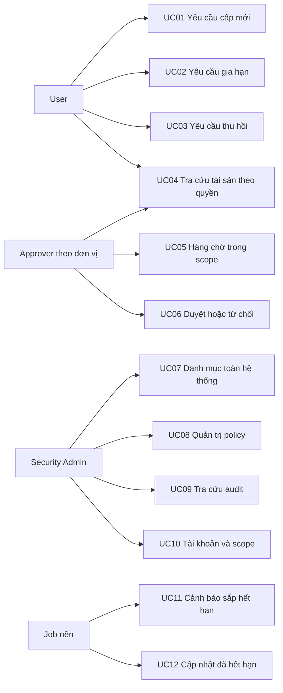
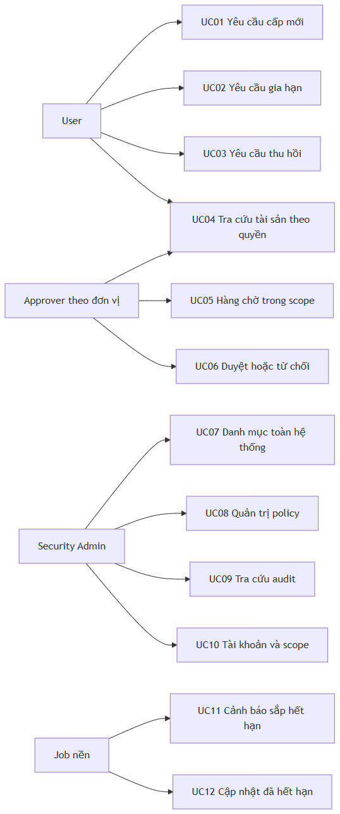

# Tổng quan 12 use case

Sơ đồ nhóm các ca theo người khởi tạo chính. Quyền cụ thể vẫn do API kiểm tra. UC02 và UC03 có bước Approver quyết định, UC04 cho User/Approver theo scope. UC11 gửi cho chủ sở hữu, Approver trong scope và Admin. UC12 do job cập nhật rồi người dùng xem kết quả. [Đặc tả và kịch bản chi tiết](NGHIEM_THU_UAT.md).

Đây là sơ đồ tổng quan quan hệ tác nhân và chức năng. Các nhánh lỗi, state machine, hai cấp duyệt và đối soát được mô tả trong [luồng hoạt động](../01_luong_hoat_dong_he_thong.md). Sơ đồ được render từ chính khối Mermaid phía trên.
