# KẾ HOẠCH TRIỂN KHAI CHI TIẾT

## Đề tài 20 — Hệ thống quản lý khóa mã hóa và chứng thư số

> **Phiên bản:** 1.0  
> **Ngày lập:** 17/08/2026  
> **Công nghệ bắt buộc:** React + Node.js  
> **Mức ưu tiên:** Cao — hệ thống có dữ liệu và thao tác nhạy cảm  
> **Mục đích tài liệu:** Làm tài liệu thống nhất để phân tích, thiết kế, chia việc, triển khai, kiểm thử, demo và viết báo cáo đồ án.

---

## Mục lục

1. [Tóm tắt điều hành](#1-tóm-tắt-điều-hành)
2. [Mục tiêu, phạm vi và giả định](#2-mục-tiêu-phạm-vi-và-giả-định)
3. [Thuật ngữ và mô hình tài sản](#3-thuật-ngữ-và-mô-hình-tài-sản)
4. [Tác nhân, phân quyền và SoD](#4-tác-nhân-phân-quyền-và-sod)
5. [Đặc tả Use Case](#5-đặc-tả-use-case)
6. [Kiến trúc hệ thống](#6-kiến-trúc-hệ-thống)
7. [Thiết kế dữ liệu](#7-thiết-kế-dữ-liệu)
8. [Luồng trạng thái và quy tắc nghiệp vụ](#8-luồng-trạng-thái-và-quy-tắc-nghiệp-vụ)
9. [Thiết kế API](#9-thiết-kế-api)
10. [Thiết kế Frontend](#10-thiết-kế-frontend)
11. [Thiết kế Backend và Background Job](#11-thiết-kế-backend-và-background-job)
12. [Thiết kế bảo mật](#12-thiết-kế-bảo-mật)
13. [Audit Log và giám sát](#13-audit-log-và-giám-sát)
14. [Kế hoạch kiểm thử](#14-kế-hoạch-kiểm-thử)
15. [DevOps, triển khai và phục hồi](#15-devops-triển-khai-và-phục-hồi)
16. [Lộ trình triển khai](#16-lộ-trình-triển-khai)
17. [Phân công nhóm](#17-phân-công-nhóm)
18. [Tiêu chí nghiệm thu](#18-tiêu-chí-nghiệm-thu)
19. [Rủi ro và phương án xử lý](#19-rủi-ro-và-phương-án-xử-lý)
20. [Kịch bản demo và cấu trúc báo cáo](#20-kịch-bản-demo-và-cấu-trúc-báo-cáo)
21. [Checklist hoàn thành](#21-checklist-hoàn-thành)

---

## 1. Tóm tắt điều hành

Hệ thống quản lý toàn bộ vòng đời của khóa mã hóa và chứng thư số trong một tổ chức, từ lúc người dùng gửi yêu cầu, người có thẩm quyền phê duyệt, hệ thống cấp phát hoặc cập nhật tài sản, cho đến cảnh báo sắp hết hạn, thu hồi và lưu vết kiểm toán.

Hệ thống phải đáp ứng bốn nguyên tắc nền tảng:

1. **Không tự phê duyệt:** người tạo yêu cầu không được duyệt chính yêu cầu đó.
2. **Đặc quyền tối thiểu:** mỗi vai trò chỉ truy cập đúng chức năng và dữ liệu cần thiết.
3. **Không lộ khóa bí mật:** private key không được lưu dạng rõ trong database, source code hoặc log.
4. **Mọi thao tác quan trọng đều truy vết được:** Audit Log chỉ được ghi thêm, không có chức năng sửa/xóa.

### 1.1. Kết quả cần đạt

- Ứng dụng web hoạt động với bốn nhóm tác nhân: Requester (User), Approver (Manager), CISO / Security Admin và System Admin (cùng System Background Worker).
- Hoàn chỉnh 15 Use Case nghiệp vụ cốt lõi (UC-01 đến UC-15) cùng hệ thống Bảng thông báo nổi (Notification Popover).
- Có RBAC và kiểm tra phạm vi dữ liệu (Approver Scopes) ở backend.
- Có luồng cấp mới, gia hạn, hủy đơn và thu hồi theo mô hình yêu cầu–phê duyệt.
- Có luồng Thu hồi khẩn cấp (Emergency Revocation) độc lập không qua phê duyệt dành riêng cho CISO/Admin khi phát hiện sự cố an toàn thông tin.
- Có dashboard và màn hình riêng biệt cho từng vai trò (User Dashboard, Approval Queue, Admin Console).
- Có job cảnh báo sắp hết hạn và job tự động cập nhật trạng thái `EXPIRED`.
- Có Audit Log bất biến ở cấp ứng dụng và ràng buộc trigger database.
- Có bộ kiểm thử nghiệp vụ tự động 100% PASS (58 API E2E tests, 21 Workflow tests, 20 Notification tests).
- Có seed dữ liệu demo đầy đủ tài khoản các phòng ban, tài liệu API (Swagger UI `/docs`) và hướng dẫn chạy.

### 1.2. Kiến trúc đề xuất

| Lớp            | Công nghệ đề xuất                                           | Ghi chú                                                  |
| -------------- | ----------------------------------------------------------- | -------------------------------------------------------- |
| Frontend       | React, TypeScript, Vite, React Router, TanStack Query       | Giao diện theo vai trò                                   |
| Backend        | Node.js, TypeScript, NestJS hoặc Express có cấu trúc module | Khuyến nghị NestJS nếu nhóm chưa có framework thống nhất |
| Database       | PostgreSQL                                                  | Hỗ trợ transaction, constraint, JSONB và phân quyền tốt  |
| ORM            | Prisma hoặc TypeORM                                         | Khuyến nghị Prisma cho đồ án                             |
| Authentication | JWT access token + refresh token rotation                   | MFA là mục tiêu mở rộng cho vai trò nhạy cảm             |
| Job Scheduler  | node-cron                                                   | Chạy ngầm trực tiếp trong Node.js, không cần Queue       |
| Key Provider   | Adapter mô phỏng (Mock)                                     | Cấp phát khóa giả lập để pass luồng nghiệp vụ            |
| API Docs       | OpenAPI/Swagger                                             | Sinh tài liệu và hỗ trợ kiểm thử                         |
| Đóng gói       | Tùy chọn (Docker hoặc chạy thủ công)                        | Chỉ cần Frontend, Backend và Database                    |

---

## 2. Mục tiêu, phạm vi và giả định

### 2.1. Mục tiêu nghiệp vụ

- Chuẩn hóa quy trình quản lý tài sản mật mã trong tổ chức.
- Giảm rủi ro khóa/chứng thư hết hạn mà không được xử lý.
- Ngăn người yêu cầu tự phê duyệt.
- Cung cấp bằng chứng kiểm toán cho mọi thay đổi quan trọng.
- Cho phép quản trị viên cấu hình chính sách tập trung.

### 2.2. Phạm vi MVP bắt buộc

- Đăng nhập, đăng xuất, làm mới phiên đăng nhập.
- Quản lý tài khoản và gán vai trò.
- User tạo yêu cầu cấp mới, gia hạn, thu hồi.
- User xem tài sản và yêu cầu của chính mình.
- Approver xem các yêu cầu trong phạm vi phụ trách.
- Approver phê duyệt hoặc từ chối, bắt buộc ghi lý do khi từ chối.
- Hệ thống tạo/cập nhật metadata tài sản sau phê duyệt.
- Admin xem tài sản toàn hệ thống, cấu hình policy và xem Audit Log.
- Job cảnh báo sắp hết hạn và cập nhật trạng thái `EXPIRED`.
- Thông báo trong ứng dụng (In-app Notification).
- Audit Log cho authentication, request, approval, asset, policy và role.

### 2.3. Phạm vi nâng cao

- Kết nối HashiCorp Vault, AWS KMS, Azure Key Vault hoặc HSM.
- Kết nối Certificate Authority thật.
- MFA cho Approver và Security Admin.
- Phê duyệt hai cấp cho khóa có mức nhạy cảm cao.
- Export báo cáo CSV/PDF có kiểm soát.
- SSO/OIDC với hệ thống danh tính của tổ chức.
- Cơ chế hash-chain hoặc ký số Audit Log.

### 2.4. Ngoài phạm vi MVP

- Tự xây thuật toán mã hóa hoặc tự xây Certificate Authority hoàn chỉnh.
- Cho phép tải private key rõ từ trang quản trị.
- Lưu secret trong Git hoặc cấu hình frontend.
- Quản lý thiết bị HSM vật lý.
- Thay thế toàn bộ PKI/KMS doanh nghiệp.

### 2.5. Giả định thiết kế

- Mỗi User thuộc một đơn vị/phòng ban.
- Approver chỉ xem và xử lý yêu cầu trong phạm vi đơn vị được gán.
- Security Admin không được phê duyệt yêu cầu nghiệp vụ.
- Tài sản không bị xóa cứng; chỉ thay đổi trạng thái.
- Thời gian được lưu trong database theo UTC và hiển thị theo múi giờ cấu hình.
- Bản MVP quản lý metadata và `provider_reference`; private key nằm ngoài database hoặc được mô phỏng.

---

## 3. Thuật ngữ và mô hình tài sản

### 3.1. Thuật ngữ

| Thuật ngữ   | Ý nghĩa trong hệ thống                                       |
| ----------- | ------------------------------------------------------------ |
| Key         | Khóa mật mã dùng cho mã hóa, giải mã, ký hoặc xác minh       |
| Certificate | Chứng thư số gắn danh tính với public key và được CA ký      |
| Private key | Thành phần bí mật, không được ghi log hoặc lưu dạng rõ       |
| Public key  | Thành phần có thể phân phối để mã hóa/xác minh               |
| Rotation    | Tạo khóa mới để thay thế khóa cũ theo chu kỳ                 |
| Renewal     | Cấp chứng thư mới kế tiếp chứng thư cũ; không sửa chứng thư đã phát hành |
| Revocation  | Chấm dứt hiệu lực trước thời hạn                             |
| Owner       | Người hoặc đơn vị chịu trách nhiệm với tài sản               |
| Custodian   | Hệ thống/nhà cung cấp đang lưu vật liệu khóa                 |
| Policy      | Quy tắc về thuật toán, độ dài khóa, thời hạn và cảnh báo     |
| SoD         | Separation of Duties — phân tách nhiệm vụ                    |

### 3.2. Nguyên tắc mô hình hóa

Không coi khóa và chứng thư là một bản ghi hoàn toàn giống nhau. Sử dụng `crypto_assets` làm thực thể chung, sau đó tách thuộc tính riêng sang `cryptographic_keys` và `certificates`.

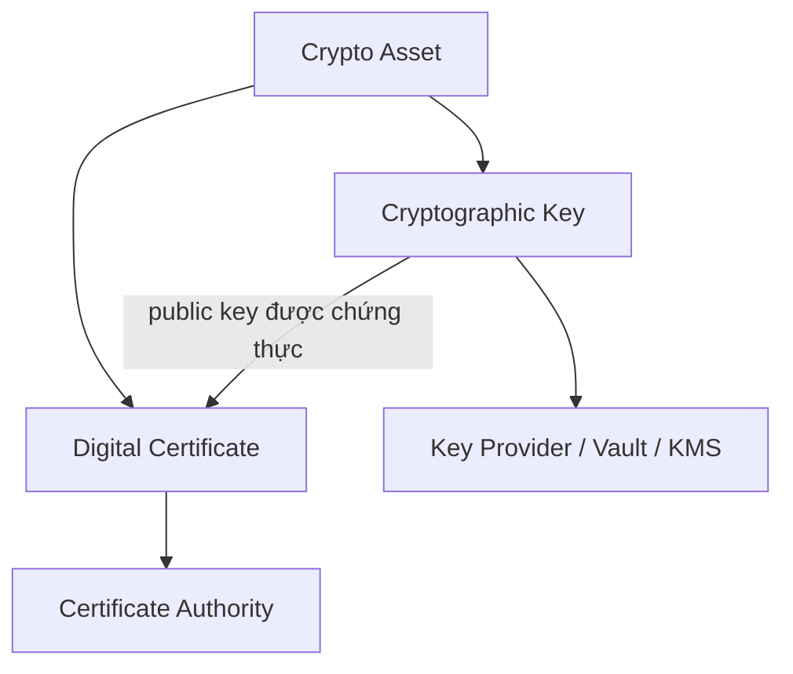

### 3.3. Phân loại dữ liệu

| Mức       | Ví dụ                                  | Quy tắc                                      |
| --------- | -------------------------------------- | -------------------------------------------- |
| Công khai | Public key, thuật toán hỗ trợ          | Có thể hiển thị theo nghiệp vụ               |
| Nội bộ    | Owner, ngày hết hạn, trạng thái        | Chỉ người có quyền và đúng phạm vi           |
| Nhạy cảm  | Policy, Audit Log, certificate request | Hạn chế Admin/Approver phù hợp               |
| Tối mật   | Private key, refresh token, secret     | Không trả về tùy ý; mã hóa hoặc lưu ngoài DB |

---

## 4. Tác nhân, phân quyền và SoD

### 4.1. Tác nhân

| Tác nhân | Trách nhiệm chính | Hạn chế bắt buộc |
| --- | --- | --- |
| **Requester (User / Employee)** | Tạo yêu cầu cấp mới, gia hạn, thu hồi; theo dõi tiến độ & hủy đơn khi đang chờ duyệt (`PENDING`); xem tài sản cá nhân và tải Public Key. | Không xem tài sản của người khác; không tự phê duyệt đơn của chính mình (SoD). |
| **Approver (Manager / Trưởng phòng)** | Xem hàng đợi duyệt trong phạm vi phòng ban được phân công (`approver_scopes`); phê duyệt hoặc từ chối kèm lời phê bắt buộc; xem dashboard phòng ban. | Không tự duyệt đơn do mình tạo; không duyệt đơn ngoài phạm vi phòng ban; không cấu hình chính sách/RBAC. |
| **CISO / Security Admin** | Ban hành và nâng cấp phiên bản Chính sách bảo mật (Policy Versioning v1/v2); **Thu hồi Khẩn cấp (Emergency Revocation)** trực tiếp khi phát hiện sự cố rò rỉ khóa; tra cứu Audit Log bất biến; giám sát an toàn toàn hệ thống. | Tuyệt đối không có quyền phê duyệt yêu cầu cấp phát nghiệp vụ thông thường (chống xung đột lợi ích SoD). |
| **System Admin** | Quản lý danh mục phòng ban (Departments); quản lý người dùng (tạo mới, reset mật khẩu, kích hoạt/vô hiệu hóa tài khoản); phân quyền Role và gán phạm vi duyệt phòng ban (`approver_scopes`). | Không phê duyệt yêu cầu cấp phát tài sản mật mã; thao tác phân quyền đều bị ghi vết kiểm toán. |
| **System Background Worker** | Tự động sinh khóa ngầm sau khi duyệt; quét cảnh báo tài sản sắp hết hạn (30 ngày); tự động chuyển trạng thái `EXPIRED`; gửi thông báo In-app/Email. | Chỉ chạy dưới quyền hệ thống tối thiểu, ghi vết kiểm toán cho các tác vụ thay đổi trạng thái. |

### 4.2. Sơ đồ Use Case tổng quát

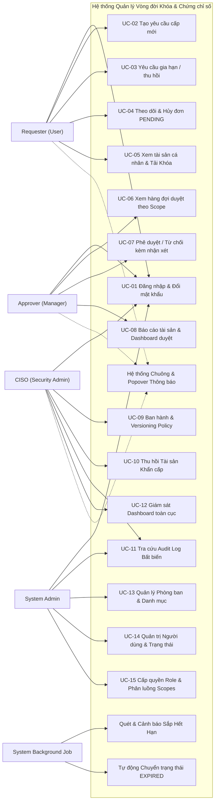

### 4.3. Ma trận quyền

Ký hiệu: `O` = Dữ liệu của chính mình (Owner), `S` = Dữ liệu trong phạm vi phụ trách (Scope), `A` = Toàn hệ thống (All), `—` = Không được phép.

| Chức năng / Quyền hạn | Requester (User) | Approver (Manager) | CISO / Security Admin | System Admin | System Worker |
| :--- | :---: | :---: | :---: | :---: | :---: |
| **Đăng nhập & Đổi mật khẩu** (`auth:*`) | O | O | O | O | — |
| **Xem tài sản cá nhân** (`asset:read:own`) | O | O | A | A | S |
| **Tải khóa công khai / Cert** (`asset:download`) | O | S | A | A | — |
| **Tạo yêu cầu cấp/gia hạn/thu hồi** (`request:create`) | O | O (không tự duyệt) | — | — | — |
| **Theo dõi & Hủy đơn PENDING** (`request:cancel`) | O | O | A (chỉ xem) | A (chỉ xem) | — |
| **Xem hàng đợi chờ duyệt** (`request:read:scope`) | — | S | A (chỉ xem) | A (chỉ xem) | — |
| **Phê duyệt / Từ chối yêu cầu** (`request:approve`) | — | S (bắt buộc khác creator) | — | — | — |
| **Thu hồi Khẩn cấp trực tiếp** (`asset:revoke:emergency`) | — | — | **A** | **A** | — |
| **Quản trị Chính sách (Tạo mới & Versioning)** (`policy:manage`) | — | — | **A** | **A** | Chỉ đọc |
| **Tra cứu Nhật ký Kiểm toán bất biến** (`audit:read`) | — | — | **A** | **A** | — |
| **Ghi vết Audit Log** (`audit:write`) | Tự động | Tự động | Tự động | Tự động | Tự động |
| **Xem & Tương tác Bảng thông báo nổi** (`notification:*`) | O | O | O | O | Tạo thông báo |
| **Quản lý Phòng ban & Danh mục** (`dept:manage`) | — | — | — | **A** | — |
| **Quản lý Người dùng & Trạng thái** (`user:manage`) | — | — | — | **A** | — |
| **Phân quyền Role & Approver Scopes** (`role:assign`) | — | — | — | **A** | — |
| **Tác vụ quét hết hạn & Cấp phát ngầm** | — | — | — | — | **A** |

### 4.4. Quy tắc SoD bắt buộc

- Backend từ chối nếu `request.creator_id == approver.id`.
- Security Admin không có permission `request:approve`.
- Approver phải có scope phù hợp với `request.department_id`.
- Thay đổi vai trò phải được Audit Log ghi cả giá trị trước và sau.
- Không cho Admin gỡ vai trò quản trị viên cuối cùng của hệ thống.
- Tùy chọn nâng cao: thay đổi policy nhạy cảm hoặc vai trò Admin cần phê duyệt thứ hai.

---

## 5. Đặc tả Use Case

### 5.1. Bảng tổng hợp 15 Use Cases & Các chức năng nền tảng

| Mã UC | Nhóm Tác nhân | Tên Ca Sử Dụng (Use Case) | Tiền điều kiện | Kết quả thành công |
| :--- | :--- | :--- | :--- | :--- |
| **UC-01** | Requester / Tất cả | Đăng nhập, Quản lý phiên & Đổi mật khẩu bắt buộc | Tài khoản tồn tại và `ACTIVE` | Trả về JWT Access Token & Refresh Cookie; buộc đổi mật khẩu nếu `must_change_password=true`. |
| **UC-02** | Requester (User) | Tạo Đơn yêu cầu cấp mới Khóa/Chứng chỉ | Đã đăng nhập; chọn đúng Policy Version | Tạo đơn `PENDING`; gửi thông báo In-app cho Approver phòng ban. |
| **UC-03** | Requester (User) | Yêu cầu Gia hạn / Thu hồi tài sản | Là chủ sở hữu tài sản mục tiêu (`owner`) | Tạo đơn `PENDING` gắn `target_asset_id` và lý do nghiệp vụ. |
| **UC-04** | Requester (User) | Theo dõi trạng thái & Hủy yêu cầu chờ duyệt | Đơn của chính mình đang ở trạng thái `PENDING` | Xem chi tiết tiến độ; hủy đơn thành công đổi trạng thái sang `CANCELLED`. |
| **UC-05** | Requester (User) | Xem tài sản cá nhân & Tải Khóa công khai | Có tài sản được cấp phát | Chỉ thấy tài sản của chính mình; tải được Public Key/Certificate PEM. |
| **UC-06** | Approver (Manager) | Xem danh sách chờ duyệt theo phòng ban | Có vai trò `APPROVER` & được gán scope | Chỉ thấy đơn của nhân viên thuộc các phòng ban trong scope phụ trách. |
| **UC-07** | Approver (Manager) | Phê duyệt hoặc Từ chối kèm lời phê | Đơn `PENDING`; đảm bảo SoD (`creator != approver`) | Ghi nhận vào `request_decisions`; đơn đổi trạng thái `APPROVED` hoặc `REJECTED`. |
| **UC-08** | Approver (Manager) | Báo cáo tài sản phòng ban & Dashboard duyệt | Thuộc phòng ban được gán phụ trách | Xem KPI số đơn chờ duyệt, đơn khẩn cấp, tài sản theo phòng ban. |
| **UC-09** | CISO / Admin | Quản trị & Ban hành phiên bản Chính sách (Policy) | Có vai trò `ADMIN` | Tạo chính sách mới; ban hành phiên bản v2+; ép buộc tham số thuật toán. |
| **UC-10** | CISO / Admin | Thu hồi Tài sản Khẩn cấp (Emergency Revocation) | Có vai trò `ADMIN` | Vô hiệu hóa ngay lập tức tài sản thành `REVOKED` không qua phê duyệt; ghi log khẩn cấp. |
| **UC-11** | CISO / Admin | Tra cứu & Kiểm toán Nhật ký Bất biến (Audit Log) | Có vai trò `ADMIN` | Tra cứu toàn bộ lịch sử; trigger CSDL cấm sửa/xóa bảo vệ tính bất biến. |
| **UC-12** | CISO / Admin | Giám sát toàn cục (Admin Dashboard) | Có vai trò `ADMIN` | Xem tổng quan tài sản toàn hệ thống, tình trạng dịch vụ (Mock/SMTP). |
| **UC-13** | System Admin | Quản lý Phòng ban & Danh mục Hệ thống | Có vai trò `ADMIN` | Truy xuất, thêm mới phòng ban và danh mục tham chiếu hệ thống. |
| **UC-14** | System Admin | Quản lý Người dùng & Trạng thái hoạt động | Có vai trò `ADMIN` | Tạo tài khoản mới; kích hoạt / vô hiệu hóa (`INACTIVE`). |
| **UC-15** | System Admin | Cấp quyền Role & Phân luồng duyệt (Scopes) | Có vai trò `ADMIN` | Gán vai trò `USER`/`APPROVER`/`ADMIN` và phòng ban duyệt cho User. |
| **UC-SYS-01** | System Worker | Quét và cảnh báo tài sản sắp hết hạn | Cron job active; cấu hình số ngày cảnh báo | Sinh thông báo In-app/Email cho chủ sở hữu tài sản trước 30 ngày. |
| **UC-SYS-02** | System Worker | Tự động chuyển trạng thái Hết hạn (`EXPIRED`) | `expires_at <= NOW()` và status `ACTIVE` | Tài sản chuyển sang `EXPIRED`; ghi Audit Log tự động. |
| **UC-UI-01** | Mọi Tác nhân | Tương tác Chuông thông báo & Bảng thông báo nổi | Đã đăng nhập vào hệ thống | Bật/tắt Notification Popover; đánh dấu đã đọc; xóa chấm đỏ Header. |

---

### 5.2. Đặc tả chi tiết UC-01 — Đăng nhập, Quản lý phiên & Đổi mật khẩu bắt buộc

**Tiền điều kiện:** Tài khoản tồn tại trong bảng `users`, trạng thái `status = 'ACTIVE'`.

**Luồng chính:**
1. Người dùng nhập email và mật khẩu tại màn hình Đăng nhập.
2. Backend kiểm tra số lần đăng nhập sai liên tiếp (`failed_login_attempts < 10`); nếu quá hạn trả về `ACCOUNT_LOCKED`.
3. Backend so khớp mật khẩu bằng hàm băm an toàn `bcrypt.compare`.
4. Nếu thành công, hệ thống reset `failed_login_attempts = 0`, cấp phát JWT Access Token (hạn 15 phút) và ghi nhận `crypta_refresh` cookie HTTP-Only.
5. Kiểm tra cờ `must_change_password`: nếu bằng `true`, giao diện ép buộc mở hộp thoại đổi mật khẩu mới trước khi cho phép thao tác hệ thống.
6. Người dùng nhập mật khẩu mới (tối thiểu 6 ký tự), backend cập nhật mật khẩu, set `must_change_password = false`, tăng `token_version` để thu hồi phiên cũ và ghi Audit Log `AUTH_CHANGE_PASSWORD`.

**Luồng ngoại lệ:**
- Sai mật khẩu: Tăng bộ đếm thử sai, ghi log `AUTH_LOGIN_FAILED`. Nếu vượt ngưỡng 10 lần, khóa tài khoản tạm thời 15 phút.
- Tài khoản ở trạng thái `INACTIVE`: Trả về `ACCOUNT_DISABLED`, từ chối phát hành token.

---

### 5.3. Đặc tả chi tiết UC-02 — Tạo Đơn yêu cầu cấp mới (Create Request)

**Tiền điều kiện:** User đang ở trạng thái `ACTIVE` và đã đăng nhập; chọn Policy Version hợp lệ.

**Luồng chính:**
1. User nhấn "Yêu cầu cấp phát" trên Dashboard.
2. User chọn loại tài sản (`KEY_PAIR`, `SYMMETRIC_KEY`, `CERTIFICATE`), mục đích sử dụng, thuật toán mong muốn và thời hạn.
3. Frontend kiểm tra ràng buộc dữ liệu cơ bản.
4. Backend đối chiếu tham số với phiên bản chính sách (`policy_versions`): thuật toán phải nằm trong danh mục cho phép, thời hạn không vượt quá `max_validity_days`.
5. Backend tạo bản ghi `requests` ở trạng thái `PENDING`.
6. Backend ghi Audit Log `REQUEST_CREATED`.
7. Hệ thống tự động kích hoạt thông báo In-app (`REQUEST_SUBMITTED`) gửi đến danh sách Approver có scope phụ trách phòng ban của User.

**Luồng ngoại lệ:**
- Vi phạm chính sách (ví dụ chọn thời hạn vượt mức cho phép): Backend trả về `422 POLICY_VIOLATION`.
- Người dùng thuộc phòng ban chưa được gán Approver nào: Yêu cầu vẫn lưu thành công nhưng gắn cờ cảnh báo trong log quản trị.

---

### 5.4. Đặc tả chi tiết UC-03 — Yêu cầu Gia hạn / Thu hồi thông thường (Renew / Revoke)

**Luồng gia hạn (Renew):**
- Chỉ chủ sở hữu (`owner_id`) mới có quyền yêu cầu gia hạn tài sản của mình.
- Tài sản phải ở trạng thái `ACTIVE`, `EXPIRING_SOON` hoặc `EXPIRED`.
- Khi đơn gia hạn được phê duyệt, hệ thống tạo một tài sản mới thay thế, liên kết qua `replaces_asset_id` và đánh dấu tài sản cũ thành `SUPERSEDED`. Không chỉnh sửa đè lên lịch sử tài sản cũ.

**Luồng thu hồi thông thường (Revoke):**
- User chọn tài sản cần thu hồi và bắt buộc cung cấp lý do: `KEY_COMPROMISE`, `DEVICE_LOST`, `CESSATION_OF_OPERATION`, `SUPERSEDED`, `OTHER`.
- Đơn thu hồi chuyển trạng thái `PENDING` và chờ Approver phê duyệt. Sau khi duyệt, tài sản chuyển vĩnh viễn sang trạng thái `REVOKED`.

---

### 5.5. Đặc tả chi tiết UC-04 — Theo dõi trạng thái & Hủy đơn yêu cầu (Track & Cancel Request)

**Tiền điều kiện:** Đơn yêu cầu do chính User tạo ra và đang ở trạng thái `PENDING`.

**Luồng chính:**
1. User truy cập tab "Yêu cầu gần đây" trên Dashboard cá nhân.
2. Hệ thống hiển thị chi tiết tiến độ xử lý, thời gian nộp, chính sách áp dụng và trạng thái `PENDING`.
3. Nếu không còn nhu cầu, User bấm nút "Hủy yêu cầu" (`POST /api/v1/requests/:id/cancel`).
4. Backend kiểm tra quyền sở hữu (`creator_id == current_user.id`) và trạng thái hiện tại phải là `PENDING`.
5. Backend chuyển trạng thái đơn sang `CANCELLED` và ghi Audit Log `REQUEST_CANCELLED`.
6. Yêu cầu lập tức được gỡ khỏi Hàng đợi phê duyệt (Approval Queue) của Quản lý.

**Luồng ngoại lệ:**
- Đơn đã được phê duyệt (`APPROVED`) hoặc đã từ chối (`REJECTED`): Backend từ chối lệnh hủy với lỗi `REQUEST_NOT_CANCELLABLE`.

---

### 5.6. Đặc tả chi tiết UC-07 — Phê duyệt / Từ chối yêu cầu (Approve / Reject kèm SoD)

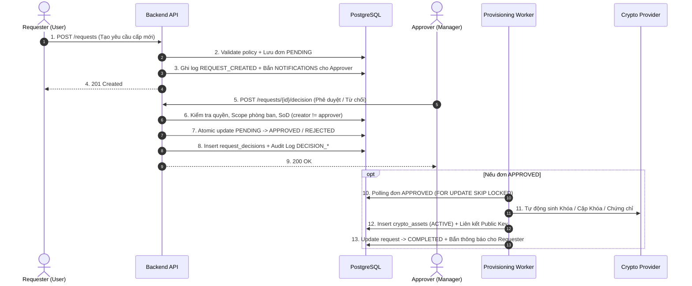

**Nguyên tắc Phân tách Trách nhiệm (SoD Enforcement):**
- Kiểm tra cả 2 tầng: Code nghiệp vụ Backend và Database Trigger `trg_check_sod_rule`.
- Nếu `approver_id == creator_id` $\rightarrow$ Ném lỗi `403 SOD_VIOLATION` và rollback giao dịch.

---

### 5.7. Đặc tả chi tiết UC-09 — Quản trị & Ban hành phiên bản Chính sách (Policy Versioning)

**Tiền điều kiện:** Tác nhân có vai trò `ADMIN` hoặc `CISO`.

**Luồng chính:**
1. CISO tạo danh mục chính sách mới (`POST /api/v1/policies`) hoặc nâng cấp phiên bản cho chính sách hiện có (`POST /api/v1/policies/:policyId/versions`).
2. Cấu hình các tham số bắt buộc: `algorithm` (ví dụ `RSA`, `AES`, `ECDSA`), `min_key_size` (ví dụ 2048), `max_validity_days` (ví dụ 90 ngày), số ngày cảnh báo trước (`notify_before_days`).
3. Backend tự động tăng số hiệu phiên bản (`version = 1, 2, 3...`) và đánh dấu phiên bản mới nhất là `ACTIVE`.
4. Mọi yêu cầu cấp mới kể từ thời điểm ban hành sẽ tự động áp dụng phiên bản mới nhất. Các tài sản cũ đã cấp theo phiên bản trước vẫn giữ nguyên tính hợp lệ cho đến khi gia hạn.

---

### 5.8. Đặc tả chi tiết UC-10 — Thu hồi Tài sản Khẩn cấp (Emergency Revocation)

**Ý nghĩa bài toán:** Trong an toàn thông tin, khi một máy chủ bị tấn công hoặc khóa bí mật bị nghi ngờ rò rỉ, CISO cần có quyền thu hồi tài sản mật mã **ngay lập tức** mà không cần qua quy trình tạo đơn và chờ Trưởng phòng duyệt.

**Tiền điều kiện:** Tác nhân có vai trò `ADMIN` / `CISO`.

**Luồng chính:**
1. CISO chọn tài sản bị rò rỉ trên giao diện Quản trị và bấm nút "Thu hồi khẩn cấp" (`POST /api/v1/assets/:id/revoke`).
2. CISO nhập lý do thu hồi nghiệp vụ (ví dụ: *"Phát hiện rò rỉ private key trên kho lưu trữ công khai"*).
3. Backend kiểm tra quyền `ADMIN` (Người dùng thường và Approver bị chặn với mã lỗi `403 ADMIN_REQUIRED`).
4. Backend cập nhật trạng thái tài sản thành `REVOKED` ngay lập tức trong cơ sở dữ liệu.
5. Hệ thống gửi thông báo In-app cảnh báo đỏ (`ASSET_REVOKED`) đến chủ sở hữu tài sản.
6. Hệ thống ghi một bản ghi Audit Log đặc biệt: `action = 'EMERGENCY_REVOKE'`, đánh dấu `emergency = true`. Bản ghi này được bảo vệ bởi trigger `trg_audit_log_immutable`, cấm tuyệt đối mọi hành vi can thiệp sửa/xóa.

---

### 5.9. Đặc tả chi tiết UC-11 — Tra cứu & Kiểm toán Nhật ký Bất biến (Audit Log)

**Tiền điều kiện:** Tác nhân có vai trò `ADMIN`.

**Luồng chính:**
1. Quản trị viên truy cập mục Audit Log trên Admin Console (`GET /api/v1/audit-logs`).
2. Hệ thống hiển thị danh sách dòng thời gian các sự kiện: Thời gian, Tác nhân (`actor_id`), Hành động (`action`), Loại tài nguyên (`resource_type`), Địa chỉ IP và Kết quả (`SUCCESS` / `FAILED`).
3. Cung cấp bộ lọc theo loại hành động (`AUTH_*`, `REQUEST_*`, `ASSET_*`, `POLICY_*`, `ROLE_*`, `EMERGENCY_REVOKE`) và kết quả thực thi.
4. **Cơ chế Bất biến (Immutability):** Bảng `audit_logs` được gắn Trigger chặn toàn bộ câu lệnh `UPDATE` và `DELETE`. Bất kỳ nỗ lực can thiệp nào từ ứng dụng hoặc cơ sở dữ liệu đều bị từ chối với lỗi `AUDIT_LOG_IMMUTABLE`.

---

### 5.10. Đặc tả chi tiết UC-12 & UC-UI-01 — Hệ thống Chuông thông báo & Bảng thông báo nổi (Notification Bell & Popover)

**Tiền điều kiện:** Mọi người dùng đã đăng nhập hệ thống (`USER`, `APPROVER`, `ADMIN`).

**Luồng chính:**
1. Khi có sự kiện liên quan (yêu cầu mới cần duyệt, yêu cầu được duyệt/từ chối, tài sản sắp hết hạn, tài sản bị thu hồi), hệ thống tự động sinh bản ghi trong bảng `notifications`.
2. Biểu tượng quả chuông trên thanh Header hiển thị chấm đỏ cảnh báo (`.has-alert`) kèm số lượng thông báo chưa đọc (`read_at IS NULL`).
3. Người dùng click vào quả chuông $\rightarrow$ Bảng thông báo nổi (`NotificationPopover`) xổ xuống mượt mà ngay bên dưới chuông:
   - Hiển thị danh sách 15 thông báo mới nhất kèm icon màu sắc phân loại và thời gian tạo.
   - Nút "Đánh dấu đã đọc": Click để gọi `PATCH /api/v1/notifications/read-all`, cập nhật `read_at = NOW()`, tắt chấm đỏ trên Header ngay lập tức.
   - Click vào từng dòng thông báo: Tự động điều hướng và cuộn chuột đến bảng dữ liệu liên quan (`approval-queue`, `assets`, `requests`).
4. Click ra ngoài vùng bảng thông báo hoặc bấm phím `Escape`: Popover tự động đóng lại.

---

### 5.11. Đặc tả chi tiết UC-14 & UC-15 — Quản trị Người dùng, Phân vai trò & Scopes Duyệt

**Tiền điều kiện:** Tác nhân có vai trò `ADMIN`.

**Luồng chính:**
1. **Tạo tài khoản mới (UC-14):** Admin nhập email, họ tên, phòng ban ban đầu và mật khẩu tạm thời (`POST /api/v1/users`). Tài khoản mặc định kích hoạt cờ `must_change_password = true`.
2. **Kích hoạt / Vô hiệu hóa tài khoản (UC-14):** Admin có thể chuyển trạng thái user thành `INACTIVE` (`PATCH /api/v1/users/:id/status`). Người dùng bị vô hiệu hóa sẽ lập tức bị chặn đăng nhập và từ chối mọi token hiện có.
3. **Phân vai trò & Luồng duyệt Scopes (UC-15):** Admin thiết lập danh sách vai trò (`USER`, `APPROVER`, `ADMIN`) và gán danh sách phòng ban được quyền duyệt (`approver_scopes`) thông qua endpoint `PUT /api/v1/users/:id/access`.
4. Ràng buộc SoD: Hệ thống ngăn chặn việc vô hiệu hóa tài khoản Quản trị viên cuối cùng của hệ thống. Mọi thao tác thay đổi quyền hạn đều được ghi vết kiểm toán với đầy đủ trạng thái trước và sau.

### 5.6. Acceptance Criteria chung cho Use Case

- Mọi endpoint từ chối request không có authentication.
- Quyền được kiểm tra ở backend, không phụ thuộc vào việc ẩn nút frontend.
- Dữ liệu sai trả mã lỗi và thông báo có thể hiểu được.
- Thao tác thay đổi dữ liệu tạo Audit Log trong cùng transaction hoặc qua outbox đáng tin cậy.
- Không ghi private key, token hoặc mật khẩu vào response/log.

---

## 6. Kiến trúc hệ thống

### 6.1. Sơ đồ kiến trúc logic

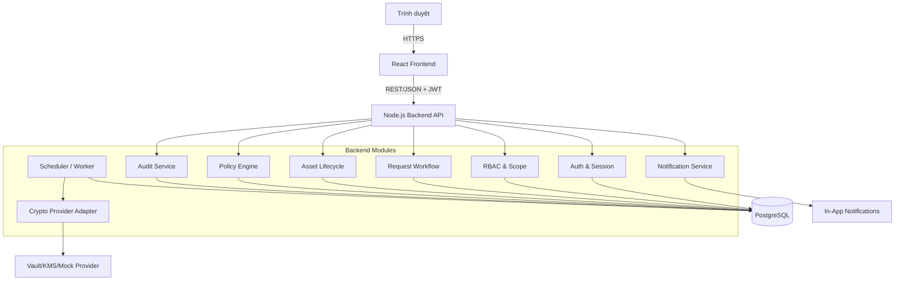

### 6.2. Ranh giới tin cậy

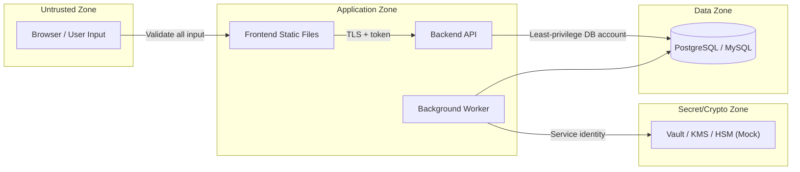

### 6.3. Cấu trúc source code đề xuất

```text
root/
├── apps/
│   ├── web/                       # React application
│   │   └── src/
│   │       ├── app/
│   │       ├── features/
│   │       │   ├── auth/
│   │       │   ├── assets/
│   │       │   ├── requests/
│   │       │   ├── approvals/
│   │       │   ├── policies/
│   │       │   ├── audit/
│   │       │   └── users/
│   │       └── shared/
│   └── api/                       # Node.js backend
│       └── src/
│           ├── auth/
│           ├── iam/
│           ├── users/
│           ├── requests/
│           ├── approvals/
│           ├── assets/
│           ├── policies/
│           ├── audit/
│           ├── notifications/
│           ├── jobs/
│           └── crypto-provider/
├── packages/
│   ├── contracts/                 # DTO/schema dùng chung nếu phù hợp
│   └── eslint-config/
├── infra/
│   ├── docker/
│   └── migrations/
├── docs/
│   ├── diagrams/
│   ├── api/
│   └── test-cases/
├── .env.example
├── docker-compose.yml
└── README.md
```

### 6.4. Quyết định kiến trúc quan trọng

| ID     | Quyết định đề xuất                      | Lý do                                      |
| ------ | --------------------------------------- | ------------------------------------------ |
| ADR-01 | PostgreSQL làm nguồn dữ liệu chính      | Transaction và constraint phù hợp workflow |
| ADR-02 | TypeScript cho cả frontend/backend      | Giảm lỗi contract và dễ bảo trì            |
| ADR-03 | Private key không lưu dạng rõ trong DB  | Giảm rủi ro lộ vật liệu khóa               |
| ADR-04 | Provider adapter                        | MVP dùng mock nhưng có thể thay Vault/KMS  |
| ADR-05 | Approval bằng atomic update/transaction | Ngăn duyệt đồng thời                       |
| ADR-06 | Audit append-only                       | Đảm bảo truy vết                           |
| ADR-07 | UTC trong DB                            | Tránh lỗi hết hạn theo timezone            |

---

## 7. Thiết kế dữ liệu

### 7.1. ERD đề xuất

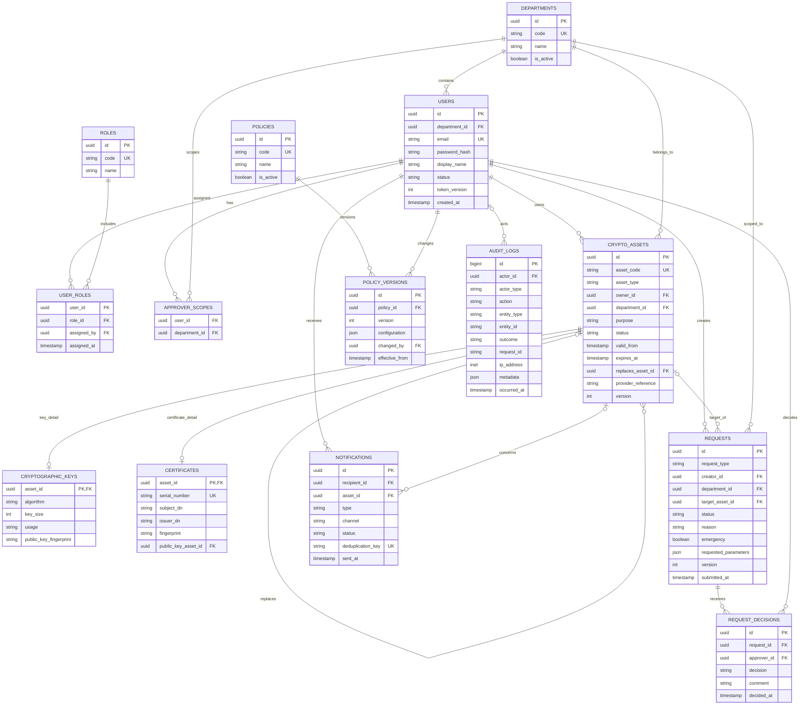

### 7.2. Quy tắc dữ liệu

- Tất cả bảng nghiệp vụ dùng UUID; Audit Log có thể dùng `BIGINT` tăng dần.
- Email, role code, department code, asset code và certificate serial là unique.
- Dùng enum hoặc check constraint cho `status`, `request_type`, `asset_type`.
- `expires_at > valid_from`.
- `requested_parameters` chỉ chứa tham số nghiệp vụ; không chứa private key.
- `version` hỗ trợ optimistic locking.
- Không cascade delete từ User sang request, asset, decision hoặc audit.
- User nghỉ việc chuyển `DISABLED`, không xóa bản ghi.
- Mỗi request chỉ có một quyết định cuối cùng trong MVP.
- Unique partial index ngăn nhiều request gia hạn/thu hồi đang mở cho một asset.

### 7.3. Index quan trọng

- `requests(status, department_id, submitted_at)` cho hàng đợi Approver.
- `crypto_assets(owner_id, status)` cho dashboard User.
- `crypto_assets(expires_at, status)` cho background job.
- `audit_logs(occurred_at)`, `(actor_id, occurred_at)`, `(entity_type, entity_id)`.
- `notifications(deduplication_key)` unique để chống gửi lặp.

### 7.4. Seed data demo

- 01 Security Admin.
- 02 Approver thuộc hai phòng ban.
- 04 User thuộc hai phòng ban.
- 01 policy mặc định.
- Tối thiểu 10 tài sản có đủ trạng thái.
- Tối thiểu 6 request: pending, approved, rejected, completed, failed.

---

## 8. Luồng trạng thái và quy tắc nghiệp vụ

### 8.1. State machine của Request

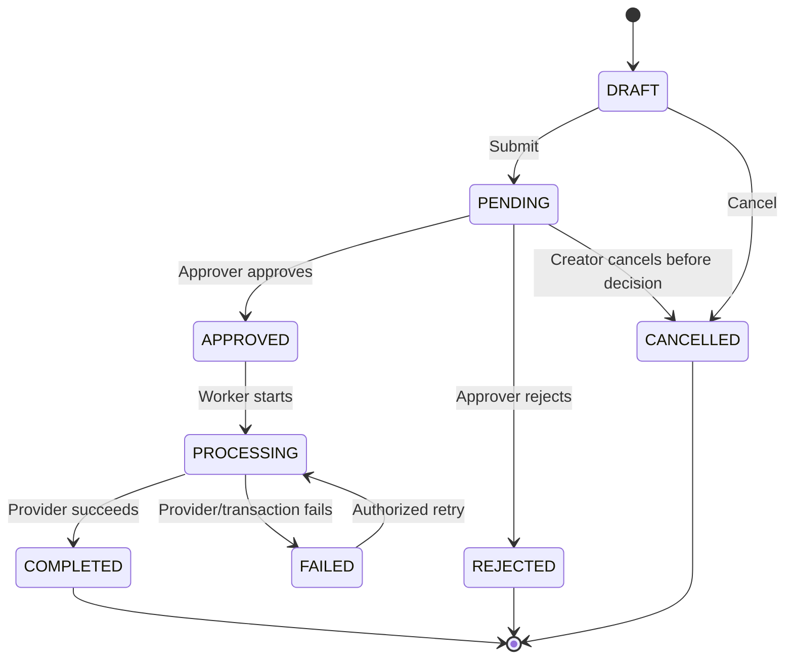

### 8.2. State machine của tài sản

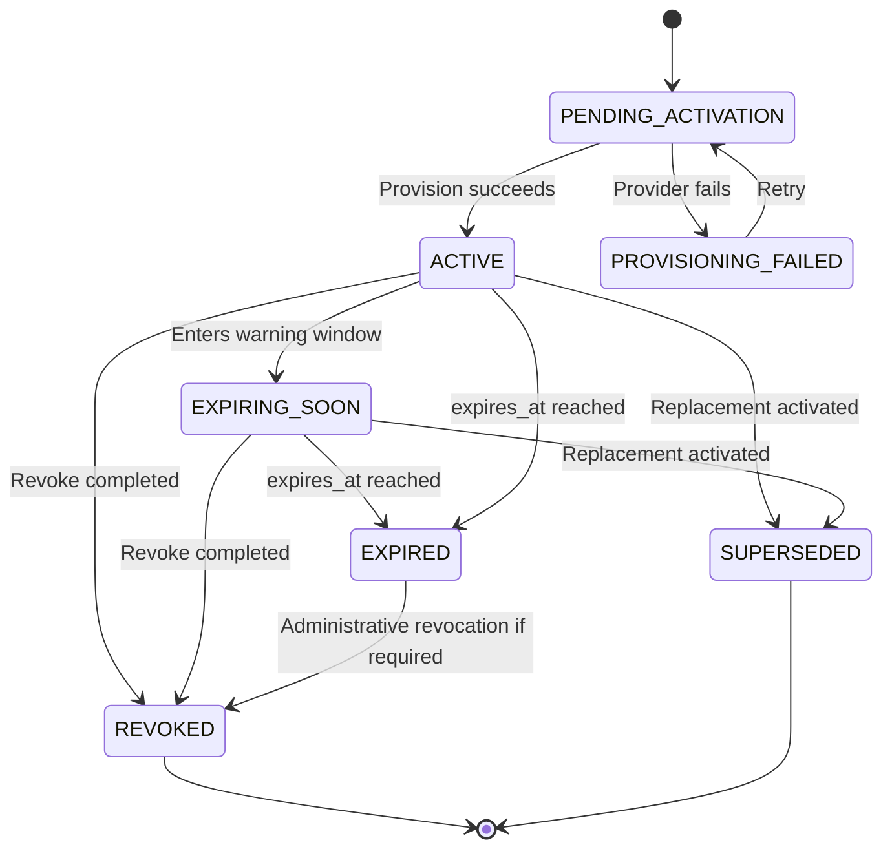

### 8.3. Bảng chuyển trạng thái được phép

| Đối tượng | Từ                   | Sang          | Tác nhân/service | Điều kiện                     |
| --------- | -------------------- | ------------- | ---------------- | ----------------------------- |
| Request   | DRAFT                | PENDING       | Creator          | Payload hợp policy            |
| Request   | PENDING              | APPROVED      | Approver         | Khác creator, đúng scope      |
| Request   | PENDING              | REJECTED      | Approver         | Có lý do                      |
| Request   | APPROVED             | PROCESSING    | Worker           | Job idempotent                |
| Request   | PROCESSING           | COMPLETED     | Worker           | Provider thành công           |
| Request   | PROCESSING           | FAILED        | Worker           | Lưu error code đã che dữ liệu |
| Asset     | ACTIVE               | EXPIRING_SOON | System Job       | Nằm trong warning window      |
| Asset     | ACTIVE/EXPIRING_SOON | REVOKED       | Worker           | Revoke request đã duyệt       |
| Asset     | ACTIVE/EXPIRING_SOON | EXPIRED       | System Job       | `expires_at <= now`           |

### 8.4. Luồng cảnh báo hết hạn

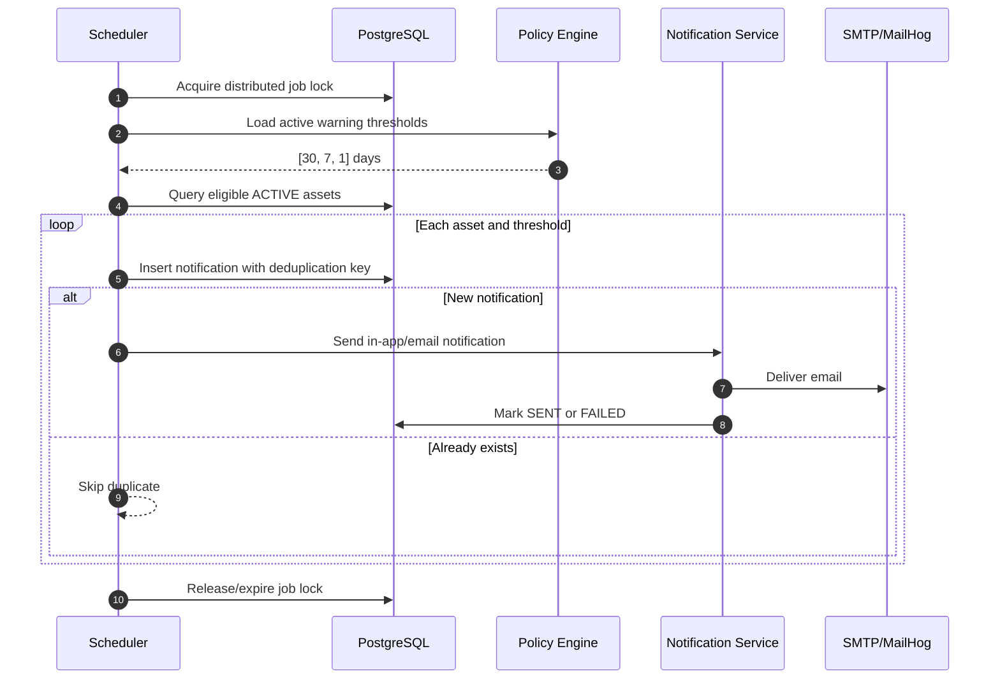

### 8.5. Quy tắc thời gian

- Database lưu UTC.
- So sánh hết hạn bằng timestamp chính xác, không chỉ bằng ngày.
- Job phải idempotent: chạy lại không gửi trùng và không tạo trạng thái sai.
- Policy thay đổi chỉ áp dụng từ `effective_from`, không sửa lịch sử.

---

## 9. Thiết kế API

### 9.1. Quy ước chung

- Base path: `/api/v1`.
- JSON dùng `camelCase`; database dùng `snake_case`.
- Pagination theo `page`, `pageSize`, giới hạn tối đa 100.
- Mọi response có `requestId` để đối chiếu log.
- Lỗi dùng cấu trúc thống nhất, không trả stack trace.
- Các thao tác nhạy cảm hỗ trợ `Idempotency-Key` khi phù hợp.

### 9.2. Response lỗi chuẩn

```json
{
  "error": {
    "code": "SOD_VIOLATION",
    "message": "Người tạo yêu cầu không được tự phê duyệt.",
    "details": []
  },
  "requestId": "req_01..."
}
```

### 9.3. Danh sách endpoint MVP

#### Authentication

| Method | Endpoint        | Quyền           | Mô tả                   |
| ------ | --------------- | --------------- | ----------------------- |
| POST   | `/auth/login`   | Public          | Đăng nhập               |
| POST   | `/auth/refresh` | Refresh session | Đổi access token        |
| POST   | `/auth/logout`  | Authenticated   | Thu hồi refresh session |
| GET    | `/auth/me`      | Authenticated   | Thông tin user và quyền |

#### Assets

| Method | Endpoint              | Quyền                      | Mô tả                |
| ------ | --------------------- | -------------------------- | -------------------- |
| GET    | `/assets`             | `asset:read:own/scope/any` | Danh sách theo scope |
| GET    | `/assets/:id`         | Theo scope                 | Chi tiết asset       |
| GET    | `/assets/:id/history` | Theo scope                 | Lịch sử vòng đời     |

Không cung cấp API CRUD tùy ý để User sửa trạng thái tài sản.

#### Requests và Approval

| Method | Endpoint                 | Quyền             | Mô tả                    |
| ------ | ------------------------ | ----------------- | ------------------------ |
| POST   | `/requests`              | `request:create`  | Tạo draft hoặc submit    |
| GET    | `/requests`              | Theo owner/scope  | Danh sách request        |
| GET    | `/requests/:id`          | Theo owner/scope  | Chi tiết request         |
| POST   | `/requests/:id/submit`   | Creator           | Gửi duyệt                |
| POST   | `/requests/:id/cancel`   | Creator           | Hủy trước quyết định     |
| GET    | `/approval-queue`        | `request:approve` | Danh sách chờ duyệt      |
| POST   | `/requests/:id/decision` | `request:approve` | Approve/reject nguyên tử |
| POST   | `/requests/:id/retry`    | Quyền vận hành    | Retry request failed     |

#### Admin

| Method | Endpoint                  | Quyền           | Mô tả             |
| ------ | ------------------------- | --------------- | ----------------- |
| GET    | `/admin/users`            | `user:read`     | Danh sách user    |
| PATCH  | `/admin/users/:id/status` | `user:manage`   | Khóa/mở tài khoản |
| PUT    | `/admin/users/:id/roles`  | `role:assign`   | Gán vai trò       |
| GET    | `/policies`               | `policy:read`   | Xem policy        |
| POST   | `/policies/:id/versions`  | `policy:manage` | Tạo version mới   |
| GET    | `/audit-logs`             | `audit:read`    | Tra cứu log       |

#### Notifications

| Method | Endpoint                  | Quyền         | Mô tả              |
| ------ | ------------------------- | ------------- | ------------------ |
| GET    | `/notifications`          | Authenticated | Thông báo của mình |
| POST   | `/notifications/:id/read` | Owner         | Đánh dấu đã đọc    |

### 9.4. Mã HTTP cần dùng

| Mã   | Khi dùng                                              |
| ---- | ----------------------------------------------------- |
| 200  | Truy vấn/cập nhật thành công                          |
| 201  | Tạo request/resource thành công                       |
| 204  | Logout hoặc thao tác không cần body                   |
| 400  | Payload sai cú pháp                                   |
| 401  | Chưa đăng nhập/token không hợp lệ                     |
| 403  | Có đăng nhập nhưng không đủ quyền/scope               |
| 404  | Không tìm thấy hoặc cần che sự tồn tại của tài nguyên |
| 409  | Xung đột trạng thái/duyệt đồng thời/request trùng     |
| 422  | Vi phạm policy/quy tắc nghiệp vụ                      |
| 429  | Quá giới hạn request                                  |
| 500  | Lỗi nội bộ đã che chi tiết                            |
| 503  | Provider/email tạm thời không sẵn sàng                |

---

## 10. Thiết kế Frontend

### 10.1. Sitemap

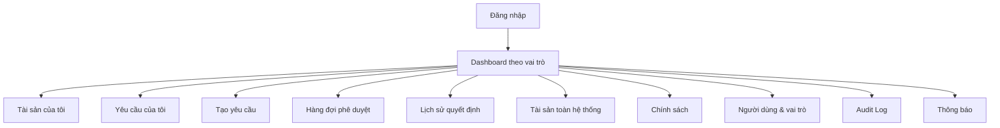

### 10.2. Màn hình User

- Dashboard: số tài sản active, sắp hết hạn, request đang chờ.
- Danh sách tài sản: filter loại, trạng thái, ngày hết hạn.
- Chi tiết tài sản: metadata, lịch sử, nút Renew/Revoke theo trạng thái.
- Form cấp mới: loại, mục đích, thuật toán, thời hạn, lý do.
- Form gia hạn/thu hồi: hiển thị rõ asset đang tác động.
- Danh sách request: trạng thái, thời gian, người duyệt, lý do từ chối.

### 10.3. Màn hình Approver

- Approval Queue theo scope.
- Bộ lọc loại request, độ khẩn cấp, ngày gửi, phòng ban.
- Chi tiết request hiển thị owner, asset, policy validation và lịch sử.
- Hai thao tác rõ ràng: Approve và Reject.
- Reject bắt buộc lý do; Approve yêu cầu xác nhận.
- Không hiển thị nút duyệt nếu request do chính Approver tạo.

### 10.4. Màn hình Security Admin

- Tổng quan tài sản theo trạng thái và loại.
- Danh sách user, vai trò và trạng thái tài khoản.
- Policy editor có preview giá trị cũ/mới.
- Audit Log có filter actor, action, entity, outcome và khoảng thời gian.
- Không có nút Approve/Reject.

### 10.5. Quy tắc UX và accessibility

- Không chỉ dùng màu để biểu diễn trạng thái; luôn có text/icon.
- Form có label, error message và focus hợp lý.
- Dialog nguy hiểm nêu rõ đối tượng bị ảnh hưởng.
- Không hiển thị secret/token/private key trong UI thông thường.
- Route guard chỉ hỗ trợ UX; backend vẫn là nơi quyết định quyền.
- Có trạng thái loading, empty, error và retry cho mọi danh sách.

### 10.6. Mục tiêu trải nghiệm sản phẩm

UI/UX là một tiêu chí nghiệm thu chính của đồ án, không phải phần trang trí làm sau. Giao diện phải giúp người xem hiểu được ba điều trong vòng 30 giây:

1. Người đang đăng nhập có vai trò gì.
2. Có việc gì cần xử lý ngay.
3. Tài sản/yêu cầu đang ở trạng thái nào và bước tiếp theo là gì.

Các chỉ tiêu UX đề xuất:

- User hoàn thành yêu cầu cấp mới trong tối đa 2 phút và không quá 3 bước chính.
- Approver mở một request, hiểu rủi ro và đưa ra quyết định trong tối đa 60 giây.
- Admin tìm được một Audit Log cụ thể trong tối đa 45 giây.
- Các thao tác thường dùng không sâu quá 3 cấp điều hướng.
- 100% hành động nhạy cảm có màn hình xác nhận và phản hồi kết quả rõ ràng.
- Các màn hình demo chính hoạt động tốt ở 1366×768 và 1920×1080; màn hình User dùng được trên mobile.

### 10.7. Định hướng hình ảnh và design system

Phong cách đề xuất: **Enterprise Security Dashboard** — chuyên nghiệp, rõ ràng, ít màu trang trí, nhấn mạnh độ tin cậy và khả năng truy vết.

| Thành phần     | Quy định đề xuất                                             |
| -------------- | ------------------------------------------------------------ |
| Font           | Inter hoặc system font; tối đa 3 cấp kích thước chính trên mỗi màn hình |
| Màu chủ đạo    | Xanh đậm/xanh lam thể hiện độ tin cậy                        |
| Màu trạng thái | Xanh lá = thành công/active; vàng = cảnh báo; đỏ = nguy hiểm/revoked; xám = inactive |
| Khoảng cách    | Hệ 8px: 8, 16, 24, 32                                        |
| Bo góc         | Nhất quán 8–12px, tránh mỗi component một kiểu               |
| Bóng đổ        | Nhẹ, chỉ dùng để phân tầng; không lạm dụng card nổi          |
| Icon           | Một bộ icon duy nhất, luôn đi kèm label cho hành động quan trọng |
| Bảng dữ liệu   | Header cố định, filter rõ, trạng thái có text, empty state có hướng dẫn |
| Form           | Label luôn hiển thị; helper text cho thuật toán/độ dài khóa  |

#### Token cần định nghĩa trong code

```text
color.brand.primary
color.semantic.success
color.semantic.warning
color.semantic.danger
color.semantic.info
color.surface.page
color.surface.card
color.text.primary
color.text.secondary
color.border.default
space.1 ... space.6
radius.sm / md / lg
shadow.sm / md
```

Không hard-code màu/spacing rải rác trong component. Dark mode là tính năng mở rộng; không nên làm nếu chưa hoàn chỉnh light mode.

### 10.8. App shell và hệ thống điều hướng

```text
┌──────────────────────────────────────────────────────────────────────────┐
│ Logo + Crypto Asset Manager     [Tìm kiếm]      [Chuông] [Tên + Vai trò]│
├──────────────────┬───────────────────────────────────────────────────────┤
│ Tổng quan        │ Breadcrumb                                            │
│ Tài sản          │                                                       │
│ Yêu cầu          │ Tên trang                              [Hành động chính]│
│ Phê duyệt (*)    │ Mô tả ngắn mục đích trang                              │
│ Chính sách (*)   ├───────────────────────────────────────────────────────┤
│ Người dùng (*)   │ Nội dung: KPI hữu ích → filter → bảng/chi tiết        │
│ Nhật ký (*)      │                                                       │
│                  │                                                       │
│ Trợ giúp         │                                                       │
└──────────────────┴───────────────────────────────────────────────────────┘
(*) Chỉ hiển thị nếu vai trò có quyền
```

Quy tắc:

- Sidebar giữ vị trí các chức năng ổn định giữa các vai trò.
- Vai trò hiện tại luôn hiển thị cạnh avatar/tên.
- Breadcrumb giúp người demo quay lại nhanh và giúp giảng viên hiểu ngữ cảnh.
- Mỗi trang chỉ có một primary action nổi bật.
- Notification hiển thị tác vụ cần xử lý, không chỉ là thông báo chung chung.

### 10.9. Wireframe Dashboard theo vai trò

#### User Dashboard

```text
┌─────────────────────────────────────────────────────────────────────────┐
│ Xin chào, Nguyễn An                    [+ Tạo yêu cầu mới]               │
│ Theo dõi tài sản và yêu cầu của bạn                                     │
├────────────────┬────────────────┬────────────────┬──────────────────────┤
│ Tài sản Active │ Sắp hết hạn    │ Đang chờ duyệt │ Cần chú ý            │
│       8        │       2        │       1        │       1              │
├──────────────────────────────────┬──────────────────────────────────────┤
│ Tài sản sắp hết hạn              │ Yêu cầu gần đây                     │
│ • CERT-024  Còn 7 ngày [Gia hạn] │ • REQ-102  Chờ duyệt               │
│ • KEY-017   Còn 25 ngày          │ • REQ-099  Đã hoàn thành           │
└──────────────────────────────────┴──────────────────────────────────────┘
```

#### Approver Dashboard

```text
┌─────────────────────────────────────────────────────────────────────────┐
│ Trung tâm phê duyệt                                                     │
├────────────────┬────────────────┬──────────────────────────────────────┤
│ Chờ xử lý: 6   │ Khẩn cấp: 1   │ Thời gian xử lý TB: 4 giờ           │
├─────────────────────────────────────────────────────────────────────────┤
│ [Loại ▾] [Phòng ban ▾] [Mức độ ▾] [Khoảng ngày ▾]                      │
├───────┬──────────────┬───────────┬─────────┬──────────┬─────────────────┤
│ Mã    │ Người gửi    │ Loại      │ Tài sản │ Thời gian│ Trạng thái      │
│ R-103 │ Trần Bình    │ Thu hồi   │ KEY-021 │ 10 phút  │ KHẨN CẤP        │
│ R-102 │ Nguyễn An    │ Cấp mới   │ —       │ 2 giờ    │ Chờ duyệt       │
└───────┴──────────────┴───────────┴─────────┴──────────┴─────────────────┘
```

#### Security Admin Dashboard

```text
┌─────────────────────────────────────────────────────────────────────────┐
│ Tổng quan an toàn tài sản mật mã                                        │
├────────────────┬────────────────┬────────────────┬──────────────────────┤
│ Tổng tài sản   │ Sắp hết hạn    │ Đã thu hồi     │ Job lỗi             │
│      128       │       9        │       14       │       0              │
├────────────────────────────────────┬────────────────────────────────────┤
│ Phân bố trạng thái                 │ Cảnh báo ưu tiên                   │
│ [Biểu đồ nhỏ, có nhãn trực tiếp]   │ • 3 cert hết hạn trong 7 ngày     │
│                                    │ • Policy RSA cần rà soát          │
├────────────────────────────────────┴────────────────────────────────────┤
│ Hoạt động quản trị gần đây                                              │
└─────────────────────────────────────────────────────────────────────────┘
```

Dashboard chỉ hiển thị số liệu có thể dẫn đến hành động. Tránh đưa nhiều biểu đồ không phục vụ demo hoặc quyết định.

### 10.10. Thiết kế màn hình chi tiết yêu cầu

```text
┌─────────────────────────────────────────────────────────────────────────┐
│ ← Hàng đợi phê duyệt       REQ-2026-0103       [KHẨN CẤP] [Chờ duyệt]  │
├──────────────────────────────────────┬──────────────────────────────────┤
│ Thông vị trí yêu cầu                 │ Kiểm tra trước phê duyệt          │
│ Người gửi: Trần Bình                 │ ✓ Đúng phạm vi phòng ban          │
│ Loại: Thu hồi                        │ ✓ Người duyệt khác người gửi      │
│ Tài sản: KEY-021                     │ ✓ Tài sản đang Active             │
│ Lý do: Nghi ngờ lộ khóa              │ ! Mức độ khẩn cấp                 │
│ Gửi lúc: 09:15                       │                                  │
├──────────────────────────────────────┴──────────────────────────────────┤
│ Timeline: Tạo yêu cầu ── Gửi duyệt ── Đang chờ ── Kết quả              │
├─────────────────────────────────────────────────────────────────────────┤
│ Ghi chú quyết định                                                       │
│ [                                                                    ]  │
│                                            [Từ chối] [Phê duyệt yêu cầu]│
└─────────────────────────────────────────────────────────────────────────┘
```

Màn hình này là “màn hình ngôi sao” của demo vì thể hiện SoD, policy check, lịch sử và hành động nghiệp vụ trong cùng một luồng.

### 10.11. Component inventory

| Nhóm       | Component bắt buộc                                           |
| ---------- | ------------------------------------------------------------ |
| Navigation | AppShell, Sidebar, Topbar, Breadcrumb, UserMenu              |
| Feedback   | Toast, Alert, ConfirmDialog, ErrorBoundary, Skeleton         |
| Data       | DataTable, Pagination, FilterBar, EmptyState                 |
| Status     | StatusBadge, RiskBadge, Timeline, ExpiryIndicator            |
| Form       | TextField, Select, DateField, RadioGroup, TextArea, FormError |
| Domain     | AssetCard, RequestSummary, ApprovalChecklist, PolicyDiff, AuditEvent |
| Security   | PermissionGate cho UX, SensitiveValueMask                    |

Tất cả component phải có variant và trạng thái thống nhất: default, hover, focus, disabled, loading và error nếu liên quan.

### 10.12. Trạng thái giao diện bắt buộc

Mỗi trang dữ liệu phải thiết kế trước các trạng thái sau:

| Trạng thái            | Cách thể hiện                                         |
| --------------------- | ----------------------------------------------------- |
| Loading               | Skeleton giữ đúng bố cục; không nhảy layout           |
| Empty lần đầu         | Giải thích chưa có dữ liệu và có CTA phù hợp          |
| Empty sau filter      | “Không có kết quả”; có nút xóa filter                 |
| Error                 | Thông báo dễ hiểu, request ID, nút thử lại            |
| Forbidden             | Giải thích không có quyền, không lộ dữ liệu           |
| Offline/provider down | Banner và trạng thái degraded nếu phù hợp             |
| Success               | Toast + cập nhật ngay bảng/timeline                   |
| Conflict              | Nêu request đã được người khác xử lý; refresh dữ liệu |

### 10.13. Microcopy và nội dung

- Viết hành động theo động từ: “Gửi yêu cầu”, “Phê duyệt yêu cầu”, “Thu hồi tài sản”.
- Không dùng thông báo chung như “Có lỗi xảy ra” nếu có thể nêu cách xử lý.
- Trước hành động nguy hiểm, mô tả hậu quả: “Tài sản đã thu hồi không thể chuyển lại Active”.
- Tooltip giải thích thuật ngữ RSA, ECDSA, key size cho người dùng không chuyên.
- Hiển thị ngày giờ thống nhất, ví dụ `17/08/2026, 14:30 (GMT+7)`.
- Mã request/asset có nút sao chép và định dạng dễ đọc.

### 10.14. Quy trình thiết kế và đánh giá UX

1. Vẽ low-fidelity wireframe cho 8 màn hình demo trước khi code UI.
2. Chốt design tokens và 10 component nền tảng.
3. Làm một vertical slice hoàn chỉnh: User tạo request → Approver duyệt → User thấy asset.
4. Test với ít nhất 3 người ngoài nhóm; giao nhiệm vụ mà không hướng dẫn thao tác.
5. Ghi lại thời gian, điểm bị kẹt và lỗi hiểu nhầm.
6. Sửa các vấn đề cản trở luồng chính trước khi thêm hiệu ứng/biểu đồ.
7. Review giao diện ở 1366×768, 1920×1080 và mobile 390px.

### 10.15. UI/UX acceptance checklist

- [ ] Có một design system thống nhất; không dùng màu/kích thước tùy ý.
- [ ] Ba vai trò có dashboard khác nhau đúng nhu cầu.
- [ ] Luồng chính không quá 3 bước và có progress/timeline.
- [ ] Tất cả table có filter, empty, loading và error state.
- [ ] Form có validation gần field và giữ dữ liệu khi submit lỗi.
- [ ] Keyboard focus rõ; label và contrast đạt mức dễ đọc.
- [ ] Confirm dialog cho approve, reject, revoke, role change và policy change.
- [ ] Toast chỉ báo kết quả; thông tin quan trọng vẫn hiện trên trang.
- [ ] Không có nút “chết”, dữ liệu lorem ipsum hoặc màn hình chưa hoàn thiện trong demo.
- [ ] Không xuất hiện raw UUID/JSON/error stack nếu không phục vụ kỹ thuật.
- [ ] Demo chạy đẹp ở độ phân giải máy chiếu dự kiến.

---

## 11. Thiết kế Backend và Background Job

### 11.1. Module backend

| Module          | Trách nhiệm                                            |
| --------------- | ------------------------------------------------------ |
| Auth            | Login, token, refresh session, logout, password policy |
| IAM             | Role, permission, scope, SoD guard                     |
| Users           | Hồ sơ, trạng thái tài khoản, phòng ban                 |
| Requests        | Tạo, submit, cancel, query workflow                    |
| Approvals       | Quyết định nguyên tử, chống self-approval              |
| Assets          | Query và lifecycle tài sản                             |
| Policies        | Versioning và validation rule                          |
| Crypto Provider | Giao diện create/renew/revoke, mock/Vault/KMS adapter  |
| Audit           | Append event, redaction, correlation ID                |
| Notifications   | In-app/email, template, retry, deduplication           |
| Jobs            | Expiry scan, reminder, provisioning, cleanup session   |

### 11.2. Transaction phê duyệt

Trong một transaction:

1. Đọc request kèm lock hoặc atomic compare-and-swap theo `version`.
2. Kiểm tra trạng thái là `PENDING`.
3. Kiểm tra permission, scope và SoD.
4. Insert `request_decisions`.
5. Update request thành `APPROVED` hoặc `REJECTED`.
6. Append Audit Log.
7. Ghi outbox event nếu dùng queue.

Nếu bất kỳ bước nào lỗi, toàn bộ transaction rollback.

### 11.3. Crypto Provider Interface

```ts
interface CryptoProvider {
  provision(input: ProvisionInput): Promise<ProvisionResult>;
  renew(input: RenewInput): Promise<RenewResult>;
  revoke(input: RevokeInput): Promise<RevokeResult>;
  getStatus(reference: string): Promise<ProviderStatus>;
}
```

`ProvisionResult` chỉ trả metadata, public data và provider reference. Nếu bài toán bắt buộc bàn giao private key, phải thiết kế kênh một lần, được mã hóa, có thời hạn và không ghi log; phần này không nên nằm trong MVP nếu chưa có Vault/KMS.

### 11.4. Danh sách job

| Job                     | Lịch                    | Idempotency key                         | Xử lý lỗi                 |
| ----------------------- | ----------------------- | --------------------------------------- | ------------------------- |
| Expiry status updater   | Hàng giờ hoặc hàng ngày | `expire:{assetId}:{expiresAt}`          | Ghi log nếu lỗi           |
| Expiry reminder         | Hàng ngày               | `reminder:{assetId}:{threshold}:{date}` | Cập nhật status đã báo    |
| Provisioning worker     | Sau khi Approve         | `provision:{requestId}`                 | Trực tiếp xử lý           |
| Notification sender     | Tức thời                | `notify:{notificationId}`               | Lưu db cảnh báo trên web  |
| Refresh-session cleanup | Hàng ngày               | Theo session ID                         | Dọn rác DB                |

---

## 12. Thiết kế bảo mật

### 12.1. Threat model rút gọn

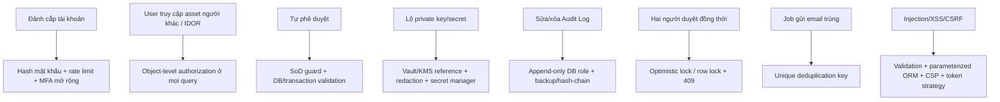

### 12.2. Authentication

- Password hash bằng Argon2id; nếu dùng bcrypt phải có cost phù hợp.
- Access token ngắn hạn, ví dụ 10–15 phút.
- Refresh token rotation; lưu hash của refresh token trong DB.
- Logout thu hồi session; thay đổi password/role có thể tăng `token_version`.
- Rate limit login và có lockout mềm có thời hạn.
- Cookie refresh token phải `HttpOnly`, `Secure`, `SameSite`; nếu lưu token theo cách khác phải có threat analysis.
- Không lưu access token lâu dài trong `localStorage` nếu có thể tránh.

### 12.3. Authorization

Kiểm tra ba lớp cho mỗi request:

1. **Role/permission:** tác nhân có quyền chức năng không?
2. **Object scope:** đối tượng thuộc owner/phòng ban được phép không?
3. **Business rule:** trạng thái và SoD có cho phép thao tác không?

### 12.4. Bảo vệ dữ liệu

- HTTPS ở môi trường triển khai.
- Secret chỉ qua environment/secret store; `.env` thật không commit.
- Không log password, token, private key, OTP hoặc toàn bộ certificate request nhạy cảm.
- Backup được mã hóa và giới hạn quyền.
- Database application account không phải superuser.
- Tách account migration, application và audit writer nếu có thể.

### 12.5. Web/API hardening

- Validation allowlist cho enum, UUID, thời hạn, key size và algorithm.
- ORM parameterized query; không nối chuỗi SQL từ input.
- Security headers/CSP, CORS allowlist và giới hạn body size.
- Chống stored XSS ở lý do/comment bằng output encoding.
- Không trả stack trace, SQL error hoặc provider secret cho client.
- Dependency scanning và khóa phiên bản dependency.

### 12.6. Chính sách mật mã mẫu

> Các giá trị dưới đây là dữ liệu demo và phải được nhóm xác nhận theo yêu cầu giảng viên; không xem là chính sách áp dụng thực tế mặc định.

```json
{
  "allowedAlgorithms": ["RSA", "ECDSA", "AES"],
  "minimumRsaKeySize": 2048,
  "allowedEcCurves": ["P-256", "P-384"],
  "allowedAesKeySizes": [128, 256],
  "defaultValidityDays": 365,
  "maximumValidityDays": 825,
  "expiryWarningDays": [30, 7, 1]
}
```

---

## 13. Audit Log và giám sát

### 13.1. Sự kiện bắt buộc ghi log

- Login thành công/thất bại, logout, refresh thất bại.
- Tạo, submit, cancel request.
- Approve, reject và vi phạm self-approval.
- Provision, renew, revoke, expire và retry.
- Thay đổi user status, role và approver scope.
- Tạo phiên bản policy.
- Xem/export Audit Log nếu có export.
- Job bắt đầu/kết thúc/thất bại ở mức tổng hợp.

### 13.2. Thuộc tính log

| Thuộc tính          | Ví dụ                            |
| ------------------- | -------------------------------- |
| actorId/actorType   | User UUID hoặc SYSTEM            |
| action              | `REQUEST_APPROVED`               |
| entityType/entityId | `REQUEST`, UUID                  |
| outcome             | `SUCCESS`, `DENIED`, `FAILED`    |
| occurredAt          | UTC timestamp                    |
| requestId           | Correlation ID                   |
| ipAddress/userAgent | Metadata truy cập đã giới hạn    |
| before/after        | Chỉ trường an toàn, đã redaction |
| reason/errorCode    | Mã lỗi, không chứa stack/secret  |

### 13.3. Bất biến Audit Log

- API không có `PUT`, `PATCH`, `DELETE` Audit Log.
- Database role của ứng dụng chỉ có `INSERT/SELECT` phù hợp trên bảng log.
- Trigger có thể chặn `UPDATE/DELETE`.
- Backup định kỳ.
- Nâng cao: mỗi record lưu `previous_hash` và `record_hash` để phát hiện chỉnh sửa.

### 13.4. Metrics tối thiểu

- Số request theo trạng thái và loại.
- Thời gian trung bình từ submit đến decision.
- Số asset sắp hết hạn/hết hạn/thu hồi.
- Số job failed và notification failed.
- Số lần login thất bại và authorization denied.
- Không đưa dữ liệu nhạy cảm vào label của metric.

---

## 14. Kế hoạch kiểm thử

### 14.1. Kim tự tháp kiểm thử

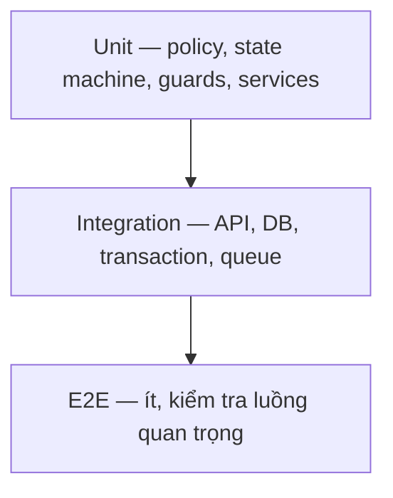

### 14.2. Unit test

- Policy validation cho algorithm, key size và validity.
- State transition hợp lệ/không hợp lệ.
- SoD guard.
- Scope resolver.
- Notification deduplication key.
- Audit redaction.
- Mapping provider error sang application error.

### 14.3. Integration test

- Login/refresh/logout.
- User chỉ xem asset của mình.
- Approver chỉ xem request trong scope.
- Creator không tự duyệt.
- Security Admin gọi approval endpoint nhận 403.
- Hai Approver cùng duyệt: một thành công, một nhận 409.
- Approval và Audit Log rollback cùng nhau nếu transaction lỗi.
- Job chạy hai lần không gửi notification trùng.
- Asset tự chuyển `EXPIRED` đúng timestamp.

### 14.4. E2E test bắt buộc

1. User tạo yêu cầu cấp mới → Approver duyệt → asset xuất hiện.
2. User tạo yêu cầu → Approver từ chối → User thấy lý do.
3. User gia hạn asset → asset mới liên kết asset cũ.
4. User yêu cầu thu hồi → duyệt → asset thành `REVOKED`.
5. Job cảnh báo → notification/email demo xuất hiện.
6. Admin đổi policy và xem được Audit Log.
7. Admin gán role nhưng không thể duyệt request.

### 14.5. Security test

| ID     | Kịch bản                              | Kỳ vọng                           |
| ------ | ------------------------------------- | --------------------------------- |
| SEC-01 | Không token gọi API                   | 401                               |
| SEC-02 | User gọi endpoint Admin               | 403                               |
| SEC-03 | User đổi asset ID sang của người khác | 404/403, không lộ dữ liệu         |
| SEC-04 | Creator tự duyệt                      | 403/422 `SOD_VIOLATION`           |
| SEC-05 | Sửa request đã approved               | 409/422                           |
| SEC-06 | Gửi comment chứa script               | Không thực thi; output encoded    |
| SEC-07 | Brute-force login                     | 429/lockout mềm                   |
| SEC-08 | Tìm secret trong log/response         | Không có secret/private key/token |
| SEC-09 | Duyệt đồng thời                       | Chỉ một decision hiệu lực         |
| SEC-10 | Gọi DELETE Audit Log                  | Endpoint không tồn tại/403        |

### 14.6. Mục tiêu chất lượng

- 100% business rule quan trọng có test.
- Coverage backend mục tiêu tối thiểu 80% cho service/guard nghiệp vụ; không dùng coverage thay thế chất lượng test.
- Không còn lỗi mức Critical/High trước demo/nghiệm thu.
- Build, lint, typecheck và test chạy tự động.

---

## 15. DevOps, triển khai và phục hồi

### 15.1. Môi trường

| Môi trường          | Mục đích                   | Dữ liệu                          |
| ------------------- | -------------------------- | -------------------------------- |
| Local               | Phát triển từng thành viên | Seed giả lập                     |
| Test/CI             | Test tự động               | Tạo mới theo pipeline            |
| Demo/Staging        | Demo tích hợp              | Dữ liệu giả lập ổn định          |
| Production giả định | Mô tả trong báo cáo        | Không nhất thiết triển khai thật |

### 15.2. Docker Compose đề xuất

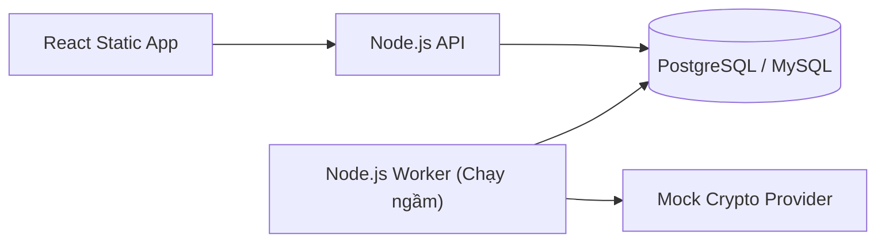

### 15.3. CI pipeline

```mermaid
flowchart LR
    PUSH["Push / Pull Request"] --> INSTALL["Install locked dependencies"]
    INSTALL --> LINT["Lint + Format check"]
    LINT --> TYPES["Typecheck"]
    TYPES --> TEST["Unit + Integration tests"]
    TEST --> BUILD["Build web + API"]
    BUILD --> SCAN["Dependency/secret scan"]
    SCAN --> IMAGE["Build container image"]
    IMAGE --> DEMO["Deploy demo — manual approval"]
```

### 15.4. Backup và phục hồi

- Backup PostgreSQL định kỳ ở môi trường demo nếu dữ liệu cần giữ.
- Mã hóa backup; không commit backup vào Git.
- Ghi rõ RPO/RTO giả định trong báo cáo.
- Thực hiện ít nhất một lần restore thử trước nghiệm thu.
- Với provider thật, backup metadata không đồng nghĩa backup private key; phải theo cơ chế của provider.

---

## 16. Lộ trình triển khai

### 16.1. Kế hoạch 12 tuần đề xuất

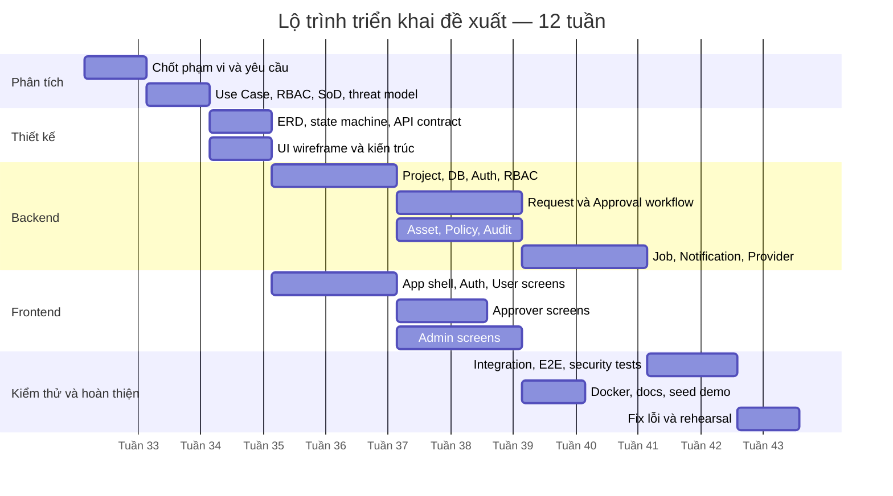

### 16.2. Milestone và đầu ra

| Mốc                        | Thời điểm    | Đầu ra bắt buộc                                  | Điều kiện qua mốc                        |
| -------------------------- | ------------ | ------------------------------------------------ | ---------------------------------------- |
| M1 — Requirements Baseline | Cuối tuần 2  | Use Case, RBAC, scope, SoD, phạm vi MVP          | Không còn câu hỏi nền tảng chưa có owner |
| M2 — Design Baseline       | Cuối tuần 3  | ERD, state machine, API, wireframe, threat model | Review chéo và chốt version              |
| M3 — Backend Core          | Cuối tuần 6  | Auth, RBAC, request, approval, audit             | Integration test cốt lõi pass            |
| M4 — Feature Complete      | Cuối tuần 9  | UI ba vai trò, job, provider mock                | 12 UC có thể chạy                        |
| M5 — Release Candidate     | Cuối tuần 11 | Security test, Docker, docs                      | Không còn Critical/High                  |
| M6 — Final                 | Tuần 12      | Demo, báo cáo, source, hướng dẫn                 | Rehearsal hoàn chỉnh                     |

### 16.3. Sprint backlog gợi ý

#### Sprint 0 — Phân tích và nền tảng

- [ ] Chốt MVP và ngoài phạm vi.
- [ ] Viết đặc tả 15 Use Case cốt lõi và các kịch bản kiểm thử.
- [ ] Chốt RBAC, scope và SoD.
- [ ] Chốt mô hình lưu private key/provider.
- [ ] Hoàn thiện ERD và state machine.
- [ ] Khởi tạo monorepo, lint, formatter, CI.
- [ ] Docker Compose PostgreSQL/Redis/MailHog.

#### Sprint 1 — Authentication và dữ liệu nền

- [ ] Migration users, roles, departments và sessions.
- [ ] Seed account demo.
- [ ] Login, refresh, logout và `/me`.
- [ ] Guards cho role/permission/scope.
- [ ] Audit authentication.
- [ ] React shell, login và protected routes.

#### Sprint 2 — Request và Approval

- [ ] Migration requests/decisions.
- [ ] API create/submit/cancel/list/detail.
- [ ] Approval queue và decision transaction.
- [ ] SoD và concurrency tests.
- [ ] UI User request.
- [ ] UI Approval Queue.

#### Sprint 3 — Asset và Policy

- [ ] Migration asset/key/certificate/policy.
- [ ] Asset lifecycle service.
- [ ] Provider interface và mock provider.
- [ ] Policy validation/versioning.
- [ ] UI asset User/Admin.
- [ ] UI policy Admin.

#### Sprint 4 — Notification, Audit và Admin

- [ ] Expiry updater/reminder.
- [ ] Notification deduplication và MailHog.
- [ ] Audit query/filter.
- [ ] User/role/scope management.
- [ ] UI notification, RBAC và Audit Log.

#### Sprint 5 — Hardening và bàn giao

- [ ] E2E cho 12 UC.
- [ ] Security test matrix.
- [ ] Dependency/secret scan.
- [ ] Docker production-like build.
- [ ] Seed kịch bản demo.
- [ ] Swagger, README, báo cáo, video/demo rehearsal.

---

## 17. Phân công nhóm

### 17.1. Mẫu cho nhóm 4 người

| Thành viên | Vai trò chính      | Công việc sở hữu                     | Review chéo            |
| ---------- | ------------------ | ------------------------------------ | ---------------------- |
| TV1        | Tech Lead/Backend  | Kiến trúc, Auth, RBAC, transaction   | Review API và security |
| TV2        | Backend/Data       | DB, request, asset, policy, jobs     | Review migration/test  |
| TV3        | Frontend           | User và Approver UI, API integration | Review accessibility   |
| TV4        | Frontend/QA/DevOps | Admin UI, E2E, Docker, docs          | Review UX và release   |

Nếu nhóm có 3 người, gộp TV3 và TV4 theo từng sprint. Nếu nhóm có 5 người, tách QA/Security/DevOps thành người thứ năm.

### 17.2. RACI cho hạng mục quan trọng

Ký hiệu: `R` thực hiện, `A` chịu trách nhiệm cuối, `C` tham vấn, `I` được thông báo.

| Hạng mục             | Lead | Backend/Data | Frontend | QA/DevOps |
| -------------------- | :--: | :----------: | :------: | :-------: |
| Chốt yêu cầu/SoD     |  A   |      C       |    C     |     R     |
| ERD/migration        |  C   |     A/R      |    I     |     C     |
| Auth/RBAC            | A/R  |      C       |    C     |     C     |
| Request workflow     |  A   |      R       |    C     |     C     |
| UI ba vai trò        |  C   |      I       |   A/R    |     R     |
| Audit/security tests |  A   |      R       |    C     |     R     |
| Docker/release       |  C   |      C       |    I     |    A/R    |
| Báo cáo/demo         |  A   |      R       |    R     |     R     |

### 17.3. Quy tắc làm việc Git

- Branch ngắn theo feature: `feat/request-approval`, `fix/sod-check`.
- Pull request bắt buộc có mô tả, ảnh/chứng cứ test và checklist.
- Không merge khi CI fail.
- Thay đổi schema phải có migration.
- Không commit `.env`, private key, token hoặc dữ liệu thật.
- Ít nhất một người khác review code nhạy cảm: Auth, RBAC, approval, audit.

---

## 18. Tiêu chí nghiệm thu

### 18.1. Functional acceptance

- Cả 15 Use Case (UC-01 đến UC-15) cùng Bảng thông báo nổi chạy được từ giao diện đến database.
- User không thấy dữ liệu ngoài owner scope.
- Approver không thấy yêu cầu ngoài scope.
- Creator không tự duyệt được bằng cả UI và API trực tiếp.
- Admin quản lý policy/RBAC/audit nhưng không duyệt được.
- Renewal tạo asset kế tiếp, không sửa lịch sử asset cũ.
- Revocation không thể hoàn tác thành `ACTIVE`.
- Job hết hạn và cảnh báo chạy idempotent.

### 18.2. Security acceptance

- Không có private key/token/password trong Git, log hoặc response thông thường.
- Mật khẩu được hash mạnh.
- RBAC và object scope có automated tests.
- Audit Log không có endpoint sửa/xóa.
- Không còn lỗ hổng Critical/High đã biết.
- Các dependency có lock file và không có secret trong image/source.

### 18.3. Technical acceptance

- `docker compose up` khởi động được hệ thống demo.
- Migration và seed chạy lại được trên database mới.
- README đủ để thành viên/giảng viên chạy dự án.
- Swagger/OpenAPI truy cập được ở môi trường demo.
- Lint, typecheck, unit và integration test pass.
- Có tài khoản demo riêng cho User, Approver và Admin.

### 18.4. Definition of Done cho mỗi story

- Code và migration hoàn tất.
- Input validation, authorization và Audit Log đã xem xét.
- Unit/integration test phù hợp đã có.
- UI có loading/error/empty state nếu liên quan.
- API docs cập nhật.
- Không đưa secret/dữ liệu nhạy cảm vào log.
- PR được review và CI pass.

---

## 19. Rủi ro và phương án xử lý

| Rủi ro                              |  Xác suất  |  Tác động  | Biện pháp                                      | Chủ sở hữu       |
| ----------------------------------- | :--------: | :--------: | ---------------------------------------------- | ---------------- |
| Phạm vi quá lớn                     |    Cao     |    Cao     | Chốt MVP; Vault/CA thật là nâng cao            | Lead             |
| Nhầm khóa với chứng thư             | Trung bình |    Cao     | Tách entity, state và renewal semantics        | Backend/Data     |
| Lộ private key/secret               | Trung bình |  Rất cao   | Provider reference, redaction, secret scan     | Lead             |
| RBAC chỉ làm ở UI                   | Trung bình |  Rất cao   | Guard + object authorization + API test        | Backend          |
| Self-approval/race condition        | Trung bình |    Cao     | Transaction, version/lock, test đồng thời      | Backend          |
| Audit có thể bị sửa                 | Trung bình |    Cao     | Append-only role/trigger/backup                | Data             |
| Job gửi trùng                       |    Cao     | Trung bình | Dedup key + unique index + idempotent job      | Backend          |
| Chậm tích hợp frontend/backend      |    Cao     | Trung bình | OpenAPI sớm, mock contract, weekly integration | Frontend/Backend |
| Demo phụ thuộc email/provider ngoài | Trung bình |    Cao     | MailHog + mock provider local                  | DevOps           |
| Thiếu dữ liệu demo                  | Trung bình | Trung bình | Seed cố định theo kịch bản                     | QA               |
| Báo cáo làm muộn                    |    Cao     | Trung bình | Viết theo milestone, lưu sơ đồ trong repo      | Cả nhóm          |

---

## 20. Kịch bản demo và cấu trúc báo cáo

### 20.1. Kịch bản demo 12–15 phút

1. **Giới thiệu vấn đề và kiến trúc** — 1 phút.
2. **User tạo yêu cầu cấp mới** — 2 phút.
3. **Chứng minh SoD:** cùng User/Approver tạo request không thể tự duyệt — 1 phút.
4. **Approver đúng scope phê duyệt** — 2 phút.
5. **Asset được tạo và Audit Log xuất hiện** — 2 phút.
6. **Gia hạn hoặc thu hồi** — 2 phút.
7. **Admin đổi policy, gán role và xem audit** — 2 phút.
8. **Chạy job cảnh báo/hết hạn bằng dữ liệu seed** — 1 phút.
9. **Trình bày security tests và kết luận** — 2 phút.

Chuẩn bị trước một bản quay màn hình dự phòng nếu môi trường demo gặp sự cố.

### 20.2. Storyline thuyết minh sản phẩm

Không demo theo kiểu đi lần lượt qua tất cả menu. Toàn bộ phần trình bày nên kể một câu chuyện nghiệp vụ xuyên suốt:

> “Một nhân viên cần chứng thư để ký tài liệu. Nhân viên gửi yêu cầu; quản lý phê duyệt theo nguyên tắc SoD; hệ thống cấp phát và ghi audit. Sau đó hệ thống phát hiện chứng thư sắp hết hạn, nhắc người sở hữu gia hạn. Khi một khóa khác bị nghi lộ, tổ chức thu hồi và truy vết toàn bộ sự kiện.”

Câu chuyện này giúp giảng viên thấy được vòng đời hoàn chỉnh thay vì các màn CRUD rời rạc.

### 20.3. Runbook demo theo phút

| Thời gian   | Người trình bày làm gì            | Nội dung thuyết minh                           | Bằng chứng trên UI                       |
| ----------- | --------------------------------- | ---------------------------------------------- | ---------------------------------------- |
| 00:00–01:00 | Mở slide vấn đề/kiến trúc         | Rủi ro hết hạn, lộ khóa, tự phê duyệt          | Sơ đồ kiến trúc ngắn                     |
| 01:00–02:00 | Login User                        | Giao diện thay đổi theo vai trò; scope dữ liệu | Role ở topbar, dashboard cá nhân         |
| 02:00–04:00 | Tạo request cấp chứng thư         | Policy hỗ trợ chọn đúng thuật toán/thời hạn    | Validation, review step, success state   |
| 04:00–05:00 | Cho thấy request Pending          | Mọi thay đổi có timeline/audit                 | Mã request và timeline                   |
| 05:00–07:00 | Login Approver, mở request        | Approver thấy đúng scope và policy check       | Approval checklist                       |
| 07:00–08:00 | Approve                           | Backend kiểm tra SoD; xử lý bằng transaction   | Confirm dialog, success, queue giảm      |
| 08:00–09:00 | Quay lại User                     | Asset đã được cấp; không lộ private key        | Asset detail, provider reference đã mask |
| 09:00–10:30 | Tạo/duyệt revoke khẩn cấp đã seed | Thu hồi là một chiều, có lý do                 | Warning, status REVOKED, timeline        |
| 10:30–12:00 | Login Admin                       | Admin quản lý policy/RBAC nhưng không approve  | Menu không có Approval, Audit Log        |
| 12:00–13:00 | Kích hoạt job demo                | Cảnh báo hết hạn idempotent                    | Notification + MailHog + job status      |
| 13:00–14:00 | Chạy security test tiêu biểu      | UI không phải lớp bảo vệ duy nhất              | API trả 403 self-approval/IDOR           |
| 14:00–15:00 | Kết luận                          | 12 UC, bảo mật, hạn chế và hướng mở rộng       | Slide kết quả                            |

Nếu thời lượng chỉ có 10 phút, bỏ thao tác policy chi tiết và chỉ cho xem Audit Log; không bỏ luồng User → Approver → Asset.

### 20.4. Demo mode và dữ liệu trình diễn

Tạo seed cố định để buổi demo không phụ thuộc thao tác ngẫu nhiên:

| Tài khoản                    | Vai trò        | Phòng ban | Mật khẩu demo                     | Mục đích                 |
| ---------------------------- | -------------- | --------- | --------------------------------- | ------------------------ |
| `user.demo@example.test`     | User           | Kế toán   | Chỉ lưu trong tài liệu demo riêng | Tạo request và xem asset |
| `approver.demo@example.test` | Approver       | Kế toán   | Như trên                          | Duyệt đúng scope         |
| `approver.it@example.test`   | Approver       | CNTT      | Như trên                          | Chứng minh khác scope    |
| `admin.demo@example.test`    | Security Admin | Security  | Như trên                          | Policy/RBAC/Audit        |

> Không ghi mật khẩu demo thật vào repository public. Có thể dùng script seed nhận password qua environment và in hướng dẫn riêng khi chạy local.

Dữ liệu cần chuẩn bị:

- Một certificate còn 31 ngày để minh họa trước warning window.
- Một certificate còn 7 ngày để job tạo cảnh báo.
- Một key `ACTIVE` cho luồng revoke khẩn cấp.
- Một asset `REVOKED` có timeline đầy đủ.
- Hai request `PENDING` thuộc hai phòng ban để chứng minh scope.
- Một request do Approver tự tạo để chứng minh SoD.
- Một policy version cũ và mới để hiển thị diff.
- Audit events đủ cho toàn bộ câu chuyện demo.

### 20.5. Chế độ điều khiển demo an toàn

Để không phải đợi scheduler thật, môi trường demo có thể có công cụ chỉ dành cho development:

- `Demo Clock` hoặc seed với timestamp tương đối.
- Nút/command chạy expiry scan thủ công, chỉ bật khi `NODE_ENV=development`.
- Mock provider có độ trễ ngắn để thể hiện `PROCESSING → COMPLETED`.
- MailHog để mở email ngay trên máy local.
- Script reset demo data về trạng thái ban đầu.

Các công cụ demo phải bị tắt hoàn toàn ở cấu hình production giả định và được giải thích rõ với giảng viên.

### 20.6. Phương án dự phòng khi demo

| Sự cố                       | Phương án ngay lập tức                                       |
| --------------------------- | ------------------------------------------------------------ |
| Internet lỗi                | Toàn bộ demo chạy local bằng Docker Compose                  |
| Email không gửi             | Mở notification in-app và MailHog local                      |
| Provider lỗi                | Dùng mock provider; giải thích adapter cho provider thật     |
| Database bẩn                | Chạy script reset/seed đã thử trước                          |
| Một bước thao tác lỗi       | Chuyển sang account/state seed kế tiếp, không debug trực tiếp quá 30 giây |
| Docker không khởi động      | Có bản build đã chạy sẵn và video dự phòng                   |
| Máy chiếu độ phân giải thấp | Browser zoom đã kiểm tra ở 80–100%; UI responsive            |

### 20.7. Checklist trước giờ trình bày

#### Trước 1 tuần

- [ ] Đóng băng feature; chỉ sửa lỗi và polish UI.
- [ ] Chạy toàn bộ E2E/security test.
- [ ] Review microcopy, format ngày, trạng thái và dữ liệu demo.
- [ ] Quay video dự phòng từ đầu đến cuối.

#### Trước 1 ngày

- [ ] Test trên đúng laptop/cổng xuất hình sẽ dùng.
- [ ] Pull/build image và dependency cần thiết; bảo đảm chạy offline.
- [ ] Reset seed và rehearsal có bấm giờ.
- [ ] Mỗi thành viên biết câu chuyển giao cho người kế tiếp.

#### Trước 30 phút

- [ ] Khởi động Docker và kiểm tra health endpoint.
- [ ] Mở sẵn đúng tab: User, Approver, Admin, MailHog, Swagger.
- [ ] Dùng các browser profile/incognito riêng để không nhầm token vai trò.
- [ ] Tắt notification cá nhân và ứng dụng không liên quan.
- [ ] Reset zoom, đóng DevTools trừ khi chuẩn bị demo API/security.
- [ ] Kiểm tra dữ liệu seed và job chưa chạy trước thời điểm dự kiến.

### 20.8. Cách trình bày phần UI/UX để ghi điểm

Khi demo mỗi màn hình, thuyết minh theo ba lớp:

1. **Nhu cầu:** “Approver cần biết yêu cầu nào nguy hiểm và cần xử lý trước.”
2. **Quyết định UI:** “Vì vậy hàng đợi ưu tiên emergency request, có filter và hiển thị thời gian chờ.”
3. **Bảo mật/nghiệp vụ:** “Nút phê duyệt chỉ là UX; backend vẫn kiểm tra role, scope và người tạo khác người duyệt.”

Những điểm nên chủ động chỉ ra:

- Dashboard khác nhau theo vai trò, không phải một dashboard dùng chung.
- Timeline giúp giải thích vòng đời và khả năng audit.
- Policy check giúp Approver ra quyết định, không chỉ đưa hai nút Approve/Reject.
- Confirm dialog giải thích hậu quả của revoke/role change.
- Loading, empty, error và conflict state đã được thiết kế, chứng minh sản phẩm hoàn chỉnh.
- Màu trạng thái luôn có text nên vẫn hiểu khi chiếu máy hoặc người xem khó phân biệt màu.

### 20.9. Câu hỏi phản biện dự kiến

| Câu hỏi                             | Ý chính cần trả lời                                          |
| ----------------------------------- | ------------------------------------------------------------ |
| Khóa bí mật lưu ở đâu?              | Không lưu rõ trong DB; DB chỉ giữ provider reference; MVP dùng mock adapter |
| Vì sao Admin không được duyệt?      | SoD: quyền cấu hình/quản trị không đồng nghĩa quyền chấp thuận nghiệp vụ |
| Có thể sửa Audit Log không?         | Không có API sửa/xóa; DB role/trigger append-only; có thể bổ sung hash-chain |
| Hai người cùng duyệt thì sao?       | Transaction + row/optimistic lock; chỉ một người thành công, người còn lại nhận 409 |
| Job chạy hai lần có gửi trùng?      | Notification có deduplication key và unique constraint       |
| Gia hạn có sửa ngày hết hạn cũ?     | Không; tạo asset/chứng thư kế tiếp và giữ lịch sử asset cũ   |
| User đổi ID trên URL thì sao?       | Backend kiểm tra object scope, không chỉ route guard frontend |
| Tại sao dùng React/Node/PostgreSQL? | Phù hợp yêu cầu công nghệ; TypeScript chia sẻ kiểu; PostgreSQL mạnh về transaction/constraint |
| Hệ thống có phải KMS/CA thật không? | Đây là lớp quản lý lifecycle/workflow; provider adapter cho phép nối KMS/CA thật sau này |
| Điểm hạn chế hiện tại?              | Chưa tích hợp HSM/CA thật, MFA/hash-chain là hướng mở rộng; nêu thẳng phạm vi MVP |

### 20.10. Cấu trúc báo cáo đồ án

1. Bối cảnh, lý do chọn đề tài và mục tiêu.
2. Cơ sở lý thuyết: key lifecycle, certificate lifecycle, RBAC, SoD, audit.
3. Khảo sát yêu cầu và đặc tả 15 Use Case.
4. Kiến trúc hệ thống và threat model.
5. Thiết kế dữ liệu, state machine và API.
6. Thiết kế giao diện.
7. Chi tiết triển khai backend/frontend/job.
8. Các cơ chế bảo mật.
9. Kế hoạch và kết quả kiểm thử.
10. Hướng dẫn triển khai/demo.
11. Kết quả đạt được, hạn chế và hướng phát triển.

### 20.11. Minh chứng cần lưu

- Ảnh Use Case, kiến trúc, ERD và state machine.
- Swagger screenshot hoặc OpenAPI file.
- Kết quả test/coverage.
- Kết quả security test quan trọng.
- Ảnh UI của ba vai trò.
- Log chứng minh job và Audit Log.
- Docker Compose và hướng dẫn chạy.

---

## 21. Checklist hoàn thành

### 21.1. Trước khi bắt đầu code

- [ ] Giảng viên/nhóm xác nhận phạm vi MVP.
- [ ] Xác nhận hệ thống chỉ quản lý metadata hay có provider thật.
- [ ] Xác nhận Approver scope theo phòng ban.
- [ ] Xác nhận Admin tuyệt đối không có quyền duyệt.
- [ ] Duyệt ERD và state machine.
- [ ] Duyệt API contract và wireframe.
- [ ] Chốt tiêu chí nghiệm thu.

### 21.2. Trước khi tích hợp

- [ ] Database migration và seed ổn định.
- [ ] OpenAPI cập nhật.
- [ ] Auth/RBAC/SoD integration test pass.
- [ ] Frontend dùng đúng error model.
- [ ] Không có secret trong repo.
- [ ] User/Approver/Admin có dữ liệu demo riêng.

### 21.3. Trước khi demo/nghiệm thu

- [ ] 15 Use Case đã test (100% PASS).
- [ ] Security test matrix đã chạy.
- [ ] Job không gửi trùng.
- [ ] Audit Log đủ sự kiện và không sửa/xóa được.
- [ ] Docker chạy từ máy sạch hoặc môi trường mới.
- [ ] README và Swagger hoàn chỉnh.
- [ ] Backup/restore đã thử nếu thuộc phạm vi.
- [ ] Slide, báo cáo và video dự phòng hoàn tất.
- [ ] Không còn bug Critical/High.
- [ ] Cả nhóm rehearsal ít nhất hai lần.

---

## Phụ lục A — Các quyết định nhóm phải chốt ngay

| Câu hỏi                            | Khuyến nghị mặc định                          | Hạn chốt                 |
| ---------------------------------- | --------------------------------------------- | ------------------------ |
| Có quản lý private key thật không? | Không trong MVP; dùng provider reference/mock | Trước Sprint 0 kết thúc  |
| Backend framework nào?             | NestJS + TypeScript                           | Ngày đầu Sprint 0        |
| ORM/database?                      | Prisma + PostgreSQL                           | Ngày đầu Sprint 0        |
| Approver scope?                    | Theo department                               | Trước thiết kế API       |
| Admin có được duyệt không?         | Không                                         | Chốt trong RBAC baseline |
| Renewal có tạo asset mới không?    | Có; liên kết `replaces_asset_id`              | Trước migration asset    |
| Job framework?                     | node-cron cho MVP; BullMQ nếu có thời gian    | Trước Sprint 4           |
| Email?                             | MailHog cho demo                              | Trước Sprint 4           |

## Phụ lục B — Ưu tiên MoSCoW

### Must have

- Auth, RBAC, object scope và SoD.
- UC-01 đến UC-15 (15 Use Cases).
- Asset/request state machine.
- Audit append-only ở mức ứng dụng và quyền DB.
- Expiry/reminder job idempotent.
- Test luồng chính và security test cốt lõi.
- Docker, seed, Swagger, README.

### Should have

- Refresh token rotation.
- Notification in-app và MailHog.
- Optimistic locking.
- Policy versioning.
- Dashboard và filter hữu ích.

### Could have

- Vault/KMS adapter thật.
- MFA.
- Hash-chain Audit Log.
- Phê duyệt hai cấp.
- Export báo cáo.

### Won't have trong MVP

- Tự xây CA hoàn chỉnh.
- HSM vật lý.
- Tải private key rõ qua trang Admin.
- Dữ liệu người dùng/chứng thư thật trong demo.
